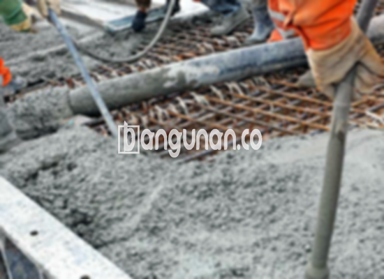

**Jasa Cor Beton Readymix & Jayamix Di Galur Kulon Progo** – Beton cor readymix, solusi modern untuk konstruksi, menawarkan kemudahan dan efisiensi yang tak tertandingi. Di Galur Kulon Progo, **Bangunan.co** hadir sebagai penyedia jasa cor beton readymix dan jayamix terpercaya, memastikan kualitas beton yang sesuai standar dan pengiriman tepat waktu. Mitra Bangunan dapat mengandalkan layanan kami untuk mempercepat proyek Anda tanpa mengorbankan kekuatan dan durabilitas struktur beton.



## Mengoptimalkan Efisiensi Proyek dengan Jasa Cor Beton Readymix & Jayamix dari Bangunan.co di Galur Kulon Progo

Layanan beton readymix dari **Bangunan.co** dirancang untuk menyederhanakan dan mempercepat proses pengecoran. Kami memahami bahwa waktu adalah esensi dalam setiap proyek konstruksi di Galur Kulon Progo. Dengan memilih layanan kami, Anda mendapatkan beton yang telah diformulasikan secara presisi untuk memenuhi spesifikasi proyek Anda, sehingga Anda dapat fokus pada aspek-aspek penting lainnya.

Beton ready mix tersedia dalam berbagai kualitas, memungkinkan Anda memilih opsi yang paling ekonomis dan efektif untuk aplikasi spesifik Anda. Sebagai penyedia solusi beton terpercaya, **Bangunan.co** memastikan bahwa setiap batch beton diproduksi dengan kontrol kualitas yang ketat, mulai dari pemilihan material hingga proses pencampuran.

Proses produksi beton di pabrik pengolahan beton kami memastikan konsistensi kualitas dan efisiensi waktu. Anda tidak perlu lagi khawatir tentang penyediaan material, pencampuran yang tidak tepat, atau tenaga kerja tambahan. **Bangunan.co** menangani semuanya, sehingga Anda dapat memastikan proyek Anda berjalan lancar dan sesuai jadwal.

## Keunggulan dan Pertimbangan Memilih Beton Readymix dari Bangunan.co di Galur Kulon Progo

Membandingkan beton yang diproduksi di pabrik pengolahan beton modern, seperti **Bangunan.co**, dengan metode pencampuran manual tradisional mengungkapkan sejumlah perbedaan signifikan. Masing-masing pendekatan memiliki kelebihan dan kekurangan yang perlu dipertimbangkan secara cermat:

Beton dari pabrik pengolahan beton menawarkan keunggulan-keunggulan berikut:

1.  Proporsi campuran yang tepat, menjamin kualitas beton yang konsisten dan optimal.
2.  Pencampuran yang homogen, menghasilkan mutu beton yang merata di seluruh volume.
3.  Penggunaan material berkualitas tinggi yang telah melalui seleksi ketat.
4.  Efisiensi waktu dan biaya yang signifikan.
5.  Menghilangkan kebutuhan untuk menghitung dan mencampur beton secara manual, mengurangi risiko kesalahan dan pemborosan.

Meskipun menawarkan banyak keuntungan, ada beberapa pertimbangan yang perlu diperhatikan:

Pemesanan beton readymix memerlukan perencanaan yang matang, karena proses produksi tidak dapat dilakukan secara instan. Survey lokasi yang akurat diperlukan untuk menentukan volume beton yang dibutuhkan, sehingga **Bangunan.co** dapat memastikan ketersediaan yang cukup dan menghindari pemborosan material.

## Jenis Kualitas Beton yang Paling Sering Digunakan di Galur Kulon Progo

Di Galur Kulon Progo, mutu beton K225 adalah pilihan yang paling umum untuk berbagai aplikasi konstruksi. K225 sangat ideal untuk pengecoran dak rumah, lantai dua, dan jalan gang yang tidak menanggung beban lalu lintas berat.

Kualitas beton K250 dan K300 juga banyak digunakan, terutama untuk pondasi, tiang, dan cakar ayam. Untuk jalan pedesaan, **Bangunan.co** merekomendasikan mutu K250, K300, atau K350, tergantung pada tingkat beban yang diharapkan. Sementara itu, mutu beton di atas K350, seperti K375, K400, dan K500, dirancang untuk aplikasi yang membutuhkan pengeringan cepat, seperti konstruksi jalan tol, area parkir berat, atau proyek yang memiliki tenggat waktu yang ketat.

## Bangunan.co: Jasa Cor Beton Readymix & Jayamix yang Mengutamakan Kualitas di Galur Kulon Progo



Penting untuk dicatat bahwa adukan beton readymix atau *ready mix concrete* dari **Bangunan.co** diformulasikan dengan cermat untuk memastikan kinerja dan daya tahan yang optimal. Komposisi campuran dirancang sesuai dengan standar mutu beton nasional (SNI), menjamin bahwa beton yang Anda terima memenuhi persyaratan kualitas yang ketat. Komposisi idealnya mencakup sekitar 10% hingga 15% semen Portland, 60% hingga 75% agregat halus dan kasar (pasir dan split), serta 10% hingga 15% air. Sisanya adalah udara, yang memainkan peran penting dalam memberikan kemampuan kerja yang optimal.

**Bangunan.co** menggunakan teknologi modern dan proses kontrol kualitas yang ketat untuk memastikan bahwa setiap batch beton diproduksi dengan presisi. Penggunaan air bersih, yang bebas dari lumpur dan kotoran, juga merupakan faktor penting dalam menjaga kualitas beton.

Itulah informasi mengenai Jasa Cor Beton Readymix & Jayamix Di Galur Kulon Progo dari **Bangunan.co** yang dapat kami sampaikan. Untuk mengetahui lebih lanjut tentang harga dan ketersediaan, jangan ragu untuk menghubungi kami melalui tombol WhatsApp atau Telepon yang tersedia di halaman ini. Mitra Bangunan, **Bangunan.co** siap menjadi mitra terpercaya Anda dalam membangun infrastruktur berkualitas di Galur Kulon Progo.

**Ref by:** [Cor Beton Readymix & Jayamix Galur Kulon Progo](https://id.wikipedia.org/wiki/Cor)