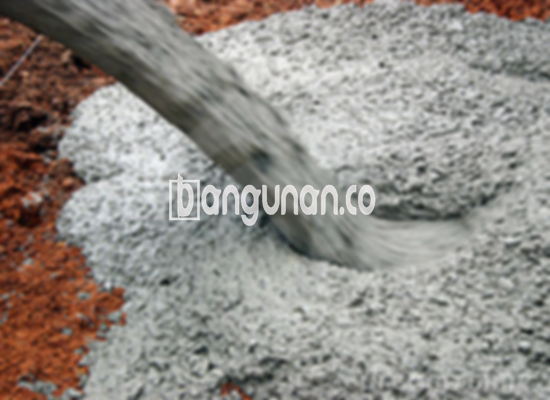

**Jasa Cor Beton Readymix & Jayamix Di Gamping Sleman** – Beton readymix atau campuran beton siap pakai merupakan solusi konstruksi modern yang dirancang untuk pengecoran cepat dan berkualitas. Bagi Mitra Bangunan di Gamping Sleman, material ini mempermudah pembangunan karena formulasi yang tepat dan pengiriman langsung ke lokasi proyek, menghilangkan kebutuhan pengadukan manual yang memakan waktu dan tenaga.



## Mengoptimalkan Pembangunan dengan Pengcampuran Beton dari Bangunan.co di Gamping Sleman

Penggunaan campuran beton yang diproses melalui pabrik pengolahan beton modern bertujuan mempercepat progres konstruksi sekaligus menjamin mutu yang konsisten. Dengan demikian, proyek Anda di Gamping Sleman dapat berjalan efisien dan sesuai dengan standar kualitas yang ditetapkan.  Beton readymix memastikan hasil pengecoran yang andal dan tahan lama.

Jenis beton ini dikenal pula sebagai *ready mix concrete*, diproduksi secara khusus di pabrik dengan persiapan matang sehingga siap digunakan saat tiba di lokasi. Anda tidak perlu lagi repot menyiapkan material dan mengaduknya sendiri, melainkan fokus pada persiapan bekisting dan memastikan kelancaran proses pengecoran. Ini memberikan efisiensi waktu dan tenaga yang signifikan.

Kualitas beton dikontrol ketat di setiap tahap produksi, mulai dari pemilihan material hingga proses pencampuran dan pengiriman. Bangunan.co memastikan bahwa setiap batch beton yang dikirim ke Gamping Sleman memenuhi standar kualitas yang tinggi.

## Keunggulan dan Pertimbangan Penggunaan Beton Cor Readymix dari Bangunan.co

Pengecoran beton dengan sistem manual yang biasa dilakukan tukang bangunan tentu berbeda dengan beton yang diproses oleh pabrik pengolahan. Masing-masing metode memiliki kelebihan dan kekurangan yang perlu Anda pertimbangkan. Berikut perbandingannya:

Beton yang diproduksi di pabrik memiliki keunggulan sebagai berikut:

1.  Komposisi adukan sesuai dengan mutu yang diinginkan, menjamin kekuatan dan daya tahan beton.
2.  Kualitas beton merata karena proses pencampuran dilakukan secara homogen dengan mesin modern.
3.  Material yang digunakan adalah bahan bangunan berkualitas terbaik, yang dipilih secara cermat untuk mencapai mutu beton optimal.
4.  Waktu pengolahan lebih singkat, sehingga menghemat biaya dan waktu proyek Anda.
5.  Anda tidak perlu khawatir tentang perhitungan campuran yang rumit, karena pabrik sudah merumuskan adukan yang tepat sesuai kebutuhan spesifik konstruksi Anda.

Namun, ada beberapa hal yang juga perlu diperhatikan:

Pembuatan beton readymix memerlukan perencanaan yang matang. Pesanan tidak bisa dilakukan secara dadakan, dan perlu ada penjadwalan pengiriman. Selain itu, survei lokasi juga diperlukan untuk menghitung volume kubikasi yang dibutuhkan secara akurat, sehingga tidak ada material yang terbuang sia-sia.

## Jenis Mutu Beton yang Umum Digunakan di Gamping Sleman

Salah satu mutu beton yang paling sering diaplikasikan adalah K225. Mutu ini ideal untuk pengecoran dak rumah, lantai dua, atau struktur ringan lainnya.  Namun, K225 juga bisa digunakan untuk pengecoran jalan gang kecil yang tidak dilalui truk berat.

Pilihan mutunya yang lain adalah K250 dan K300. Mutu beton K250 dan K300 lazim digunakan untuk konstruksi tiang, pondasi, atau cakar ayam. Untuk jalan pedesaan, biasanya digunakan K250, K300, atau bahkan K350 untuk daya tahan lebih tinggi. Kualitas yang lebih tinggi seperti K375, K400, dan K500 umumnya digunakan untuk proyek yang membutuhkan waktu pengerasan beton yang sangat cepat, seperti konstruksi jalan tol atau area parkir dengan lalu lintas padat. Beton tersebut sering juga disebut beton *fast track*.

## Bangunan.co: Jaminan Kualitas Beton untuk Proyek Anda di Gamping Sleman



Kunci utama beton readymix berkualitas tinggi terletak pada perancangan campuran yang tepat. Campuran ini harus dirancang agar memiliki daya kerja yang baik, daya tahan yang cukup, dan memenuhi standar kualitas yang ditetapkan. Komposisi idealnya terdiri dari: 10% hingga 15% semen Portland, 60% hingga 75% agregat halus dan kasar (pasir dan split), sekitar 10% hingga 15% air, dan sisanya adalah kandungan udara.

Untuk menciptakan beton dengan mutu tinggi, kadar air harus diminimalkan tanpa mengorbankan kemampuan kerja beton segar. Penggunaan air bersih yang bebas dari lumpur, garam, atau bahan organik sangat penting untuk menghindari penurunan kualitas beton. Bangunan.co berkomitmen untuk hanya menggunakan air bersih dalam proses produksi beton readymix.

Dengan layanan dari Bangunan.co, Anda dapat memastikan bahwa beton readymix yang Anda gunakan memenuhi standar kualitas tertinggi.

**Ref by:** [Cor Beton Readymix & Jayamix Gamping Sleman](https://id.wikipedia.org/wiki/Cor)

Mitra Bangunan yang mencari solusi pengecoran yang andal dan ekonomis di Gamping Sleman, jangan ragu untuk menghubungi Bangunan.co melalui tombol WhatsApp atau Telepon yang tersedia di halaman ini. Kami akan dengan senang hati membantu Anda menemukan solusi beton readymix terbaik untuk proyek konstruksi Anda.