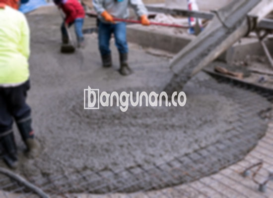

**Jasa Cor Beton Readymix & Jayamix Di Gandrungmangu Cilacap** – Memastikan fondasi yang kokoh dan struktur bangunan yang tahan lama membutuhkan material yang tepat. Mitra Bangunan menghadirkan solusi praktis dan berkualitas melalui layanan cor readymix atau adukan beton siap pakai, diformulasikan khusus untuk pengecoran cepat dan efisien. Dengan beton readymix dari bangunan.co, Anda tidak perlu lagi repot mencampur material di lokasi proyek Anda di Gandrungmangu Cilacap.



## Mengapa Memilih Layanan Cor Beton Readymix & Jayamix Dari bangunan.co di Gandrungmangu Cilacap?

Layanan kami dirancang untuk mempercepat pelaksanaan pengecoran sekaligus menjamin kualitas yang terstandarisasi. Hal ini memungkinkan Anda, para kontraktor dan pemilik proyek di Gandrungmangu Cilacap, untuk bekerja lebih efisien dan menyelesaikan proyek tepat waktu. Dengan mutu beton yang terjamin, Anda dapat merasa yakin bahwa konstruksi yang dibangun sesuai dengan standar dan desain yang direncanakan.

Beton readymix dikenal juga dengan beton cair siap guna, merupakan campuran beton yang telah diformulasikan secara khusus di pabrik pengolahan beton. Beton ini siap digunakan langsung di lokasi proyek Anda. Anda hanya perlu mempersiapkan bekisting yang memadai sebagai cetakan untuk beton yang akan dituang. Dengan demikian, Anda dapat menghemat waktu dan tenaga yang biasanya dibutuhkan untuk mencampur material beton secara manual.

Kualitas beton dikontrol secara ketat selama proses produksi di pabrik pengolahan beton atau *batching plant*. Pengawasan meliputi mulai dari pencampuran material hingga pengiriman ke lokasi proyek Anda. Hal ini memastikan Anda menerima beton yang konsisten dan berkualitas tinggi. Bagi Anda yang berada di Gandrungmangu Cilacap dan membutuhkan bahan konstruksi yang andal, readymix dari bangunan.co adalah solusi yang tepat.

## Keunggulan dan Kekurangan Beton Cor Readymix

Terdapat perbedaan mendasar antara beton yang diproduksi di pabrik pengolahan beton dan beton yang dicampur secara manual. Masing-masing memiliki kelebihan dan kekurangan yang perlu Anda pertimbangkan sebelum membuat keputusan. Berikut adalah perbandingannya:

Beton yang dicampur di pabrik pengolahan beton menawarkan sejumlah keuntungan, antara lain:

1.  Kualitas adukan terjamin sesuai dengan mutu yang dipesan.
2.  Kualitas beton yang merata karena proses pencampuran yang seragam.
3.  Pemilihan material berkualitas tinggi untuk menghasilkan beton terbaik.
4.  Proses pengolahan yang cepat, menghemat waktu dan biaya proyek Anda.
5.  Anda tidak perlu khawatir tentang perhitungan dan pencampuran yang tepat, karena semuanya telah ditangani oleh pabrik.

Namun, terdapat juga beberapa kekurangan yang perlu Anda ketahui:

Pemesanan beton readymix biasanya memerlukan penjadwalan terlebih dahulu. Anda tidak dapat memesan dan menerima beton secara instan. Proses survei lokasi juga diperlukan untuk menentukan jumlah kubikasi beton yang dibutuhkan secara akurat. Hal ini bertujuan untuk menghindari pemborosan material atau kekurangan beton saat pengecoran.

## Macam-Macam Mutu Beton yang Sering Digunakan di Gandrungmangu Cilacap

Untuk berbagai aplikasi konstruksi di wilayah Gandrungmangu Cilacap, mutu beton K225 menjadi salah satu pilihan yang paling populer. K225 sangat cocok untuk pengecoran dak rumah atau lantai dua, karena dirancang khusus untuk aplikasi tersebut. Selain itu, mutu beton ini juga dapat digunakan untuk pengecoran jalan gang yang tidak dilalui kendaraan berat seperti truk.

K250 dan K300 adalah mutu beton lain yang sering digunakan untuk pengecoran tiang, pondasi, atau cakar ayam. K250 juga umum diaplikasikan pada proyek pengecoran jalan pedesaan. Untuk mutu yang lebih tinggi, seperti K350, K375, K400, dan K500, biasanya digunakan untuk proyek-proyek yang membutuhkan beton *fast track*, yaitu beton yang mengeras dengan cepat. Contohnya seperti pembangunan jalan tol atau area parkir yang memerlukan waktu penyelesaian yang singkat dan mampu menahan beban berat.

## Jasa Cor Beton Readymix & Jayamix Di Gandrungmangu Cilacap: Kualitas Terjamin bangunan.co



Memastikan kualitas adukan beton readymix sangat penting untuk menghasilkan konstruksi yang kuat dan tahan lama. Campuran material harus diformulasikan dengan cermat dan sesuai dengan standar nasional Indonesia (SNI). Komposisi idealnya terdiri dari sekitar 10% hingga 15% semen Portland, 60% hingga 75% agregat halus dan kasar (pasir dan split), 10% hingga 15% air, dengan sisanya berupa udara.

Penggunaan air yang bersih merupakan faktor krusial dalam proses pencampuran beton. Hindari penggunaan air yang mengandung lumpur, tanah, atau lumut, karena dapat menurunkan kualitas beton secara signifikan. Semakin sedikit air yang digunakan, semakin tinggi kualitas beton yang dihasilkan, asalkan tetap mempertahankan kemampuan kerja beton yang optimal.

Mitra Bangunan dari bangunan.co siap melayani Anda dengan mutu beton yang terjamin dan layanan yang profesional di Gandrungmangu Cilacap. Hubungi kami untuk informasi lebih lanjut mengenai spesifikasi beton dan penawaran harga.

**Ref by:** [Cor Beton Readymix & Jayamix Gandrungmangu Cilacap](https://id.wikipedia.org/wiki/Cor)