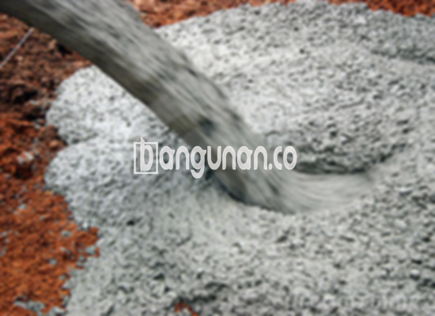

**Jasa Cor Beton Readymix & Jayamix Di Gantiwarno Klaten** – Beton readymix atau campuran beton siap pakai merupakan solusi adukan material beton yang diformulasikan secara khusus untuk pengecoran instan, ideal untuk kebutuhan konstruksi di Gantiwarno Klaten. Terdiri dari pasir beton, batu kerikil, semen, dan air dengan komposisi terukur, beton ini menjamin kualitas optimal. Mitra Bangunan hadir untuk memastikan kelancaran proyek Anda dengan penyediaan beton readymix terpercaya.



## Alasan Memilih Pengadukan Beton dari Jasa Cor Beton Readymix & Jayamix Di Gantiwarno Klaten

Pembuatan adukan beton presisi seperti ini bertujuan mempercepat progres pembangunan sekaligus menjamin mutu beton yang konsisten. Dengan kualitas yang terjamin, Anda dapat memastikan bahwa kekuatan beton yang dihasilkan sesuai dengan standar yang diinginkan dan sepadan dengan spesifikasi konstruksi yang direncanakan.

Beton ready mix menawarkan fleksibilitas pemilihan mutu yang sesuai dengan berbagai aplikasi. Seringkali disebut sebagai beton cair siap pakai, beton ini telah diproduksi di pabrik pengolahan beton dengan formulasi yang siap digunakan. Ini berarti beton siap dituang dan diratakan langsung di lokasi proyek. Anda tidak perlu lagi repot mencampur beton secara manual, cukup menyiapkan bekisting sebagai cetakan beton.

Kualitas beton dikendalikan secara ketat mulai dari pencampuran material hingga pengiriman di pabrik pengolahan beton (batching plant). Hal ini memberikan kemudahan bagi para profesional konstruksi di Gantiwarno Klaten dalam mendapatkan beton berkualitas tanpa membuang waktu untuk mencari dan mencampur material terbaik untuk mencapai mutu yang optimal.

## Keunggulan dan Kekurangan Beton readymix Menurut Jasa Cor Beton Readymix & Jayamix Di Gantiwarno Klaten

Beton yang diproduksi di pabrik pengolahan beton (batching plant) memiliki keunggulan dan kekurangan dibandingkan beton yang dicampur secara manual oleh tukang bangunan. Berikut adalah rinciannya:

Kelebihan beton dari pabrik pengolahan beton meliputi:

1.  Adukan presisi sesuai dengan kualitas yang ditentukan.
2.  Kualitas beton yang seragam karena proses pencampuran yang konsisten.
3.  Penggunaan material berkualitas tinggi untuk mencapai mutu beton yang optimal.
4.  Efisiensi waktu dan biaya dalam proses pengolahan.
5.  Anda tidak perlu menghabiskan waktu untuk menghitung atau mencampur komposisi beton yang tepat, karena pabrik telah mengkalkulasinya sesuai dengan kebutuhan konstruksi Anda.

Namun, ada beberapa kekurangan yang perlu diperhatikan:

Pemesanan beton di pabrik pengolahan beton umumnya memerlukan penjadwalan terlebih dahulu. Anda tidak bisa memesan secara mendadak. Selain itu, diperlukan survei lokasi untuk menentukan volume beton yang dibutuhkan secara akurat, untuk menghindari kelebihan atau kekurangan pasokan saat pengiriman.

## Jenis Mutu Beton yang Banyak Digunakan Di Gantiwarno Klaten

Jenis mutu beton yang paling umum digunakan untuk konstruksi struktural adalah mutu K225. Mutu K225 ideal untuk pengecoran dak rumah atau lantai atas karena dirancang khusus untuk keperluan tersebut. Selain itu, mutu ini juga cocok untuk pengecoran jalan gang dengan lalu lintas kendaraan ringan.

Mutu beton K250 dan K300 juga banyak digunakan. Kedua mutu ini sering diaplikasikan untuk pengecoran tiang, pondasi, atau cakar ayam. Untuk pembangunan jalan pedesaan, mutu K250, K300, dan K350 adalah pilihan yang umum. Mutu yang lebih tinggi seperti K375, K400, K500, dan seterusnya digunakan untuk beton Fast Track – beton yang membutuhkan waktu pengerasan yang cepat, misalnya untuk jalan tol atau area parkir yang menerima beban berat. Mutu Fast Track umumnya dimulai dari K400 ke atas.

## Jasa Cor Beton Readymix & Jayamix Di Gantiwarno Klaten Menjamin Kualitas Beton



Formulasi beton readymix harus dirancang secara cermat untuk memastikan kinerja dan daya tahan yang optimal. Beton berkualitas tinggi diproduksi dengan meminimalkan rasio air terhadap semen tanpa mengurangi kemampuan kerja beton segar. Pemilihan mutu beton yang lebih tinggi umumnya dicapai dengan mengurangi kandungan air. Penggunaan air dalam campuran juga harus tepat dan tidak berlebihan. Penting untuk menggunakan air bersih yang bebas dari kontaminan. Hindari menggunakan air yang mengandung tanah atau lumut, karena dapat menurunkan kualitas beton.

Anda dapat memastikan kualitas beton dengan menggunakan air bersih tanpa material asing yang dapat mengganggu proses pengerasan dan kekuatan beton yang dihasilkan.

Mitra Bangunan di Gantiwarno Klaten berkomitmen untuk memastikan setiap proses pencampuran beton dilakukan sesuai dengan standar nasional Indonesia (SNI) untuk menghasilkan beton yang kuat dan awet. Kami juga memberikan pelayanan terbaik dari bangunan.co untuk tiap pelanggan.

**Ref by:** [Cor Beton Readymix & Jayamix Gantiwarno Klaten](https://id.wikipedia.org/wiki/Cor)