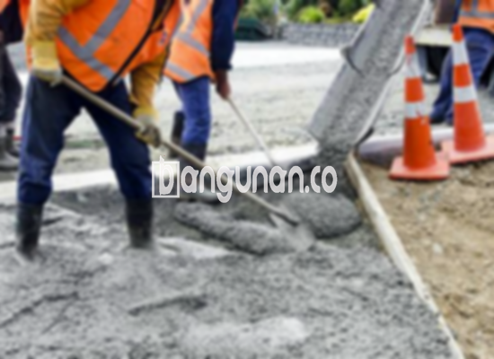

**Jasa Cor Beton Readymix & Jayamix Di Garung Wonosobo** – Mencari solusi beton siap pakai yang andal di Garung Wonosobo? Bangunan.co hadir sebagai penyedia jasa cor beton readymix dan jayamix yang terpercaya, dirancang untuk menyederhanakan proyek konstruksi Anda. Kami memahami pentingnya kualitas dan ketepatan waktu, oleh karena itu kami menyediakan beton dengan mutu terjamin yang dikirim langsung ke lokasi proyek Anda. Sebagai Mitra Bangunan, kami berkomitmen untuk memberikan solusi terbaik bagi kebutuhan pembangunan Anda.



## Mengoptimalkan Pengerjaan Konstruksi dengan Jasa Cor Beton Readymix & Jayamix dari Bangunan.co di Garung Wonosobo

Penggunaan adukan beton readymix menawarkan solusi yang efisien untuk mempercepat penyelesaian proyek konstruksi Anda. Beton readymix, atau adukan beton siap pakai, diformulasikan secara khusus untuk memenuhi standar mutu yang tepat, memastikan hasil pengecoran yang optimal. Pada dasarnya, komposisi bahan material yang digunakan serupa dengan adukan beton konvensional, terdiri dari pasir beton, batu split, semen, dan air, dengan perbandingan yang telah dihitung secara akurat untuk menghasilkan kualitas beton yang diinginkan. 

Dengan memilih layanan kami, Anda dapat memastikan kualitas beton yang konsisten dan sesuai dengan spesifikasi proyek Anda. Beton readymix hadir dalam berbagai tingkatan kekuatan, memungkinkan Anda memilih mutu yang paling sesuai dengan kebutuhan spesifik konstruksi yang Anda kerjakan. Beton ini dikenal juga sebagai beton cair siap pakai, karena telah diproduksi di pabrik pengolahan beton, siap digunakan begitu tiba di lokasi proyek. Anda tidak perlu lagi khawatir tentang proses pencampuran dan pengadukan manual, yang seringkali memakan waktu dan tenaga.

Kendali mutu yang ketat diterapkan oleh tim ahli kami mulai dari pemilihan material hingga proses pengiriman, menjamin bahwa setiap batch beton yang Anda terima memenuhi standar kualitas tertinggi. Hal ini memberikan kemudahan dan kepastian bagi para pelaku konstruksi di Garung Wonosobo, memungkinkan mereka untuk fokus pada tahapan pembangunan lainnya tanpa harus khawatir tentang kualitas bahan dasar.

## Keunggulan dan Pertimbangan dalam Memilih Cor Readymix dari Bangunan.co di Garung Wonosobo

Terdapat perbedaan signifikan antara beton yang dicampur di pabrik pengolahan beton (batching plant) dan beton yang dicampur secara manual di lapangan. Memahami perbedaan ini akan membantu Anda membuat keputusan yang tepat untuk proyek Anda.

Berikut adalah keunggulan beton pabrikan:

1.  Pertama, campuran beton diformulasikan dengan presisi untuk mendapatkan mutu yang sesuai dengan kebutuhan proyek Anda.
2.  Kedua, kualitas beton yang seragam dan konsisten karena proses pencampuran yang terotomatisasi.
3.  Ketiga, penggunaan bahan baku berkualitas tinggi yang telah melalui seleksi ketat.
4.  Keempat, efisiensi waktu dan biaya karena proses produksi yang cepat dan terkontrol.
5.  Kelima, menghilangkan kebutuhan untuk mencampurkan beton secara manual, menghemat tenaga kerja dan mengurangi risiko kesalahan.

Namun, perlu diingat bahwa pemesanan beton readymix memerlukan perencanaan yang matang. Anda tidak dapat memesan beton secara spontan; diperlukan penjadwalan dan survei lokasi untuk menentukan volume yang dibutuhkan. Hal ini penting untuk memastikan ketersediaan beton yang cukup tanpa menimbulkan pemborosan.

## Pilihan Mutu Beton yang Paling Banyak Dicari di Garung Wonosobo

Salah satu jenis mutu beton yang paling banyak digunakan di Garung Wonosobo adalah K225. Mutu beton ini sangat ideal untuk pengecoran dak rumah atau lantai dua ke atas, karena dirancang khusus untuk menahan beban yang sesuai dengan keperluan tersebut. Selain itu, K225 juga dapat digunakan untuk pengecoran jalan gang yang tidak menanggung beban lalu lintas kendaraan berat.

Pilihan populer lainnya adalah K250 dan K300. Kedua mutu ini sering diaplikasikan untuk pengecoran tiang, pondasi, atau cakar ayam pada bangunan. Untuk pengecoran jalan pedesaan, umumnya digunakan K250, K300, atau K350. Sedangkan untuk mutu beton yang lebih tinggi, seperti K375, K400, dan K500, biasanya digunakan pada proyek-proyek yang membutuhkan pengeringan cepat atau kekuatan tinggi, seperti jalan tol, area parkir, atau struktur yang menahan beban berat. Beton dengan mutu tinggi ini sering disebut sebagai beton *fast track*.

## Bangunan.co: Jaminan Kualitas dan Layanan Unggul untuk Cor Beton Readymix & Jayamix di Garung Wonosobo



Perancangan adukan beton *ready mix* memerlukan perhatian yang cermat. Beton berkualitas harus memiliki kemampuan dan kekuatan yang sesuai dengan harapan. Hal ini dicapai melalui formulasi yang tepat berdasarkan standar nasional (SNI) untuk mencegah risiko kerusakan, seperti keropos atau retak. Komposisi idealnya terdiri dari 10-15% semen Portland, 60-75% agregat halus dan kasar (pasir dan split), serta 10-15% air, dengan sisanya merupakan udara. 

Meminimalkan rasio air dan semen merupakan kunci untuk menghasilkan beton dengan mutu yang tinggi. Semakin sedikit air yang digunakan, semakin kuat dan tahan lama beton tersebut. Penting untuk menggunakan air bersih yang bebas dari kontaminan atau kotoran, karena air yang tercemar dapat mengurangi kualitas beton secara signifikan. Penggunaan air yang berkualitas adalah faktor penting dalam memastikan beton yang dihasilkan memiliki kekuatan dan daya tahan yang optimal.

Dengan mengutamakan kualitas dan pelayanan, Bangunan.co siap menjadi Mitra Bangunan terpercaya Anda di Garung Wonosobo. Untuk informasi harga yang kompetitif dan penawaran terbaik, jangan ragu untuk menghubungi kami melalui tombol WhatsApp atau Telepon yang tersedia di halaman ini.

**Ref by:** [Cor Beton Readymix & Jayamix Garung Wonosobo](https://id.wikipedia.org/wiki/Cor)