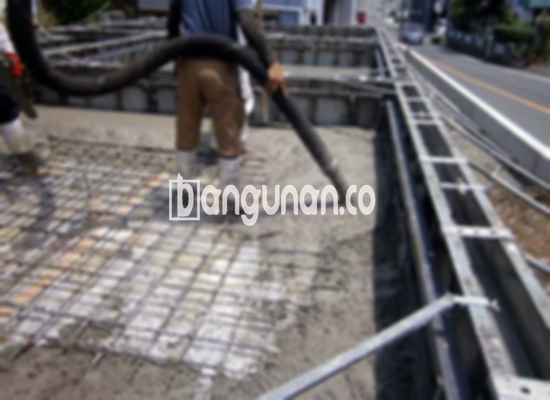

**Jasa Cor Beton Readymix & Jayamix Di Gatak Sukoharjo** – Beton Cor Readymix atau adukan beton siap pakai adalah solusi konstruksi modern yang dirancang untuk mempercepat pengecoran dengan kualitas terjamin. Dengan layanan dari bangunan.co, Mitra Bangunan di Gatak Sukoharjo dapat menikmati kemudahan mendapatkan adukan beton yang presisi dan sesuai kebutuhan proyek. Campuran material beton ini diformulasikan khusus untuk pengecoran cepat, menggunakan bahan baku standar seperti pasir, split, semen, dan air dalam komposisi yang terukur.



## Alasan Memilih Layanan Cor Beton Readymix & Jayamix bangunan.co di Gatak Sukoharjo

Tujuan utama layanan adukan beton siap pakai yang disediakan oleh bangunan.co adalah untuk memperlancar proses pengecoran dengan menjamin konsistensi kualitas. Dengan mutu yang terpercaya, Anda dapat fokus pada aspek lain dari proyek konstruksi tanpa khawatir tentang kualitas beton yang digunakan.

Beton Cor Readymix dari bangunan.co tersedia dalam berbagai pilihan mutu, disesuaikan dengan kebutuhan spesifik proyek Anda. Beton ini disebut juga beton cair siap guna karena telah diproses di pabrik pengolahan beton hingga siap dituang langsung di lokasi kerja. Hal ini menghemat waktu dan tenaga, karena Anda tidak perlu lagi menyiapkan campuran beton manual di lapangan. Anda hanya perlu menyiapkan bekisting yang memadai untuk menampung beton yang akan dituang.

Proses kontrol kualitas dari bangunan.co sangat ketat, dimulai dari pemilihan bahan baku hingga pengiriman ke lokasi proyek. Pengendalian mutu ini memastikan bahwa setiap batch beton yang kami kirimkan memenuhi standar kualitas yang diharapkan, menjamin kekuatan dan ketahanan struktur bangunan Anda.

## Keunggulan dan Kekurangan Cor Readymix dari bangunan.co di Gatak Sukoharjo

Aduk beton yang diproduksi di pabrik pengolahan beton modern, seperti bangunan.co, tentu memiliki perbedaan dengan adukan beton manual yang biasa dibuat oleh tukang bangunan. Baik metode pabrikasi maupun manual memiliki kelebihan dan kekurangannya masing-masing. Berikut adalah perbandingannya:

Keunggulan beton yang dicampur di pabrik bangunan.co antara lain:

1.  Adukan beton dipastikan sesuai dengan mutu yang dipesan.
2.  Mutu beton lebih homogen karena proses pencampuran yang merata.
3.  Material yang digunakan adalah bahan-bahan berkualitas tinggi yang teruji.
4.  Waktu pengolahan lebih efisien, sehingga menghemat biaya dan waktu proyek.
5.  Anda tidak perlu repot menentukan proporsi campuran beton yang tepat karena sudah ditangani oleh tenaga ahli.

Meskipun demikian, terdapat juga beberapa kekurangan yang perlu Anda pertimbangkan:

Pemesanan beton readymix dari bangunan.co memerlukan penjadwalan terlebih dahulu. Proses pemesanan melibatkan survei lokasi untuk menghitung volume beton yang dibutuhkan, sehingga diperlukan waktu untuk persiapan pengiriman. Hal ini dilakukan untuk memastikan ketersediaan material yang cukup dan menghindari pemborosan beton.

## Jenis Mutu Beton yang Paling Banyak Digunakan di Gatak Sukoharjo

Dari berbagai jenis mutu beton yang tersedia, mutu K225 adalah yang paling umum digunakan di Gatak Sukoharjo. Mutu beton K225 sangat ideal untuk pengecoran dak rumah atau lantai dua ke atas, karena dirancang khusus untuk menahan beban hidup dan beban mati yang ada pada struktur dak. Selain itu, mutu ini juga cocok untuk pengecoran jalan gang yang tidak terlalu sering dilalui kendaraan berat.

Mutu beton K250 dan K300 juga sering digunakan untuk aplikasi yang lebih berat seperti pengecoran tiang, pondasi, atau cakar ayam. Untuk jalan pedesaan, mutu K250, K300, dan bahkan K350 seringkali menjadi pilihan yang tepat, tergantung pada volume lalu lintas dan beban yang akan ditanggung oleh jalan tersebut. Untuk aplikasi khusus yang membutuhkan kekuatan ekstra dan waktu pengeringan yang cepat, mutu beton K375, K400, dan K500 dapat digunakan. Jenis beton *fast track* ini biasanya digunakan untuk proyek-proyek infrastruktur besar seperti jalan tol atau lahan parkir.

## bangunan.co: Jaminan Kualitas Cor Beton Readymix & Jayamix Di Gatak Sukoharjo



Adukan Cor Readymix atau *ready mix concrete* yang disediakan oleh bangunan.co dirancang dengan cermat untuk memastikan kualitas dan kinerja yang optimal. Komposisi adukan beton harus tepat sesuai dengan standar nasional (SNI) agar menghasilkan beton yang kuat, tahan lama, dan tidak mudah retak atau terkelupas. Komposisi standar meliputi 10% hingga 15% semen Portland, 60% hingga 75% agregat halus dan kasar (pasir dan split), serta 10% hingga 15% air dan sisanya adalah udara.

Untuk menghasilkan beton berkualitas tinggi, rasio air terhadap semen harus diminimalkan tanpa mengorbankan kemampuan kerja beton segar. Penggunaan air bersih sangat krusial untuk menjaga kualitas beton. Sebaiknya hindari penggunaan air yang mengandung lumpur, tanah, atau lumut, karena dapat menurunkan kekuatan beton secara signifikan.

Mitra Bangunan yang sedang mencari penyedia jasa cor beton readymix dan jayamix terpercaya di Gatak Sukoharjo, bangunan.co siap melayani kebutuhan Anda. Kami berkomitmen untuk selalu menyediakan produk dan layanan berkualitas tinggi dengan harga yang kompetitif.

**Ref by:** [Cor Beton Readymix & Jayamix Gatak Sukoharjo](https://id.wikipedia.org/wiki/Cor)