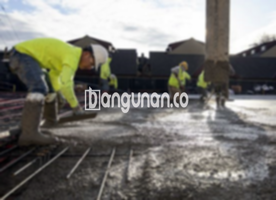

**Jasa Cor Beton Readymix & Jayamix Di Gayamsari Kota Semarang** – Solusi pengecoran beton modern yang cepat, efisien, dan berkualitas tinggi kini hadir di Gayamsari Kota Semarang. Mitra Bangunan menyediakan jasa cor beton readymix dan jayamix, dirancang untuk menjawab kebutuhan konstruksi Anda dengan presisi dan keandalan. Dengan layanan kami, Anda dapat fokus pada penyelesaian proyek tanpa khawatir akan kualitas atau ketepatan waktu pengiriman.



## Mengoptimalkan Pengecoran dengan Layanan Jasa Cor Beton Readymix & Jayamix di Gayamsari Kota Semarang

Dalam dunia konstruksi, efisiensi waktu dan kualitas merupakan faktor kunci kesuksesan. Layanan cor beton readymix dan jayamix dari bangunan.co hadir sebagai solusi cerdas untuk mempercepat proses pengecoran sambil tetap memastikan mutu beton yang optimal. Jika Anda sedang merencanakan proyek konstruksi di Gayamsari Kota Semarang, layanan kami dapat menjadi mitra terbaik Anda.

Dengan beton readymix, Anda tidak perlu lagi repot mencampur beton secara manual di lokasi proyek. Semuanya telah disiapkan dengan cermat di pabrik pengolahan beton, dengan takaran yang presisi dan pengawasan mutu yang ketat. Hal ini memastikan bahwa beton yang Anda terima memiliki konsistensi dan kekuatan yang sesuai dengan spesifikasi proyek Anda.

Layanan kami menawarkan kemudahan dalam memilih mutu beton yang sesuai dengan kebutuhan Anda. Tim ahli bangunan.co akan membantu Anda menentukan mutu beton yang paling tepat untuk aplikasi spesifik, mulai dari pondasi hingga struktur atas. Kami memahami bahwa setiap proyek memiliki persyaratan yang unik, dan kami berkomitmen untuk memberikan solusi yang disesuaikan dengan kebutuhan Anda.

## Keunggulan dan Pertimbangan dalam Memilih Beton Readymix dari bangunan.co

Terdapat perbedaan signifikan antara beton yang dicampur di lokasi proyek dengan beton yang diproduksi di pabrik pengolahan beton bangunan.co. Masing-masing metode memiliki kelebihan dan kekurangan. Memahami perbedaan ini akan membantu Anda membuat keputusan yang tepat.

Beton yang diproduksi di pabrik pengolahan beton menawarkan beberapa keunggulan utama:

1.  Komposisi yang tepat dan konsisten, karena diukur secara akurat menggunakan peralatan modern.
2.  Mutu beton yang merata, berkat proses pencampuran yang terkontrol dan menggunakan mesin berteknologi tinggi.
3.  Penggunaan material berkualitas tinggi yang telah melalui seleksi ketat oleh tim ahli bangunan.co.
4.  Waktu pengolahan yang lebih cepat, sehingga menghemat biaya tenaga kerja dan mempercepat penyelesaian proyek.
5.  Kepastian kualitas beton yang memenuhi standar nasional dan internasional.

Namun, perlu diingat bahwa pemesanan beton readymix memerlukan perencanaan yang matang. Anda perlu memesan beton beberapa hari sebelumnya karena pabrik memerlukan waktu untuk memproses pesanan Anda. Selain itu, survei lokasi akan diperlukan untuk memperkirakan volume beton yang dibutuhkan secara akurat.

## Ragam Mutu Beton yang Tersedia di bangunan.co untuk Proyek Anda di Gayamsari Kota Semarang

Kami di bangunan.co menyediakan berbagai mutu beton untuk memenuhi kebutuhan proyek yang beragam di Gayamsari Kota Semarang. Salah satu mutu yang paling sering digunakan adalah K225. Mutu beton ini cocok untuk pengecoran lantai rumah, lantai dua, dan struktur non-struktural lainnya yang tidak memerlukan kekuatan beton yang terlalu tinggi. 

Selain K225, mutu beton K250 dan K300 juga banyak digunakan untuk berbagai aplikasi konstruksi. K250 dan K300 sangat ideal untuk pengecoran tiang, pondasi, cakar ayam, dan struktur beton yang membutuhkan kekuatan yang lebih besar. Untuk proyek jalan pedesaan, mutu K250, K300, bahkan K350 dapat digunakan, tergantung pada beban lalu lintas yang diharapkan.

Untuk aplikasi khusus yang membutuhkan kekuatan beton yang sangat tinggi dan waktu pengerasan yang cepat, kami juga menyediakan mutu beton di atas K350, seperti K375, K400, dan K500. Mutu beton ini sering digunakan untuk proyek-proyek infrastruktur skala besar seperti jalan tol dan lahan parkir industri.

## Jasa Cor Beton Readymix & Jayamix bangunan.co: Kualitas Terjamin untuk Proyek Anda



Kualitas beton merupakan faktor penentu keberhasilan setiap proyek konstruksi. Di bangunan.co, kami sangat memperhatikan setiap detail dalam proses produksi beton readymix dan jayamix. Kami hanya menggunakan bahan baku berkualitas tinggi dan mengaplikasikan teknologi modern untuk memastikan bahwa setiap batch beton yang kami hasilkan memenuhi standar mutu yang tinggi.

Proses pencampuran beton kami dikontrol secara ketat oleh tim ahli yang berpengalaman. Kami memastikan bahwa proporsi semen, pasir, split, air, dan aditif yang digunakan sesuai dengan formula yang telah ditetapkan. Selain itu, kami juga melakukan pengujian laboratorium secara berkala untuk memverifikasi kekuatan dan daya tahan beton kami.

Kami memahami bahwa Anda menginginkan beton yang tahan lama, kuat, dan bebas dari masalah retak atau kerusakan. Oleh karena itu, kami berkomitmen untuk memberikan solusi beton yang memenuhi harapan Anda dan memberikan nilai tambah bagi proyek konstruksi Anda di Gayamsari Kota Semarang.

Mitra Bangunan siap membantu Anda mewujudkan proyek Anda dengan beton berkualitas dari bangunan.co. Jangan ragu untuk menghubungi kami untuk konsultasi gratis dan penawaran harga yang kompetitif.

**Ref by:** [Cor Beton Readymix & Jayamix Gayamsari Kota Semarang](https://id.wikipedia.org/wiki/Cor)