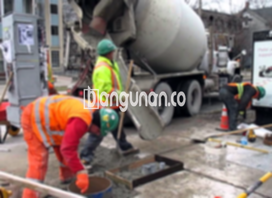

**Jasa Cor Beton Readymix & Jayamix Di Gebang Purworejo** – Beton Cor Readymix atau campuran beton siap pakai adalah solusi modern untuk pengecoran instan, yang semakin populer di Gebang Purworejo. Kami dari Bangunan.co menyediakan adukan komposisi material beton yang dirancang khusus untuk mempercepat proyek konstruksi Anda. Komposisi utamanya terdiri dari pasir beton, batu kerikil, semen, dan air, dengan formulasi yang tepat untuk menghasilkan kualitas beton yang sesuai dengan kebutuhan spesifik Anda. Mitra Bangunan berkomitmen memberikan layanan terbaik untuk memastikan keberhasilan pembangunan Anda di Gebang Purworejo.



## Mengapa Memilih Layanan Cor Beton Readymix & Jayamix dari Bangunan.co di Gebang Purworejo?

Jasa cor beton readymix dan jayamix dari Bangunan.co hadir sebagai jawaban atas kebutuhan pengecoran yang cepat, efisien, dan andal di Gebang Purworejo. Tujuan utama layanan ini adalah mempercepat proses konstruksi dengan menyediakan adukan beton yang sudah siap pakai, sehingga Anda dapat fokus pada tahapan pembangunan lainnya. Dengan kualitas yang terjamin, layanan kami membantu memastikan mutu beton yang dihasilkan sesuai dengan standar yang diinginkan dan selaras dengan rencana konstruksi Anda.

Beton Cor Readymix dari Bangunan.co menawarkan berbagai pilihan kualitas yang dapat disesuaikan dengan jenis proyek yang Anda kerjakan. Beton ini dikenal juga sebagai beton cair siap guna, karena telah dipersiapkan secara khusus di pabrik pengolahan beton agar langsung siap digunakan di lokasi proyek. Anda tidak perlu lagi khawatir tentang proses pencampuran beton yang rumit dan memakan waktu, karena kami menyediakan solusi yang praktis dan efisien.

Proses kontrol kualitas beton dilakukan secara ketat oleh pabrik pengolahan beton (batching plant) Bangunan.co, meliputi pencampuran material hingga pengiriman. Hal ini menjamin kualitas beton yang konsisten dan terpercaya, membebaskan Anda dari kompleksitas pengadukan manual dan memastikan kualitas material yang optimal. Dengan demikian Anda dapat fokus pada aspek-aspek penting lainnya dalam proyek konstruksi.

## Keunggulan dan Pertimbangan dalam Penggunaan Beton Readymix

Terdapat perbedaan signifikan antara beton yang dicampur di pabrik pengolahan beton dan adukan manual tradisional. Pemahaman mengenai keunggulan dan pertimbangan penggunaan beton readymix akan membantu Anda membuat keputusan yang tepat untuk kebutuhan konstruksi Anda. Berikut adalah poin-poin penting yang perlu Anda perhatikan.

Beberapa keunggulan beton yang diproduksi oleh pabrik pengolahan beton Bangunan.co meliputi:

1.  Kualitas adukan yang konsisten dan sesuai dengan mutu yang dipesan.
2.  Mutu beton yang seragam karena proses pencampuran yang terukur dan terkontrol.
3.  Penggunaan bahan material berkualitas tinggi yang telah dipilih secara selektif untuk mencapai mutu beton terbaik.
4.  Efisiensi waktu dan penghematan biaya pengolahan.
5.  Kemudahan dan kenyamanan karena Anda tidak perlu memikirkan formula adukan beton yang tepat.

Meskipun memiliki banyak keunggulan, ada beberapa pertimbangan yang perlu diperhatikan saat menggunakan beton readymix. Proses pemesanan beton readymix biasanya memerlukan penjadwalan terlebih dahulu dan survei lokasi untuk perkiraan volume yang akurat. Hal ini bertujuan untuk memastikan ketersediaan beton sesuai kebutuhan Anda tanpa pemborosan material.

## Variasi Kualitas Beton yang Paling Sering Digunakan di Gebang Purworejo

Di Gebang Purworejo, variasi kualitas beton struktural K225 merupakan yang paling banyak digunakan, khususnya untuk pengecoran dak rumah atau lantai 2 ke atas. Kualitas beton ini sangat cocok untuk aplikasi pengecoran dak rumah. Selain itu, K225 juga dapat digunakan untuk pengecoran jalan gang dengan lalu lintas yang tidak terlalu ramai.

Kualitas beton K250 dan K300 juga sering diaplikasikan untuk pengecoran tiang, pondasi, atau cakar ayam. K250, K300 dan K350 sering digunakan untuk pengecoran jalan pedesaan. Untuk aplikasi yang membutuhkan kualitas yang lebih tinggi, seperti konstruksi cepat kering atau aplikasi beban berat (misalnya, jalan tol atau area parkir), mutu beton K400 ke atas (termasuk K375, K400, K500) seringkali menjadi pilihan yang tepat. Jenis beton ini dikenal sebagai beton *fast track*.

## Bangunan.co: Prioritas Utama pada Kualitas Beton di Gebang Purworejo



Proses produksi adukan beton ready mix atau *ready mix concrete* dari Bangunan.co dirancang dengan cermat untuk menghasilkan kinerja dan daya tahan optimal. Kami memastikan bahwa seluruh proses produksi memenuhi standar campuran beton nasional (SNI). Komposisinya terdiri dari 10% hingga 15% semen Portland, 60% hingga 75% agregat halus dan kasar (pasir dan split), serta 10% hingga 15% air. Persentase sisanya adalah udara, yang secara alami terdapat dalam campuran.

Kualitas beton yang tinggi dalam layanan Bangunan.co dihasilkan dengan meminimalkan rasio air terhadap semen tanpa mengorbankan kemampuan kerja beton segar. Penggunaan air bersih yang bebas dari kontaminan seperti lumpur dan lumut sangat penting untuk menjaga kualitas beton yang optimal. Anda dapat mempercayakan Bangunan.co untuk menyediakan beton berkualitas tinggi yang memenuhi standar industri yang ketat.

Sebagai Mitra Bangunan yang terpercaya di Gebang Purworejo, kami siap mendukung proyek konstruksi Anda dengan beton berkualitas. Hubungi kami melalui tombol WhatsApp atau Telepon di halaman ini untuk mendapatkan informasi harga terkini dan konsultasi gratis. 

**Ref by:** [Cor Beton Readymix & Jayamix Gebang Purworejo](https://id.wikipedia.org/wiki/Cor)