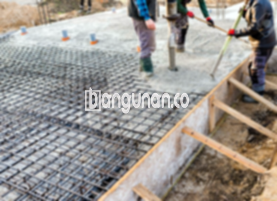

**Jasa Cor Beton Readymix & Jayamix Di Gebog Kudus** – Mitra Bangunan yang sedang merencanakan proyek konstruksi, beton readymix atau adukan beton siap pakai dari bangunan.co menjadi solusi efisien dan terpercaya. Material ini diformulasikan khusus untuk pengecoran cepat dan instan, memanfaatkan campuran material beton yang umum digunakan seperti pasir, split, semen, dan air dengan takaran presisi untuk mencapai kualitas yang optimal.



## Apa yang Membuat Jasa Cor Beton Readymix & Jayamix Di Gebog Kudus Menjadi Pilihan Terbaik?

Penggunaan adukan beton siap pakai ini bertujuan mempercepat progres pengecoran dengan memastikan kualitas yang terstandarisasi.  Dengan mutu yang terjamin konsisten, diharapkan beton yang dihasilkan sesuai dengan standar mutu yang diinginkan, selaras dengan rancangan konstruksi yang Anda terapkan. 

Beton ready mix hadir dengan beragam pilihan mutu yang menyesuaikan dengan kebutuhan konstruksi spesifik Anda. Sering dikenal sebagai beton cair siap pakai, material ini disediakan langsung dari pabrik pengolahan beton dalam kondisi yang siap dituang.  Anda tidak perlu lagi membebani diri dengan proses pencampuran manual yang memakan waktu; cukup siapkan area lokasi dan bekisting sebagai penopang.

Kualitas beton dikontrol ketat oleh tim pengolahan beton, mulai dari tahap pencampuran hingga pengiriman, sesuai dengan prosedur standar yang berlaku. Hal ini mempermudah Anda, para pelaku konstruksi, dalam mendapatkan material pengecoran tanpa harus menghabiskan waktu atau khawatir tentang kualitas campuran.

## Memahami Keunggulan dan Pertimbangan Cor Readymix

Tentu saja, terdapat perbedaan karakteristik antara beton yang diproduksi di pabrik pengolahan beton (batching plant) dengan beton yang dicampur secara tradisional. Masing-masing memiliki kelebihan dan tantangan tersendiri:

Beberapa keunggulan beton yang dihasilkan di pabrik meliputi:

1.  Konsistensi campuran yang sesuai dengan spesifikasi mutu yang diinginkan.
2.  Mutu beton yang lebih seragam karena proses pencampuran mekanis yang presisi.
3.  Pemilihan material berkualitas tinggi untuk menjamin hasil beton yang optimal.
4.  Efisiensi waktu dan biaya pengolahan.
5.  Kemudahan bagi Anda karena tidak perlu lagi merumuskan formula adukan beton yang tepat.

Namun, perlu diingat pula beberapa pertimbangan:

Pemesanan beton readymix mengharuskan penjadwalan yang matang dan survei lokasi untuk memperkirakan volume kubikasi yang dibutuhkan secara akurat. Hal ini bertujuan memastikan ketersediaan material yang cukup tanpa terjadi kelebihan atau kekurangan. 

## Jenis-jenis Mutu Beton yang Sering Digunakan di Gebog Kudus

Salah satu tipe yang paling sering diaplikasikan adalah beton mutu K225. Kualitas ini umumnya digunakan untuk pengecoran dak rumah atau lantai dua ke atas, mengingat karakteristiknya yang sesuai untuk aplikasi tersebut. Namun, mutu K225 juga dapat diaplikasikan untuk pengecoran jalan gang yang tidak menanggung beban lalu lintas berat.

Pilihan mutu K250 dan K300 juga sangat populer, terutama untuk pengecoran tiang, pondasi, atau cakar ayam. Sementara itu, mutu K250, K300, dan K350 sering digunakan untuk pengecoran jalan pedesaan. Untuk aplikasi yang membutuhkan kekuatan lebih tinggi, seperti beton *fast track* yang memerlukan pengeringan cepat – misalnya untuk jalan tol atau area parkir yang menahan beban berat – mutu K400 ke atas umumnya menjadi pilihan utama.

## Jasa Cor Beton Readymix & Jayamix Di Gebog Kudus: Komitmen Terhadap Kualitas Beton



Penting untuk diingat bahwa campuran beton readymix harus dirancang secara cermat untuk memastikan kemampuan kerja dan ketahanan yang optimal. Penggunaan standar campuran beton nasional (SNI) sangat krusial untuk menghindari potensi masalah seperti keretakan, patah, atau pengelupasan beton. Komposisi yang direkomendasikan umumnya mencakup sekitar 10% hingga 15% semen Portland, 60% hingga 75% agregat halus dan kasar (pasir dan split), serta 10% hingga 15% air dengan sisa bagian merupakan udara.

Beton dengan mutu tinggi diproduksi melalui proses yang meminimalkan rasio air terhadap semen tanpa mengorbankan kemampuan kerja beton segar. Penggunaan air bersih yang bebas dari kontaminasi juga sangat penting; hindari penggunaan air yang mengandung lumpur atau alga, karena dapat menurunkan kualitas beton. 

Dengan demikian, Mitra Bangunan dapat yakin bahwa Jasa Cor Beton Readymix & Jayamix Di Gebog Kudus selalu mengutamakan kualitas beton yang terbaik untuk kesuksesan proyek Anda. Untuk informasi lebih detail mengenai harga per mutu, silakan hubungi kami melalui WhatsApp.

**Ref by:** [Cor Beton Readymix & Jayamix Gebog Kudus](https://id.wikipedia.org/wiki/Cor)