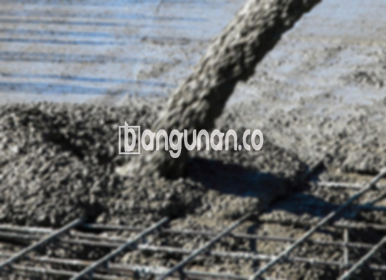

**Jasa Cor Beton Readymix & Jayamix Di Gedongtengen** – Bagi Mitra Bangunan yang tengah mempersiapkan konstruksi di Gedongtengen, beton cor readymix dari bangunan.co menawarkan solusi pengecoran modern yang cepat, praktis, dan kualitas terjamin. Layanan ini menyediakan campuran beton siap pakai yang diformulasikan secara presisi dari pasir beton, batu kerikil, semen, dan air, dengan proporsi yang dirancang untuk menghasilkan beton dengan mutu yang konsisten sesuai kebutuhan proyek Anda.



## Mengoptimalkan Pelaksanaan Pengecoran dengan Layanan Kami di Gedongtengen

Penyediaan campuran beton readymix bertujuan untuk memperlancar dan mempercepat pelaksanaan pengecoran, sekaligus memastikan kualitas beton yang terstandarisasi. Dengan menggunakan layanan kami, Anda dapat menghemat waktu dan tenaga karena beton sudah siap digunakan langsung di lokasi proyek. Hal ini memungkinkan Anda untuk fokus pada aspek konstruksi lainnya, seperti persiapan bekisting dan penyelesaian akhir.

Beton readymix hadir dalam berbagai pilihan mutu yang dapat disesuaikan dengan peruntukan konstruksi. Beton ini dikenal sebagai beton cair siap pakai karena diproduksi di pabrik dengan formula yang telah teruji, sehingga siap dituang dan diratakan segera setelah pengiriman. Anda tidak perlu lagi khawatir tentang proses pencampuran manual yang memakan waktu dan berpotensi menimbulkan variasi kualitas.

Kualitas beton dijamin melalui kontrol yang ketat di setiap tahap produksi, mulai dari pemilihan material hingga pengiriman. Tim ahli kami memastikan bahwa setiap batch beton memenuhi standar mutu yang ditetapkan, memberikan Anda kepercayaan penuh terhadap kekuatan dan daya tahan struktur yang Anda bangun. Dengan demikian, Anda dapat membangun fondasi yang kokoh dan tahan lama untuk proyek Anda di Gedongtengen.

## Keunggulan dan Pertimbangan Penggunaan Cor Readymix di Gedongtengen

Ada perbedaan signifikan antara beton yang diproduksi di pabrik pengolahan beton bangunan.co dan beton yang dicampur secara manual di lapangan. Masing-masing metode memiliki kelebihan dan kekurangan yang perlu Anda pertimbangkan. Berikut adalah perbandingan yang dapat membantu Anda dalam mengambil keputusan:

Beton yang dicampur di pabrik pengolahan beton menawarkan beberapa keunggulan utama:

1.  Pertama, komposisi adukan beton dirancang untuk mencapai mutu dan kualitas yang tepat sesuai dengan spesifikasi proyek Anda.
2.  Kedua, proses pencampuran yang seragam memastikan kualitas beton yang konsisten dan merata di seluruh bagian.
3.  Ketiga, penggunaan material berkualitas tinggi yang telah melalui seleksi ketat menjamin kekuatan dan daya tahan beton.
4.  Keempat, efisiensi waktu dan biaya, karena Anda tidak perlu menyiapkan peralatan atau tenaga kerja untuk pencampuran manual.
5.  Kelima, kemudahan dan kepastian dalam mendapatkan kualitas beton yang sesuai dengan kebutuhan konstruksi Anda.

Namun, penting untuk diingat bahwa pemesanan beton readymix memerlukan perencanaan yang matang. Anda perlu memesan beton jauh-jauh hari karena pabrik memerlukan waktu untuk memproses pesanan dan mengatur jadwal pengiriman. Selain itu, survei lokasi diperlukan untuk menghitung volume beton yang dibutuhkan secara akurat, sehingga tidak ada sisa atau kekurangan material.

## Ragam Mutu Beton yang Umum Digunakan di Gedongtengen

Di antara berbagai jenis mutu beton, K225 merupakan pilihan yang paling populer, terutama untuk pengecoran dak rumah atau lantai dua ke atas. Mutu beton ini dirancang khusus untuk menahan beban yang umum ditemui pada struktur dak. Selain itu, K225 juga cocok untuk pengecoran jalan gang yang tidak menanggung beban kendaraan berat.

Mutu beton K250 dan K300 juga sering digunakan, khususnya untuk pengecoran tiang, pondasi, atau cakar ayam. Untuk proyek jalan pedesaan, mutu K250, K300, dan K350 adalah pilihan yang tepat, tergantung pada tingkat beban yang ditanggung oleh jalan tersebut. Mutu beton di atas K350, seperti K375, K400, dan K500, umumnya digunakan untuk beton *fast track* yang membutuhkan pengeringan cepat, misalnya untuk jalan tol atau area parkir dengan lalu lintas intens.

## Komitmen bangunan.co Terhadap Kualitas Beton di Gedongtengen



Campuran cor readymix harus dirancang dengan presisi untuk memastikan bahwa beton memiliki kemampuan kerja yang optimal dan daya tahan yang tinggi. Proses pembuatan beton mengikuti standar adukan beton nasional (SNI) untuk menjamin kualitas yang terpercaya. Komposisi idealnya terdiri dari 10% hingga 15% semen Portland, 60% hingga 75% agregat halus dan kasar (pasir dan split), serta 10% hingga 15% air. Kandungan udara juga memainkan peran penting dalam kualitas beton.

Beton dengan mutu tinggi dihasilkan dengan meminimalkan rasio air-semen tanpa mengurangi kemampuan kerja beton segar. Penggunaan air bersih yang bebas dari lumpur, garam, dan bahan organik sangat penting untuk menjaga kualitas beton. Air yang tercemar dapat bereaksi dengan semen dan mengurangi kekuatan beton secara signifikan.

Oleh karena itu, kami di bangunan.co selalu memastikan bahwa semua material yang digunakan dalam produksi beton readymix memenuhi standar kualitas yang ketat. Kami juga melakukan pengujian berkala untuk memastikan bahwa beton yang kami hasilkan memiliki kekuatan dan daya tahan yang sesuai dengan spesifikasi yang dibutuhkan.

Sebagai Mitra Bangunan yang terpercaya, kami siap membantu Anda dalam memilih mutu beton yang tepat untuk proyek Anda di Gedongtengen. Hubungi kami segera untuk mendapatkan penawaran harga terbaik dan layanan pengiriman yang cepat dan efisien.

**Ref by:** [Cor Beton Readymix & Jayamix Gedongtengen](https://id.wikipedia.org/wiki/Cor)