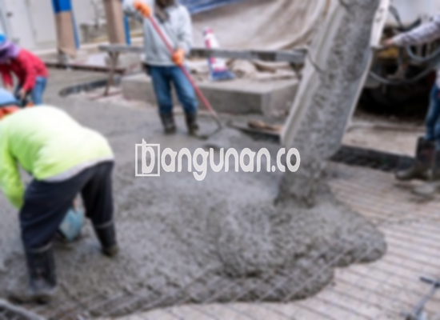

**Jasa Cor Beton Readymix & Jayamix Di Gemawang Temanggung** – Bagi Mitra Bangunan yang sedang mencari solusi konstruksi di Gemawang Temanggung, readymix atau beton siap pakai dari bangunan.co adalah pilihan yang tepat. Beton siap guna ini merupakan campuran material beton yang diformulasikan khusus untuk pengecoran instan, menghemat waktu dan tenaga dalam proyek Anda. Komposisinya terdiri dari pasir beton, kerikil, semen, dan air dengan takaran presisi untuk menghasilkan mutu beton yang diinginkan.



## Mengapa Memilih Layanan Cor Beton Readymix & Jayamix dari bangunan.co di Gemawang Temanggung?

Penyediaan beton siap pakai dari bangunan.co dirancang untuk mempercepat proses konstruksi Anda sekaligus menjamin kualitas yang tinggi dan konsisten. Dengan memilih layanan ini, Anda dapat memastikan bahwa material yang digunakan memenuhi standar mutu yang dibutuhkan untuk proyek yang sedang Anda kerjakan. 

Beton readymix dikenal juga sebagai beton cair siap pakai karena telah melalui proses pencampuran yang teliti di pabrik pengolahan beton bangunan.co. Hal ini membuat beton ini langsung siap digunakan begitu sampai di lokasi proyek, cukup diratakan setelah dituang. Anda tidak perlu lagi khawatir tentang proses pencampuran manual yang memakan waktu dan berpotensi mempengaruhi kualitas. Anda hanya perlu mempersiapkan bekisting yang kuat untuk menopang berat beton yang akan dicor.

Kami di bangunan.co memahami pentingnya kualitas, oleh sebab itu proses pengendalian mutu dilakukan secara ketat mulai dari pemilihan bahan baku hingga pengiriman ke lokasi proyek Anda. Hal ini memastikan kualitas beton yang optimal dan memberikan kemudahan bagi para profesional konstruksi dalam mendapatkan material berkualitas tanpa harus menghabiskan banyak waktu untuk mengawasi proses pencampuran.

## Keunggulan dan Pertimbangan Menggunakan Beton Readymix dari bangunan.co di Gemawang Temanggung

Beton yang diproduksi di pabrik bangunan.co tentu memiliki perbedaan dengan beton yang dicampur secara manual di lapangan. Masing-masing metode memiliki keuntungan dan kekurangannya masing-masing. Berikut adalah beberapa poin penting yang perlu dipertimbangkan:

Keunggulan beton readymix dari bangunan.co:

1.  Kualitas dan mutu adukan yang terjamin sesuai dengan spesifikasi proyek Anda.
2.  Konsistensi mutu beton yang tinggi karena proses pencampuran yang terotomasi dan terukur.
3.  Kualitas bahan baku yang terjaga, karena bangunan.co hanya menggunakan material terbaik untuk menghasilkan beton berkualitas.
4.  Efisiensi waktu dan biaya, karena Anda tidak perlu menyediakan tenaga kerja dan peralatan untuk mencampur beton.
5.  Kepastian kualitas, karena bangunan.co telah memiliki standar operasional yang ketat dalam proses produksi.

Namun, perlu diingat juga bahwa:

Proses pemesanan beton readymix dari bangunan.co memerlukan perencanaan yang matang. Anda perlu melakukan pemesanan beberapa waktu sebelumnya dan memberikan informasi yang akurat mengenai kebutuhan volume beton Anda. Hal ini memungkinkan kami untuk menyiapkan produksi secara efisien dan memastikan beton tiba tepat waktu di lokasi proyek Anda.

## Jenis-Jenis Mutu Beton yang Sering Digunakan di Gemawang Temanggung

Di Gemawang Temanggung, beberapa jenis beton dengan mutu tertentu sering digunakan untuk berbagai keperluan konstruksi. K225 adalah salah satu jenis yang paling populer, terutama untuk pengecoran lantai rumah atau lantai dua dan seterusnya. Mutu ini dirancang khusus untuk aplikasi tersebut. K225 juga cocok untuk pengecoran jalan gang yang tidak menanggung beban berat kendaraan besar.

Selain K225, beton mutu K250 dan K300 juga sering diaplikasikan untuk pengecoran tiang, pondasi, atau cakar ayam. Untuk pembangunan jalan desa, mutu K250, K300, dan bahkan K350 sering direkomendasikan untuk menjamin daya tahan. Mutu yang lebih tinggi seperti K375, K400, K500, dan seterusnya biasanya digunakan untuk beton *fast track*, yaitu beton yang memerlukan pengerasan yang sangat cepat. Pilihan ini ideal untuk proyek-proyek seperti jalan tol atau area parkir dengan beban berat, di mana waktu penyelesaian menjadi prioritas utama.

## bangunan.co: Jaminan Kualitas untuk Proyek Anda di Gemawang Temanggung



Formulasi adukan beton readymix yang berkualitas tinggi memerlukan perhatian khusus. Untuk mendapatkan kekuatan dan daya tahan yang optimal, adukan harus dirancang dengan cermat, mengikuti standar yang ditetapkan dalam Standar Nasional Indonesia (SNI). Komposisi yang ideal terdiri dari sekitar 10% hingga 15% semen Portland, 60% hingga 75% agregat halus dan kasar (pasir dan kerikil), 10% hingga 15% air, dan sisanya adalah udara. Proporsi ini penting untuk memastikan beton memiliki sifat kerja yang baik dan kekuatan yang memadai.

Di bangunan.co, kami memprioritaskan kualitas dengan meminimalkan rasio air terhadap semen, tanpa mengorbankan kemampuan kerja beton. Semakin rendah rasio air-semen, semakin tinggi pula kekuatan beton yang dihasilkan. Kami juga memastikan air yang digunakan dalam proses pencampuran bersih dan bebas dari kontaminan seperti lumpur atau lumut yang dapat menurunkan kualitas beton. Penggunaan air bersih sangat krusial untuk menghasilkan beton readymix yang berkualitas tinggi.

**Ref by:** [Cor Beton Readymix & Jayamix Gemawang Temanggung](https://id.wikipedia.org/wiki/Cor)

Mitra Bangunan yang membutuhkan solusi cor beton readymix dan jayamix di Gemawang Temanggung, jangan ragu untuk menghubungi bangunan.co melalui tombol WhatsApp atau Telepon yang tersedia di halaman ini. Kami siap memberikan penawaran terbaik dan menjadi mitra terpercaya dalam kesuksesan proyek konstruksi Anda.