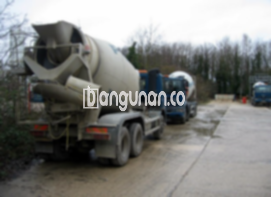

**Jasa Cor Beton Readymix & Jayamix Di Gembong Pati** – Bagi Mitra Bangunan yang tengah merencanakan pembangunan di Gembong Pati, beton readymix dari bangunan.co adalah solusi praktis dan efisien untuk kebutuhan konstruksi Anda. Campuran beton siap pakai ini menawarkan kemudahan dan kualitas terjamin, memungkinkan Anda fokus pada tahapan pembangunan lainnya. Kami melayani pengiriman readymix dan jayamix langsung ke lokasi proyek dengan truk molen yang terpercaya. 



## Mengoptimalkan Pengerjaan Konstruksi dengan Layanan Cor Readymix di Gembong Pati

Pemanfaatan layanan cor readymix menjadi semakin populer di Gembong Pati sebagai cara untuk mempercepat proses konstruksi tanpa mengorbankan kualitas. Tujuan utama dari penggunaan campuran beton ini adalah untuk efisiensi waktu dan memastikan mutu beton sesuai standar. Dengan kualitas yang terjamin, Anda dapat membangun struktur yang kokoh dan tahan lama. Layanan dari bangunan.co memastikan kepuasan Anda dalam setiap tahapan pembangunan.

Cor readymix, atau beton cair siap pakai, merupakan campuran beton yang telah diformulasikan secara presisi di pabrik pengolahan beton. Beton ini siap digunakan begitu sampai di lokasi proyek, sehingga menghilangkan kebutuhan untuk mencampur material di tempat. Hal ini sangat menguntungkan karena Anda tidak perlu lagi memikirkan perbandingan material yang tepat atau proses pencampuran yang rumit. Anda hanya perlu mempersiapkan bekisting yang kokoh sebagai wadah pengecoran.

Kualitas beton merupakan prioritas utama dalam proses produksi readymix. Pihak pengolahan beton menerapkan pengawasan ketat, mulai dari pemilihan material hingga proses pengiriman, guna memastikan mutu beton sesuai dengan standar yang ditetapkan. Hal ini memberikan keamanan dan kepercayaan kepada Anda bahwa beton yang Anda gunakan memiliki kualitas terbaik yang disediakan oleh bangunan.co.

## Keunggulan dan Pertimbangan dalam Memilih Beton Readymix

Terdapat perbedaan signifikan antara beton yang dicampur di pabrik pengolahan beton dengan beton yang dicampur secara manual di lokasi proyek. Setiap metode memiliki kelebihan dan kekurangan sendiri. Untuk memahami pilihan terbaik bagi kebutuhan Anda di Gembong Pati, pertimbangkan poin-poin berikut:

Beton yang diproduksi di pabrik pengolahan beton menawarkan sejumlah keunggulan signifikan, antara lain:

1.  Komposisi material yang tepat dan terukur sesuai standar mutu.
2.  Kualitas beton yang konsisten dan seragam berkat proses pencampuran yang terkontrol. 
3.  Penggunaan material berkualitas tinggi yang telah dipilih secara khusus untuk menghasilkan mutu beton optimal.
4.  Efisiensi waktu dan biaya karena proses pengolahan yang cepat dan akurat.
5.  Kemudahan karena Anda tidak perlu repot merumuskan campuran beton sendiri.

Namun, ada beberapa hal yang perlu Anda pertimbangkan saat memilih beton readymix:

Pemesanan beton readymix memerlukan perencanaan yang matang dan tidak dapat dilakukan secara spontan. Anda perlu melakukan pemesanan beberapa waktu sebelumnya dan menjadwalkan pengiriman. Tim dari bangunan.co mungkin juga membutuhkan survei lokasi untuk memperkirakan volume beton yang dibutuhkan secara akurat, guna menghindari pemborosan atau kekurangan material.

## Ragam Mutu Beton dan Aplikasi yang Sesuai di Gembong Pati

Salah satu mutu beton yang paling banyak diminati di Gembong Pati adalah mutu K225. Mutu beton ini ideal untuk pengecoran dak rumah atau lantai dua, karena memiliki kekuatan yang memadai untuk menopang beban yang biasanya ditemui pada konstruksi tersebut. K225 juga cocok untuk pengecoran jalan gang yang tidak sering dilalui kendaraan berat.

Selain K225, mutu K250 dan K300 juga banyak digunakan dalam berbagai proyek konstruksi. Kedua mutu ini umumnya diaplikasikan untuk pengecoran tiang, pondasi, atau cakar ayam. Untuk jalan pedesaan, mutu K250, K300, dan bahkan K350 seringkali menjadi pilihan yang tepat, tergantung pada tingkat beban yang diharapkan. Sementara itu, mutu beton K400 ke atas biasanya digunakan untuk beton fast track, seperti pada proyek jalan tol atau area parkir yang memerlukan kekuatan tinggi dan waktu pengeringan yang cepat.

## bangunan.co: Jaminan Mutu dan Pelayanan Terbaik untuk Proyek Anda di Gembong Pati



Campuran cor readymix berkualitas tinggi harus dirancang dengan cermat untuk memastikan beton memiliki kemampuan kerja yang baik dan kekuatan yang sesuai dengan mutu yang diinginkan. Komposisi material yang umum digunakan meliputi semen Portland (10-15%), agregat halus dan kasar (60-75%), air (10-15%), dan udara. Perbandingan material yang tepat sangat penting untuk mencapai kualitas beton yang optimal.

Salah satu faktor kunci dalam menghasilkan beton berkualitas adalah rasio air terhadap semen. Semakin rendah rasio ini, semakin tinggi kekuatan beton yang dihasilkan. Namun, penting untuk menjaga keseimbangan agar beton tetap mudah dikerjakan. Penggunaan air bersih yang bebas dari kotoran juga sangat krusial. Hindari menggunakan air yang mengandung lumpur atau lumut, karena hal ini dapat menurunkan kualitas beton secara signifikan. bangunan.co memastikan penggunaan material berkualitas tinggi dan proses pencampuran yang terkontrol untuk menghasilkan beton terbaik.

Sebagai penyedia jasa cor beton readymix dan jayamix terpercaya di Gembong Pati, bangunan.co selalu berkomitmen untuk memberikan produk dan layanan berkualitas tinggi. Kami menggunakan material terbaik dan menerapkan proses produksi yang ketat untuk memastikan bahwa beton yang kami kirimkan memenuhi standar mutu yang berlaku.

Sampai di sini, Mitra Bangunan, penjelasan dari Jasa Cor Beton Readymix & Jayamix Di Gembong Pati yang telah kami sampaikan. Untuk mendapatkan informasi lebih lanjut mengenai penawaran harga terbaik dan konsultasi proyek, jangan ragu untuk menghubungi kami melalui tombol WhatsApp atau Telepon di halaman ini. Tim dari bangunan.co siap membantu Anda menciptakan proyek konstruksi yang berkualitas dan tahan lama.

**Ref by:** [Cor Beton Readymix & Jayamix Gembong Pati](https://id.wikipedia.org/wiki/Cor)