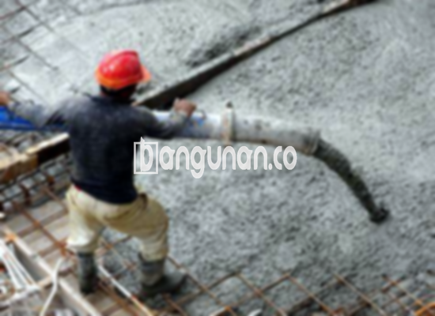

**Jasa Cor Beton Readymix & Jayamix Di Gemolong Sragen** – Cor Readymix, atau beton siap pakai, merupakan adukan campuran bahan material beton yang diformulasikan khusus untuk pengecoran cepat dan instan. Pada dasarnya, komposisi material yang digunakan serupa dengan beton konvensional, yaitu terdiri dari pasir beton, batu split, semen, dan air. Formulasi ini dirancang sedemikian rupa untuk memastikan kualitas beton sesuai dengan kebutuhan konstruksi Anda, Mitra Bangunan di Gemolong Sragen.



## Mengapa Layanan Pengadukan Beton Readymix dari bangunan.co Di Gemolong Sragen adalah Pilihan Tepat?

Tujuan utama pembuatan adukan beton siap pakai adalah mempercepat proses pengecoran sekaligus menjamin kualitas dan konsistensi. Dengan menggunakan jasa kami, Anda dapat memastikan bahwa kualitas beton yang digunakan sesuai dengan standar yang diharapkan, mendukung keberhasilan proyek konstruksi Anda. Dengan mutu terjamin, Anda membangun struktur beton yang andal, sesuai dengan spesifikasi rencana.

Beton cor readymix hadir dalam berbagai pilihan mutu, disesuaikan dengan spesifikasi konstruksi Anda. Beton ini sering disebut beton cair siap pakai karena telah diproduksi di pabrik pengolahan beton, siap langsung digunakan di lokasi proyek. Artinya, Anda tidak perlu lagi repot mengaduk dan mencampur material di lokasi, yang dapat memakan waktu dan tenaga. Sebagai gantinya, Anda cukup memastikan kesiapan bekisting untuk menerima pengecoran.

Proses pengadukan dan pengiriman beton readymix dari bangunan.co dikontrol secara ketat, mulai dari pemilihan bahan baku hingga pengujian kualitas akhir. Hal ini menjamin mutu beton yang konsisten dan sesuai dengan standar nasional maupun internasional. Investasi dalam beton readymix adalah investasi dalam kualitas dan keamanan bangunan Anda.

## Keunggulan dan Pertimbangan Penggunaan Beton Readymix

Membandingkan beton yang dicampur di pabrik pengolahan beton (batching plant) dengan beton yang dicampur secara tradisional oleh tukang bangunan, keduanya memiliki kelebihan dan kekurangan tersendiri. Berikut ini penjabaran detailnya:

Kelebihan beton readymix antara lain:

1.  Presisi dalam kualitas adukan, memastikan proporsi material yang tepat.
2.  Konsistensi kualitas beton, dengan pencampuran yang homogen dan merata.
3.  Penggunaan material pilihan dengan kualitas terbaik di setiap batch.
4.  Efisiensi waktu dan biaya, karena proses pencampuran dan pengiriman yang terstruktur.
5.  Kemudahan dalam menentukan mutu beton yang sesuai dengan kebutuhan proyek, tanpa perlu perhitungan manual.

Namun, ada juga beberapa hal yang perlu diperhatikan:

Pemesanan beton readymix memerlukan perencanaan karena pabrik perlu mempersiapkan material dan menjadwalkan pengiriman. Untuk mendapatkan penawaran harga yang akurat, penting untuk melakukan survei lokasi guna memperkirakan volume beton yang dibutuhkan. Dengan demikian, pemesanan dapat dilakukan secara optimal, menghindari kelebihan atau kekurangan material.

## Pilihan Mutu Beton yang Sering Digunakan di Gemolong Sragen

K225 adalah mutu beton yang paling banyak digunakan, terutama untuk pengecoran lantai rumah atau lantai dua. Mutu ini sangat tepat untuk elemen struktural vertikal seperti dak. Selain itu, K225 juga sering digunakan untuk pengecoran jalan gang yang tidak menahan beban berat kendaraan.

Pilihan populer lainnya adalah K250 dan K300, yang biasanya digunakan untuk pengecoran tiang pancang, pondasi rumah, atau cakar ayam. Untuk jalan pedesaan, mutu K250, K300, atau K350 sering digunakan tergantung pada tingkat lalu lintas dan beban yang diperkirakan. Untuk konstruksi yang membutuhkan kekuatan lebih tinggi dan waktu pengeringan lebih cepat, seperti jalan tol atau area parkir, mutu beton di atas K350 (K400, K500, dan seterusnya) atau beton *fast track* adalah pilihan ideal.

## bangunan.co dan Komitmen Kami Terhadap Kualitas Beton di Gemolong Sragen



Formulasi campuran beton readymix harus dirancang dengan cermat untuk mencapai performa dan daya tahan yang optimal. Proporsi material yang tepat, seperti semen Portland (10-15%), agregat halus dan kasar (60-75%), serta air (10-15%), sangat penting untuk menghasilkan beton berkualitas tinggi. Selain itu, kandungan udara yang terperangkap dalam adukan juga berperan dalam kekuatan dan tekstur beton.

Kualitas beton yang tinggi dicapai dengan meminimalkan rasio air terhadap semen, tanpa mengorbankan kemampuan kerja beton saat masih segar. Penggunaan air bersih dan bebas dari kontaminan adalah kunci untuk memastikan beton tidak mudah retak atau terdegradasi. Air yang digunakan harus bebas dari lumpur, kotoran, lumut, atau bahan organik lainnya yang dapat mengganggu proses hidrasi semen. 

Mitra Bangunan yang membutuhkan solusi pengecoran yang handal dan berkualitas di Gemolong Sragen, bangunan.co siap menjadi mitra terpercaya Anda. [Kami] menyediakan berbagai pilihan mutu beton readymix yang disesuaikan dengan spesifikasi proyek Anda. [Kami] juga berkomitmen untuk memberikan layanan terbaik dan pengiriman tepat waktu.

**Ref by:** [Cor Beton Readymix & Jayamix Gemolong Sragen](https://id.wikipedia.org/wiki/Cor)