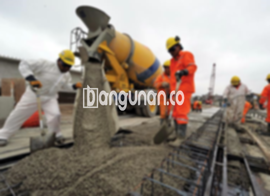

**Jasa Cor Beton Readymix & Jayamix Di Gemuh Kendal** – Memastikan fondasi yang kokoh dan pembangunan yang efisien di Gemuh Kendal membutuhkan material beton berkualitas tinggi. Bangunan.co hadir sebagai solusi terpercaya dengan layanan jasa cor beton readymix dan jayamix, menyediakan beton siap pakai yang dirancang untuk memenuhi kebutuhan konstruksi Anda. Mitra Bangunan berkomitmen memberikan kemudahan dan keandalan dalam setiap proyek Anda.



## Mengapa Memilih Layanan Jasa Cor Beton Readymix & Jayamix dari Bangunan.co di Gemuh Kendal?

Solusi beton modern ini dirancang untuk mempercepat proses konstruksi sembari menjamin kualitas yang konsisten dan terukur. Dengan memilih layanan kami, Anda memperoleh kepastian bahwa mutu beton yang digunakan sesuai dengan standar yang dibutuhkan untuk proyek konstruksi yang sedang Anda kerjakan.

Beton cor readymix, sering disebut juga beton siap pakai, telah diformulasikan secara khusus di pabrik pengolahan beton. Hal ini memungkinkan Anda untuk langsung menuangkannya dan meratakannya di lokasi proyek. Dengan demikian, Anda tidak perlu lagi repot mencampurkan material secara manual, memastikan proporsi yang akurat, atau mengkhawatirkan kualitas bahan baku. Anda dapat lebih fokus pada aspek inti konstruksi, sementara Bangunan.co memastikan kualitas beton yang optimal.

Proses produksi beton di pabrik pengolahan beton, atau *batching plant*, mengendalikan kualitas secara ketat mulai dari tahap pencampuran hingga pengiriman. Hal ini menjamin hasil akhir yang presisi dan handal, serta meningkatkan efisiensi keseluruhan proyek Anda.

## Keunggulan dan Pertimbangan dalam Menggunakan Beton Cor Readymix

Baik beton yang dihasilkan di pabrik pengolahan beton maupun beton yang dicampur secara manual di lokasi konstruksi memiliki kelebihan dan kekurangannya masing-masing. Berikut adalah perbandingan yang dapat Anda pertimbangkan:

Beton yang diproduksi di pabrik menawarkan berbagai keunggulan signifikan:

1.  Campuran yang terstandarisasi dan konsisten, memastikan kualitas yang seragam.
2.  Kualitas beton merata karena proses pencampuran menggunakan teknologi mesin modern.
3.  Penggunaan material berkualitas tinggi yang dipilih secara cermat untuk mencapai hasil terbaik.
4.  Proses produksi yang cepat, menghemat waktu dan biaya keseluruhan proyek.
5.  Anda tidak perlu lagi memikirkan formulasi campuran beton yang tepat, karena telah ditangani oleh tim ahli kami.

Namun, perlu diingat bahwa pemesanan beton readymix memerlukan perencanaan dan penjadwalan yang matang. Proses pemesanan meliputi survei lokasi untuk menentukan volume yang dibutuhkan secara akurat. Hal ini bertujuan untuk mengoptimalkan produksi dan memastikan ketersediaan material yang cukup saat tiba di lokasi pengecoran.

## Ragam Mutu Beton yang Paling Sering Digunakan di Area Gemuh Kendal

Salah satu pilihan mutu beton yang paling banyak digunakan di Gemuh Kendal adalah K225. Mutu ini sangat ideal untuk pengecoran dak rumah atau lantai dua ke atas, karena dirancang khusus untuk aplikasi tersebut. Selain itu, K225 juga cocok untuk pengecoran jalan gang yang tidak menanggung beban kendaraan berat seperti truk atau mobil.

Pilihan populer lainnya meliputi mutu beton K250 dan K300. K250 dan K300 sering diaplikasikan untuk pengecoran tiang, pondasi, atau cakar ayam. Untuk pekerjaan jalan pedesaan, penggunaan K250, K300, dan K350 adalah hal yang umum. Mutu beton yang lebih tinggi dari K350, seperti K375, K400, dan K500, umumnya digunakan untuk aplikasi khusus yang membutuhkan daya tahan ekstra dan waktu pengeringan yang cepat (beton *fast track*). Contohnya termasuk pembangunan jalan tol atau area parkir yang memerlukan kapasitas beban tinggi atau penyelesaian proyek yang dipercepat.

## Komitmen Bangunan.co Terhadap Kualitas Beton di Gemuh Kendal



Kami di Bangunan.co memahami bahwa kualitas beton adalah faktor penentu keberhasilan setiap proyek konstruksi. Oleh karena itu, adukan beton cor readymix yang kami sediakan dirancang dan diproduksi dengan sangat cermat, memastikan kekuatan dan ketahanan yang optimal sesuai harapan Anda.

Campuran bahan material beton harus memenuhi standar nasional Indonesia (SNI) yang berlaku. Komposisi idealnya terdiri dari sekitar 10% hingga 15% semen Portland, 60% hingga 75% agregat halus dan kasar (pasir dan split), dan tambahan 10% hingga 15% air. Perbandingan ini dirancang untuk memastikan beton memiliki kekuatan yang memadai dan sesuai dengan tujuan penggunaannya.

Untuk menghasilkan beton dengan kualitas yang superior, rasio air terhadap semen ditekan serendah mungkin tanpa mengorbankan kemampuan kerja beton saat masih segar. Penggunaan air bersih dan bebas dari kontaminan juga sangat penting. Hindari penggunaan air yang mengandung tanah, lumpur, atau bahan organik yang dapat menurunkan kualitas beton secara signifikan. Air yang digunakan harus bersih dan tidak mengandung zat-zat yang dapat mengganggu proses hidrasi semen dan mengurangi kekuatan beton.

Itulah penjelasan dari Jasa Cor Beton Readymix & Jayamix Di Gemuh Kendal dari Bangunan.co. Untuk informasi lengkap mengenai harga, Anda dapat menghubungi kami melalui layanan pelanggan kami. 

**Ref by:** [Cor Beton Readymix & Jayamix Gemuh Kendal](https://id.wikipedia.org/wiki/Cor)

Mitra Bangunan siap melayani kebutuhan beton Anda di Gemuh Kendal. Jangan ragu untuk menghubungi kami melalui tombol WhatsApp atau Telepon di halaman ini. Hubungi kami sekarang juga untuk konsultasi gratis dan pemesanan beton berkualitas tinggi. Kami berkomitmen untuk memberikan solusi beton terbaik untuk memastikan keberhasilan proyek konstruksi Anda.