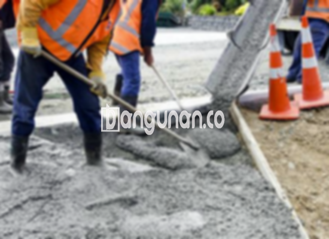

**Jasa Cor Beton Readymix & Jayamix Di Genuk Kota Semarang** – Bagi Mitra Bangunan yang berencana membangun atau merenovasi di Genuk Kota Semarang, beton readymix dari bangunan.co adalah solusi efektif. Layanan ini menawarkan adukan beton siap pakai yang dirancang untuk efisiensi waktu dan kualitas terjamin. Kami menyediakan campuran beton yang memenuhi standar konstruksi modern, membantu Anda menyelesaikan proyek dengan cepat dan kokoh. 



## Keunggulan Layanan Cor Beton Readymix & Jayamix dari bangunan.co di Genuk Kota Semarang

Penyediaan adukan beton siap pakai ini bertujuan untuk mempercepat progres pengecoran sekaligus menjamin mutu yang konsisten. Dengan menggunakan layanan dari bangunan.co, Anda dapat memperoleh mutu beton yang sesuai dengan standar yang diharapkan, sehingga memastikan konstruksi yang Anda rencanakan memiliki kualitas optimal. 

Beton readymix, atau jayamix, dikenal sebagai beton cair siap guna karena telah dipersiapkan secara khusus di pabrik pengolahan beton bangunan.co. Hal ini memungkinkan beton siap dicurahkan dan diratakan langsung di lokasi proyek. Dengan demikian, Anda tidak perlu lagi repot dengan proses pengadukan manual yang memakan waktu dan tenaga. Anda hanya perlu mempersiapkan bekisting yang kokoh sebagai penahan beton yang akan dituang.

Kualitas beton dari bangunan.co dikontrol secara ketat mulai dari pemilihan bahan baku hingga proses pencampuran dan pengiriman. Hal ini menjamin mutu yang terpercaya dan memberikan kemudahan bagi Anda dalam membangun struktur beton yang kuat dan tahan lama.

## Pertimbangan Memilih Cor Readymix atau Jayamix dari bangunan.co di Genuk Kota Semarang

Terdapat perbedaan antara beton yang diproduksi oleh pabrik pengolahan beton seperti bangunan.co dan beton yang dicampur secara manual di lapangan. Masing-masing memiliki kelebihan dan kekurangan yang perlu Anda pertimbangkan. 

Beton dari bangunan.co menawarkan keunggulan sebagai berikut:

1.  Campuran material yang presisi dan mutu yang terjamin.
2.  Kualitas beton yang homogen karena proses pencampuran yang terkontrol.
3.  Penggunaan bahan material berkualitas tinggi yang telah teruji.
4.  Efisiensi waktu dan biaya karena proses pengolahan yang cepat.
5.  Anda tidak perlu memikirkan perhitungan campuran yang rumit; bangunan.co sudah menghitungnya sesuai dengan kebutuhan konstruksi Anda.

Meskipun demikian, terdapat beberapa hal yang perlu diperhatikan:

Pemesanan beton readymix dari bangunan.co membutuhkan penjadwalan terlebih dahulu. Hal ini memungkinkan kami untuk mempersiapkan material dan mengatur pengiriman agar sesuai dengan kebutuhan proyek Anda. Kami juga akan melakukan survei lokasi untuk memperkirakan volume beton yang dibutuhkan secara akurat.

## Jenis Mutu Beton Paling Sering Dipakai di Proyek Genuk Kota Semarang

Dari berbagai jenis mutu beton yang tersedia, mutu beton K225 merupakan yang paling umum digunakan. Kwalitas beton K225 ini sangat cocok untuk pengecoran lantai rumah, lantai 2, atau bagian atas lainnya, karena memang dirancang untuk keperluan tersebut. K225 juga dapat digunakan untuk pengecoran jalan gang yang tidak dilalui truk atau mobil berat.

Selain itu, mutu beton K250 dan K300 juga banyak digunakan, terutama untuk pengecoran tiang, pondasi, atau cakar ayam. Untuk jalan pedesaan, mutu K250, K300, dan bahkan K350 sering dipilih. Mutu beton di atas K350, seperti K375, K400, dan K500, biasanya digunakan untuk beton *fast track* yang membutuhkan pengeringan cepat. Contohnya adalah jalan tol atau area parkir yang membutuhkan kekuatan tinggi dan waktu pengerjaan singkat.

## bangunan.co Memprioritaskan Kualitas Beton untuk Proyek Anda



Campuran beton readymix dari bangunan.co dirancang dengan cermat untuk memastikan kinerja dan kekuatan yang optimal. Komposisi yang tepat terdiri dari sekitar 10% hingga 15% semen Portland, 60% hingga 75% agregat halus dan kasar (pasir dan split), serta 10% hingga 15% air. Sisanya adalah udara, yang tetap merupakan elemen penting dalam campuran.

Untuk menghasilkan beton berkualitas tinggi, rasio air dan semen diminimalkan tanpa mengorbankan kemampuan kerja beton segar. Beton dengan kualitas baik umumnya menggunakan air bersih dalam jumlah yang terkontrol. Air yang digunakan harus bebas dari kontaminan, lumpur, atau alga yang dapat menurunkan kualitas beton.

**Ref by:** [Cor Beton Readymix & Jayamix Genuk Kota Semarang](https://id.wikipedia.org/wiki/Cor)

Mitra Bangunan, jika Anda mencari jasa cor beton readymix dan jayamix yang terpercaya di Genuk Kota Semarang, bangunan.co adalah pilihan yang tepat. Kami siap memberikan konsultasi dan penawaran harga yang kompetitif untuk memenuhi kebutuhan proyek Anda. Jangan ragu untuk menghubungi kami melalui tombol WhatsApp atau Telepon yang tersedia di halaman ini. Kami siap membantu Anda mewujudkan bangunan impian Anda.