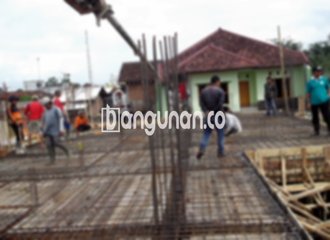

**Jasa Cor Beton Readymix & Jayamix Di Geyer Grobogan** – Memastikan fondasi konstruksi yang kuat dan tahan lama adalah fokus utama bagi setiap proyek pembangunan. Di Geyer Grobogan, readymix-bangunan-co.pages.dev hadir sebagai solusi terpercaya dalam menyediakan beton siap pakai berkualitas tinggi untuk kebutuhan Anda. Kami melayani pengiriman readymix dan jayamix langsung ke lokasi proyek Anda dengan menggunakan truk molen modern, memastikan beton sampai tepat waktu dan dalam kondisi optimal. Mitra Bangunan dapat mengandalkan layanan kami untuk mendapatkan kualitas beton yang konsisten dan pengiriman yang efisien.



## Mengapa Memilih Layanan Pengcampuran Beton dari Jasa Cor Beton Readymix & Jayamix Di Geyer Grobogan?

Penggunaan adukan beton yang dirancang secara presisi berperan penting dalam mempercepat penyelesaian proyek konstruksi Anda. Dengan adukan yang tepat, Anda dapat memastikan mutu beton sesuai standar kualitas yang dibutuhkan untuk konstruksi yang direncanakan. Layanan kami menawarkan solusi praktis dan efisien untuk memenuhi kebutuhan beton Anda di Geyer Grobogan.

Beton Cor Readymix adalah pilihan ideal karena tersedia dalam berbagai mutu yang dapat disesuaikan dengan kebutuhan spesifik proyek Anda. Dikenal juga sebagai beton cair siap pakai, beton ini telah diformulasikan secara khusus di pabrik pengolahan beton agar siap digunakan. Artinya, Anda tidak perlu lagi repot dengan proses pencampuran manual yang memakan waktu dan tenaga. Anda tinggal mempersiapkan lokasi proyek dengan bekisting yang kuat untuk menampung beton yang akan dituang. Hal ini memungkinkan Anda untuk fokus pada aspek-aspek penting lainnya dalam proyek konstruksi Anda.

Kualitas beton yang dihasilkan pun terjamin karena melalui proses pengendalian mutu yang ketat di pabrik pengolahan beton, mulai dari penimbangan bahan baku hingga proses pencampuran dan pengiriman. Dengan demikian, Anda dapat yakin bahwa beton yang Anda terima memiliki kualitas yang seragam dan memenuhi standar yang Anda harapkan.

## Keunggulan dan Pertimbangan dalam Menggunakan Cor Readymix dari Jasa Cor Beton Readymix & Jayamix Di Geyer Grobogan

Tentu saja, terdapat perbedaan antara beton yang dicampur di pabrik pengolahan beton dengan beton yang dicampur secara manual oleh tukang bangunan. Setiap metode memiliki kelebihan dan kekurangannya masing-masing. Berikut adalah perbandingan yang perlu Anda pertimbangkan:

Beton yang dicampur di pabrik pengolahan beton memiliki beberapa keunggulan penting:

1.  Pertama, proporsi campuran beton sudah diatur sedemikian rupa untuk mencapai mutu yang ideal.
2.  Kedua, kualitas beton lebih merata karena proses pencampuran yang seragam dan terkontrol.
3.  Ketiga, material yang digunakan dipilih dengan cermat untuk memastikan kualitas terbaik dalam menghasilkan beton berkualitas tinggi.
4.  Keempat, waktu pengolahan lebih cepat, sehingga dapat menghemat biaya dan waktu pelaksanaan proyek Anda.
5.  Kelima, Anda tidak perlu khawatir tentang perhitungan perbandingan campuran beton karena pabrik pengolahan beton sudah melakukan perhitungan yang tepat sesuai dengan kebutuhan konstruksi Anda.

Namun, perlu diingat bahwa pemesanan beton readymix memerlukan penjadwalan terlebih dahulu dan survei lokasi untuk menentukan volume beton yang dibutuhkan. Hal ini dilakukan untuk memastikan ketersediaan beton yang cukup tanpa terjadi kelebihan atau kekurangan saat pengiriman.

## Jenis Mutu Beton yang Umum Digunakan di Geyer Grobogan

Jenis mutu beton K225 merupakan salah satu yang paling banyak digunakan, terutama untuk pengecoran dak rumah atau lantai dua ke atas. Kualitas beton ini sangat cocok untuk kebutuhan pengecoran dak karena dirancang khusus untuk aplikasi tersebut. K225 juga dapat digunakan untuk pengecoran jalan gang yang tidak digunakan untuk lalu lintas kendaraan berat.

Selain K225, mutu beton K250 dan K300 juga seringkali menjadi pilihan utama. K250 dan K300 umumnya digunakan untuk pengecoran tiang, pondasi, atau cakar ayam. Untuk pengecoran jalan pedesaan, Anda dapat menggunakan K250, K300, atau bahkan K350. Mutu beton yang lebih tinggi, seperti K375, K400, dan K500, biasanya digunakan untuk beton *fast track* atau aplikasi yang membutuhkan kekuatan dan kecepatan pengerasan yang tinggi. Contohnya, seperti pada pembangunan jalan tol atau area parkir yang membutuhkan daya tahan terhadap beban berat dan waktu pengerjaan yang singkat.

## Jasa Cor Beton Readymix & Jayamix Di Geyer Grobogan Menjamin Kualitas Beton



Pencampuran beton yang berkualitas harus dilakukan dengan teliti dan cermat untuk menjamin performa dan kekuatan yang optimal. Beton yang berkualitas tinggi akan tahan lama, tidak mudah keropos, retak, atau mengelupas. Untuk mencapai kualitas tersebut, campuran beton harus sesuai dengan standar nasional Indonesia (SNI). Komposisi campuran yang ideal umumnya terdiri dari 10% hingga 15% semen Portland, 60% hingga 75% agregat halus dan kasar (pasir dan split), serta 10% hingga 15% air. Sisanya adalah kandungan udara yang juga berperan penting dalam beton.

Salah satu faktor penting dalam menghasilkan beton berkualitas adalah menjaga rasio air-semen serendah mungkin tanpa mengorbankan kemudahan dalam pengerjaan beton. Semakin sedikit air yang digunakan, semakin tinggi kekuatan beton yang dihasilkan. Pastikan air yang digunakan juga bersih dan bebas dari kontaminan. Hindari penggunaan air yang mengandung tanah atau lumut, karena dapat menurunkan kualitas beton. Air yang digunakan harus bersih dan tidak mengandung bahan-bahan yang dapat mengganggu proses hidrasi semen.

Dengan demikian, Mitra Bangunan dapat tenang dan percaya pada kualitas beton yang kami sediakan. Hubungi kami untuk mendapatkan penawaran harga terbaik dan solusi beton yang tepat untuk proyek konstruksi Anda.

**Ref by:** [Cor Beton Readymix & Jayamix Geyer Grobogan](https://id.wikipedia.org/wiki/Cor)