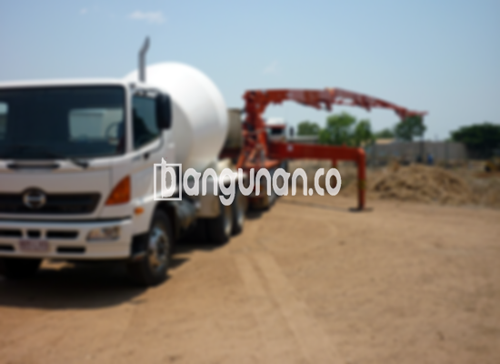

**Jasa Cor Beton Readymix & Jayamix Di Giritontro Wonogiri** – Apakah Anda sedang merencanakan proyek konstruksi di Giritontro Wonogiri dan membutuhkan solusi beton yang cepat dan terpercaya? Mitra Bangunan hadir sebagai penyedia jasa cor beton readymix dan jayamix terkemuka, siap memenuhi kebutuhan konstruksi Anda dengan kualitas terbaik. Beton siap pakai ini dirancang untuk kemudahan aplikasi, memiliki komposisi material yang presisi untuk pengecoran cepat dan efisien.



## Mengapa Memilih Layanan Cor Beton Readymix & Jayamix dari bangunan.co di Giritontro Wonogiri

Beton readymix dan jayamix dari bangunan.co menawarkan solusi praktis bagi proyek konstruksi Anda. Diformulasikan dengan campuran material yang tepat – semen, pasir beton, batu pecah, dan air – beton ini dirancang untuk memberikan kekuatan dan daya tahan optimal, sesuai dengan standar kualitas yang Anda inginkan. Dengan menggunakan layanan kami, Anda dapat menghemat waktu dan tenaga, karena beton siap digunakan langsung di lokasi proyek.

Beton cor readymix sering disebut sebagai beton cair siap pakai karena diproduksi di pabrik pengolahan beton dengan kontrol kualitas yang ketat. Proses ini memastikan bahwa beton yang Anda terima telah siap dituang dan diratakan, tanpa perlu melalui proses pencampuran manual yang memakan waktu. Anda hanya perlu mempersiapkan bekisting sebagai penopang struktur beton yang akan dicetak. Keunggulan ini menjadikan beton readymix pilihan ideal bagi kontraktor dan pemilik proyek yang mengutamakan efisiensi.

Memilih bangunan.co berarti memilih layanan yang berfokus pada kualitas dan ketepatan waktu. Kami memahami bahwa ketepatan penyediaan material adalah kunci keberhasilan proyek Anda.

## Keunggulan dan Pertimbangan dalam Penggunaan Beton Readymix dari bangunan.co

Terdapat perbedaan signifikan antara beton yang dicampur di pabrik pengolahan beton bangunan.co dengan adukan manual yang dibuat di lokasi proyek. Kedua pendekatan memiliki kelebihan dan kekurangan masing-masing. Berikut adalah perbandingan yang perlu Anda pertimbangkan:

Keunggulan beton readymix dari bangunan.co antara lain:

1.  Kualitas terjamin dan konsisten pada setiap pengiriman.
2.  Mutu beton merata karena proses pencampuran menggunakan mesin modern dan presisi.
3.  Material yang digunakan adalah bahan bangunan berkualitas tinggi yang telah melalui seleksi ketat.
4.  Efisiensi waktu dan biaya karena proses produksi yang cepat dan terstandarisasi.
5.  Kepraktisan karena Anda tidak perlu khawatir tentang perbandingan adukan; bangunan.co telah merancang formula yang optimal untuk setiap kebutuhan konstruksi.

Meskipun demikian, penting untuk diingat bahwa pemesanan beton readymix memerlukan perencanaan yang matang. Pemesanan tidak dapat dilakukan secara spontan dan memerlukan penjadwalan serta survei lokasi untuk menentukan volume beton yang dibutuhkan secara akurat. Hal ini bertujuan untuk mencegah kelebihan atau kekurangan pasokan beton saat tiba di lokasi proyek.

## Ragam Mutu Beton yang Tersedia di bangunan.co untuk Proyek di Giritontro Wonogiri

Di Giritontro Wonogiri, mutu beton K225 adalah salah satu pilihan yang paling banyak digunakan. Mutu beton ini sangat cocok untuk pengecoran dak rumah atau lantai dua, karena dirancang khusus untuk menopang beban ringan hingga sedang. K225 juga dapat digunakan untuk pengecoran jalan gang yang tidak menanggung beban lalu lintas berat seperti truk.

Selain K225, mutu beton K250 dan K300 juga populer digunakan untuk berbagai aplikasi konstruksi. K250 dan K300 cocok untuk pengecoran tiang, pondasi, atau cakar ayam yang membutuhkan kekuatan yang lebih tinggi. Untuk pengecoran jalan pedesaan, mutu K250, K300, dan bahkan K350 seringkali menjadi pilihan yang tepat. Mutu beton yang lebih tinggi, seperti K375, K400, dan K500, ideal untuk beton *fast track* atau beton yang memerlukan pengeringan cepat – seperti jalan tol atau area parkir yang menopang beban berat dan membutuhkan waktu pengerjaan minimal.

## bangunan.co: Jaminan Kualitas dalam Setiap Pengiriman Beton di Giritontro Wonogiri



Di bangunan.co, kami memahami pentingnya kualitas beton untuk keberhasilan proyek Anda. Setiap adukan beton readymix dirancang dengan teliti untuk memastikan kekuatan, daya tahan, dan kinerja yang optimal. Komposisi adukan beton kami mengikuti standar nasional (SNI), terdiri dari 10% hingga 15% semen Portland, 60% hingga 75% agregat halus dan kasar (pasir dan split), serta 10% hingga 15% air. Proporsi ini memastikan beton kami memenuhi standar kualitas yang ketat.

Kami selalu berupaya menurunkan rasio air terhadap semen sebanyak mungkin tanpa mengorbankan kemampuan kerja beton segar. Penggunaan air bersih yang bebas dari kontaminan juga merupakan prioritas utama. Air yang kotor atau mengandung lumut dapat mengurangi kualitas beton secara signifikan.

Dengan memilih layanan bangunan.co, Anda memilih beton berkualitas tinggi yang didukung oleh proses produksi yang cermat dan komitmen terhadap kepuasan pelanggan.

Oleh karena itu, Mitra Bangunan mempersembahkan layanan terbaik bagi Anda yang sedang mencari jasa cor beton readymix di Giritontro Wonogiri. Hubungi kami sekarang melalui tombol WhatsApp atau Telepon di halaman ini untuk mendapatkan penawaran harga dan informasi lebih lanjut. Kami siap membantu Anda mewujudkan proyek impian Anda dengan beton berkualitas dari bangunan.co!

**Ref by:** [Cor Beton Readymix & Jayamix Giritontro Wonogiri](https://id.wikipedia.org/wiki/Cor)