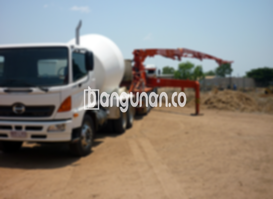

**Jasa Cor Beton Readymix & Jayamix Di Giriwoyo Wonogiri** – Apakah Anda membutuhkan solusi beton praktis dan terpercaya untuk proyek konstruksi di Giriwoyo Wonogiri? Mitra Bangunan menyediakan layanan cor beton readymix dan jayamix berkualitas tinggi. Kami menghadirkan beton siap pakai yang diformulasikan khusus untuk memenuhi kebutuhan proyek Anda dengan cepat dan efisien. Dengan bangunan.co, Anda mendapatkan kepastian mutu dan layanan yang responsif.



## Mengapa Layanan Pengadukan Beton dari bangunan.co di Giriwoyo Wonogiri adalah Pilihan Tepat?

Layanan pengadukan beton yang disediakan oleh bangunan.co dirancang untuk mempermudah dan mempercepat proses pengecoran. Dengan menggunakan beton readymix, Anda dapat menghemat waktu dan sumber daya, karena beton sudah dicampur dengan proporsi yang tepat sesuai dengan mutu yang Anda butuhkan. Ini memastikan bahwa kualitas beton yang Anda terima sesuai dengan standar konstruksi yang berlaku.

Beton cor readymix adalah solusi ideal untuk berbagai jenis proyek karena menawarkan fleksibilitas dalam pilihan mutu. Material ini dikenal sebagai beton cair siap pakai, karena telah diproduksi di pabrik bangunan.co dengan formula yang presisi, siap digunakan langsung di lokasi proyek Anda. Dengan demikian, Anda tidak perlu khawatir tentang proses pencampuran beton di lapangan, cukup fokus pada persiapan bekisting dan proses pengecoran.

Proses kontrol kualitas yang ketat diterapkan oleh bangunan.co, mulai dari pemilihan material hingga pengiriman. Ini menjamin kualitas beton yang Anda terima sesuai dengan spesifikasi yang telah ditentukan, memberikan Anda keyakinan dalam setiap tahapan pembangunan. Memilih bangunan.co berarti memilih kemudahan dan kualitas untuk proyek Anda.

## Keunggulan dan Pertimbangan Penggunaan Beton Readymix dari bangunan.co di Giriwoyo Wonogiri

Beton yang dicampur di pabrik bangunan.co (batching plant) memiliki perbedaan signifikan dibandingkan beton yang dicampur secara manual. Setiap metode memiliki kelebihan dan kekurangan masing-masing. Berikut adalah beberapa aspek penting yang perlu Anda pertimbangkan:

Beton yang diproduksi oleh bangunan.co menawarkan keunggulan seperti:

1.  Kualitas terjamin dan konsisten pada setiap pengiriman.
2.  Pencampuran yang seragam, menghasilkan kekuatan beton yang merata.
3.  Penggunaan material berkualitas tinggi yang telah teruji.
4.  Efisiensi waktu dan biaya, mengurangi kebutuhan tenaga kerja dan material.
5.  Anda tidak perlu khawatir tentang perhitungan dan pencampuran material yang rumit.

Meskipun demikian, perlu diingat bahwa memesan beton readymix dari bangunan.co memerlukan penjadwalan. Proses pemesanan dan survei lokasi diperlukan untuk menentukan jumlah beton yang dibutuhkan secara akurat, sehingga kami dapat memastikan ketersediaan material dan menghindari pemborosan.

## Jenis Mutu Beton yang Paling Banyak Digunakan di Giriwoyo Wonogiri

Kualitas beton K225 adalah salah satu jenis yang paling umum digunakan di Giriwoyo Wonogiri, khususnya untuk pengecoran dak rumah atau lantai dua ke atas. Mutu beton ini sangat sesuai untuk aplikasi ini karena memiliki kekuatan yang cukup untuk menahan beban strukturalnya. Bisa juga digunakan untuk pengecoran jalan gang kecil yang tidak dilalui kendaraan berat.

Selain K225, beton K250 dan K300 juga sering diaplikasikan. K250 dan K300 umumnya digunakan untuk pengecoran tiang, pondasi, atau cakar ayam. K250, K300, dan bahkan K350 cocok untuk pengecoran jalan pedesaan. Untuk proyek yang memerlukan kekuatan beton yang lebih tinggi, seperti jalan tol atau area parkir yang memerlukan beban berat, mutu beton K400 ke atas (sering disebut beton *fast track*) adalah pilihan yang tepat. Beton jenis ini memungkinkan pengeringan dan penggunaan jalan yang cepat, dalam beberapa hari saja.

## Jasa Cor Beton Readymix & Jayamix Di Giriwoyo Wonogiri dari bangunan.co: Komitmen Pada Kualitas



Peracikan beton readymix dengan kualitas tinggi memerlukan desain campuran yang cermat untuk memastikan kinerja dan kekuatan optimal. Komposisi campuran harus sesuai dengan standar mutu nasional (SNI) untuk menghasilkan beton yang tahan lama, tidak mudah retak, dan memiliki kekuatan yang sesuai dengan kebutuhan konstruksi Anda.

Campuran yang ideal biasanya terdiri dari 10% hingga 15% semen Portland, 60% hingga 75% agregat halus dan kasar (pasir dan split), serta 10% hingga 15% air. Udara juga merupakan komponen penting dalam campuran beton, meskipun dalam proporsi yang lebih kecil. Penggunaan air yang tepat, dalam jumlah minimal tetapi tetap mempertahankan kemampuan kerja beton, sangat penting untuk meningkatkan kualitas beton. Pastikan air yang digunakan bersih dan bebas dari lumpur atau kontaminan lain yang dapat menurunkan mutu beton.

Mitra Bangunan yang sedang mencari solusi beton terbaik di Giriwoyo Wonogiri, bangunan.co siap membantu. Kami menyediakan layanan yang responsif dan beton readymix berkualitas tinggi untuk memastikan keberhasilan proyek Anda. Jangan ragu untuk menghubungi kami untuk informasi lebih lanjut dan penawaran harga.

**Ref by:** [Cor Beton Readymix & Jayamix Giriwoyo Wonogiri](https://id.wikipedia.org/wiki/Cor)