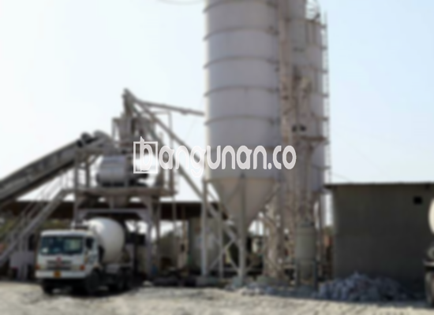

**Jasa Cor Beton Readymix & Jayamix Di Gladagsari Boyolali** – Bagi Mitra Bangunan yang tengah merencanakan konstruksi di wilayah Gladagsari Boyolali, solusi praktis dan efisien adalah menggunakan beton readymix atau adukan beton siap pakai. Produk unggulan dari bangunan.co ini diformulasikan dengan komposisi material beton yang presisi, dirancang untuk pengecoran yang cepat dan menjamin kualitas yang optimal. Proses ini melibatkan campuran pasir beton, batu pecah, semen, dan air dengan takaran yang telah teruji, untuk menghasilkan mutu beton sesuai dengan kebutuhan proyek Anda.



## Mengapa Memilih Jasa Cor Beton Readymix & Jayamix bangunan.co Di Gladagsari Boyolali?

Penggunaan beton readymix dari bangunan.co bertujuan untuk mempercepat tahapan pembangunan sekaligus memastikan kualitas beton yang konsisten. Dengan memilih mutu beton yang tepat, Anda dapat meraih hasil konstruksi yang sesuai dengan standar kualitas yang diharapkan. 

Beton ready mix yang disediakan oleh bangunan.co hadir dalam berbagai opsi mutu, disesuaikan secara spesifik dengan kebutuhan setiap proyek Anda. Jenis material ini juga dikenal sebagai beton cair siap pakai karena telah dipersiapkan secara cermat di pabrik pengolahan beton agar siap untuk langsung digunakan. Prosesnya sederhana: beton siap dituang dan diratakan di lokasi proyek, menghilangkan kebutuhan akan pencampuran manual yang memakan waktu. Anda hanya perlu memastikan kesiapan bekisting sebagai wadah penahan beton selama proses pengecoran.

Kualitas beton bangunan.co dikendalikan secara ketat mulai dari proses pengadukan hingga pengiriman, menjamin kualitas yang seragam dan efisiensi yang lebih tinggi dibandingkan dengan metode pencampuran tradisional. Hal ini memungkinkan Anda menghemat waktu dan tenaga, memastikan mutu beton terbaik untuk proyek konstruksi Anda di Gladagsari Boyolali.

## Keunggulan dan Kekurangan Cor Readymix dari bangunan.co di Gladagsari Boyolali

Terdapat perbedaan signifikan antara beton yang dicampur di pabrik pengolahan beton bangunan.co dan beton yang dicampur dengan cara manual oleh tukang bangunan. Setiap metode memiliki kelebihan dan keterbatasannya masing-masing. Berikut adalah perbandingan mendalamnya:

Beton yang diproduksi di pabrik pengolahan beton bangunan.co menawarkan berbagai keunggulan:

1.  Ketepatan kualitas dan mutu terjamin melalui kontrol kualitas yang ketat.
2.  Kualitas beton yang seragam karena proses pengadukan dilakukan dengan mesin presisi.
3.  Penggunaan material konstruksi berkualitas tinggi yang dipilih secara cermat untuk menghasilkan beton unggulan.
4.  Efisiensi waktu dan biaya yang signifikan dalam proses pengolahan.
5.  Kemudahan operasional karena Anda tidak perlu lagi menghitung dan mencampur material secara manual, bangunan.co menyediakan solusi siap pakai.

Kendati demikian, perlu diperhatikan beberapa kekurangannya:

Pemesanan beton readymix dari bangunan.co memerlukan penjadwalan dan survei lokasi awal untuk menentukan volume beton yang dibutuhkan. Proses ini bertujuan memastikan produksi beton yang tepat dan menghindari kekurangan atau kelebihan material saat pengiriman ke lokasi pengecoran.

## Variasi Kualitas Beton yang Paling Banyak Dipakai di Gladagsari Boyolali

Untuk jenis beton yang paling banyak digunakan dalam konstruksi di Gladagsari Boyolali adalah beton dengan mutu K225. Mutu beton K225 ini sering diaplikasikan untuk pengecoran dak rumah atau lantai 2 ke atas, karena memang dirancang khusus untuk jenis konstruksi tersebut. Namun, mutu ini juga cocok untuk pengecoran jalan gang yang tidak menampung beban kendaraan berat.

Selain itu, mutu K250 dan K300 juga banyak digunakan untuk pengecoran tiang, pondasi, atau cakar ayam. Untuk jalan pedesaan, mutu K250, K300, atau K350 sering dipilih. Untuk mutu yang lebih tinggi di atas K350, seperti K375, K400, dan K500, umumnya diaplikasikan untuk proyek yang membutuhkan pengeringan cepat (fast track), seperti konstruksi jalan tol atau area parkir yang membutuhkan daya tahan tinggi. Beton-beton ini menawarkan penyelesaian proyek yang lebih cepat.

## Jasa Cor Beton Readymix & Jayamix bangunan.co Di Gladagsari Boyolali Mengutamakan Kualitas Beton



Campuran cor readymix atau *ready mix concrete* yang disediakan oleh bangunan.co harus diformulasikan dengan cermat untuk menjamin kinerja dan daya tahan yang optimal. Komposisi material beton harus memenuhi standar adukan beton nasional (SNI) untuk mencegah kerusakan dini, retak, atau pengelupasan. Komposisi idealnya mencakup 10–15% semen Portland, 60–75% agregat halus dan kasar (pasir dan split), dan 10–15% air, dengan sisanya berupa udara yang terperangkap dalam campuran.

Beton bermutu tinggi yang diproduksi oleh bangunan.co dihasilkan dengan meminimalkan rasio air terhadap semen tanpa mengorbankan kemudahan kerja. Penggunaan air bersih menjadi kunci untuk mencegah kontaminasi yang dapat menurunkan kualitas beton. Air yang digunakan harus bebas dari lumpur, lumut, atau bahan lain yang berpotensi merusak komposisi beton. 

Anda dapat mempercayakan kebutuhan beton Anda kepada Jasa Cor Beton Readymix & Jayamix bangunan.co di Gladagsari Boyolali untuk mendapatkan layanan yang terpercaya dan berkualitas.

**Ref by:** [Cor Beton Readymix & Jayamix Gladagsari Boyolali](https://id.wikipedia.org/wiki/Cor)

Mitra Bangunan yang mencari solusi pengecoran beton berkualitas tinggi di Gladagsari Boyolali, jangan ragu untuk menghubungi kami melalui tombol WhatsApp atau Telepon yang tertera di halaman ini. Tim bangunan.co siap membantu Anda mewujudkan proyek konstruksi yang sukses dan berkualitas.