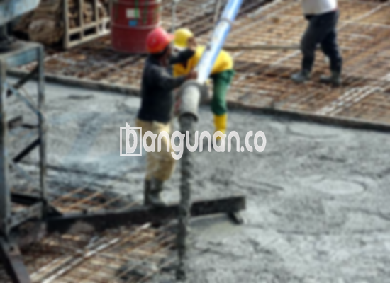

**Jasa Cor Beton Readymix & Jayamix Di Godean Sleman** – Beton readymix atau campuran beton siap guna merupakan adukan material konstruksi yang didesain khusus untuk pengecoran cepat dan praktis. Pada dasarnya, komposisi material yang digunakan serupa dengan campuran beton konvensional, terdiri dari pasir beton, batu pecah, semen, dan air dengan takaran yang sudah diatur untuk mencapai mutu beton yang diinginkan. Bangunan.co hadir sebagai solusi pengecoran andalan di Godean Sleman. Mitra Bangunan siap memenuhi kebutuhan beton Anda dengan kualitas terjamin dan layanan terbaik.



## Mengapa Memilih Jasa Cor Beton Readymix & Jayamix dari Bangunan.co di Godean Sleman?

Pengadukan beton dengan layanan kami bertujuan untuk mempercepat progres pembangunan seraya memastikan mutu yang konsisten. Dengan beton siap pakai, Anda dapat menyelesaikan pekerjaan pengecoran dengan lebih cepat dan akurat sesuai dengan spesifikasi proyek. Kualitas beton yang dihasilkan oleh Bangunan.co memenuhi standar mutu yang diharapkan, selaras dengan desain konstruksi yang Anda terapkan. 

Beton ready mix tersedia dalam berbagai pilihan mutu, memungkinkan Anda memilih yang paling sesuai dengan kebutuhan konstruksi Anda. Dijuluki juga beton cair siap pakai, material ini telah diproses secara khusus di pabrik pengolahan beton agar langsung siap digunakan. Anda tidak perlu lagi memikirkan proses pencampuran manual, cukup mempersiapkan kondisi di lokasi pengecoran seperti beking yang kokoh. 

Kualitas beton dikontrol secara ketat oleh pihak pabrik pengolahan beton—mulai dari tahap pencampuran material hingga pengiriman ke lokasi Anda. Hal ini memberikan kepastian kualitas dan mempermudah proses konstruksi Anda secara keseluruhan.

## Kelebihan dan Kekurangan Beton Readymix Dibandingkan Metode Konvensional di Godean Sleman

Beton yang dicampur melalui pabrik pengolahan beton, atau *batching plant*, tentu memiliki keunggulan dan kekurangan dibandingkan dengan beton yang dicampur secara manual oleh tukang bangunan. Berikut adalah perbandingan detailnya:

Kelebihan beton dari pabrik pengolahan beton meliputi:

1.  Ketepatan dalam mencapai mutu adukan yang ditargetkan.
2.  Kualitas beton yang merata berkat proses pencampuran menggunakan mesin modern.
3.  Penggunaan bahan material berkualitas tinggi yang dipilih secara selektif untuk menghasilkan mutu beton optimal. 
4.  Efisiensi waktu dan biaya pengolahan, karena Anda tidak perlu mengalokasikan sumber daya untuk pencampuran manual.
5.  Kepraktisan, karena Anda tidak perlu repot menghitung dan mencampur sendiri proporsi bahan yang tepat. Pihak pabrik sudah memastikan semuanya sesuai dengan spesifikasi proyek Anda.

Sementara itu, kekurangannya adalah:

Pemesanan beton readymix memerlukan penjadwalan terlebih dahulu, dan survei lokasi diperlukan untuk memperkirakan kebutuhan volume beton secara akurat. Hal ini bertujuan untuk menghindari pemborosan atau kekurangan material saat beton tiba di lokasi pengecoran Anda di Godean Sleman.

## Jenis Kualitas Beton yang Umum Digunakan di Godean Sleman

Salah satu jenis beton yang paling banyak diaplikasikan adalah mutu beton struktural K225. Kualitas beton K225 ini ideal untuk pengecoran dak rumah lantai dua atau lebih, karena memang dirancang untuk keperluan tersebut. Akan tetapi, mutu ini juga bisa digunakan untuk pengecoran jalan gang yang tidak dilalui kendaraan berat.

Pilihan yang sering digunakan lainnya adalah mutu beton K250 dan K300. K250 dan K300 umum digunakan untuk pengecoran tiang, pondasi, atau cakar ayam. Untuk konstruksi jalan pedesaan, mutu K250, K300, dan K350 adalah pilihan yang tepat. Sedangkan mutu beton di atas K350, seperti K375, K400, dan K500, biasanya dipakai untuk beton *fast track*, yaitu beton yang membutuhkan waktu pengeringan sangat singkat untuk proyek-proyek yang membutuhkan efisiensi waktu, seperti pembangunan jalan tol atau area parkir dengan beban berat.

## Bangunan.co: Jasa Cor Beton Readymix & Jayamix di Godean Sleman dengan Kualitas Terjamin



Komposisi adukan beton cor readymix harus dirancang dengan optimal untuk memastikan daya tahan dan kinerjanya yang terbaik. Proporsi campuran harus memenuhi standar mutu beton nasional (SNI). Secara umum, komposisi idealnya adalah sekitar 10-15% semen Portland, 60-75% agregat halus dan kasar (pasir dan split), dan 10-15% air. Sisanya adalah ruang udara yang terkandung dalam beton.

Beton dengan kualitas tinggi diproduksi dengan mengurangi rasio air terhadap semen seminimal mungkin, tanpa mengorbankan kemampuan kerja beton saat masih segar. Penggunaan air bersih sangat penting untuk mencegah kontaminasi yang dapat menurunkan kualitas beton. Hindari penggunaan air yang mengandung tanah atau lumut, karena dapat merusak struktur beton. Gunakan air bersih dan bebas dari material yang dapat menurunkan mutu beton.

Seperti yang telah dijelaskan, Bangunan.co menyediakan layanan Jasa Cor Beton Readymix & Jayamix Di Godean Sleman untuk memastikan Anda mendapatkan solusi beton yang andal dan berkualitas. 

**Ref by:** [Cor Beton Readymix & Jayamix Godean Sleman](https://id.wikipedia.org/wiki/Cor)

Mitra Bangunan yang berlokasi di Godean Sleman dan sedang mencari jasa cor beton readymix, jangan ragu untuk menghubungi kami melalui tombol WhatsApp atau Telepon yang tersedia di halaman ini. Kami siap membantu Anda mewujudkan proyek konstruksi impian Anda dengan beton berkualitas dan layanan yang profesional.