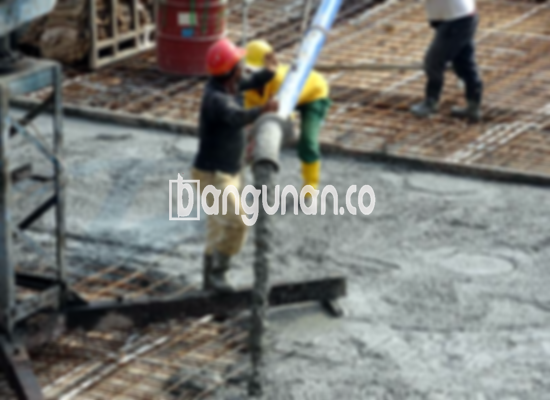

**Jasa Cor Beton Readymix & Jayamix Di Godong Grobogan** – Memastikan fondasi bangunan kuat dan tahan lama adalah kunci keberhasilan setiap proyek konstruksi. Di Godong Grobogan, readymix-bangunan-co.pages.dev hadir sebagai solusi praktis dan efisien dalam penyediaan beton siap pakai. Kami menyediakan beton readymix dan jayamix dengan pengiriman menggunakan truk molen, langsung ke lokasi proyek Anda. Mitra Bangunan akan membantu mewujudkan konstruksi yang berkualitas.



## Mengapa Memilih Jasa Cor Beton Readymix & Jayamix di Godong Grobogan?

Pengadukan beton dengan metode readymix dirancang untuk mempercepat proses pengecoran dan memastikan kualitas yang konsisten. Hal ini memberikan kepastian bahwa mutu beton yang dihasilkan sesuai dengan standar yang diharapkan, dan selaras dengan perencanaan konstruksi Anda. Dengan mutu yang terjamin, Anda dapat membangun dengan keyakinan akan kekuatan dan daya tahan struktur bangunan.

Beton readymix menawarkan beragam pilihan mutu yang dapat disesuaikan dengan kebutuhan spesifik proyek Anda. Beton ini dikenal juga sebagai beton cair siap pakai karena telah diformulasikan secara khusus di pabrik pengolahan beton, siap untuk langsung dicurahkan dan diratakan di lokasi proyek. Hal ini tentu saja membebaskan Anda dari kerumitan dan waktu yang terbuang untuk mengaduk beton secara manual. Cukup persiapkan bekisting yang memadai, dan kami akan mengurus sisanya.

Kualitas beton dikendalikan secara ketat oleh pihak pabrik pengolahan beton, mulai dari pemilihan material hingga proses pencampuran dan pengiriman. Kontrol kualitas ini memastikan bahwa setiap batch beton memenuhi standar mutu yang ditetapkan. Hal ini memberikan kemudahan bagi pelaku konstruksi untuk mendapatkan beton berkualitas tanpa perlu bersusah payah dalam proses pengadaan dan pencampuran.

## Keunggulan dan Pertimbangan Memilih Beton Readymix di Godong Grobogan

Terdapat perbedaan mendasar antara beton yang dicampur di pabrik pengolahan beton (batching plant) dengan beton yang dicampur secara manual di lokasi proyek. Masing-masing metode memiliki kelebihan dan kekurangan yang perlu Anda pertimbangkan. Berikut adalah rinciannya:

Beton yang dicampur di pabrik pengolahan beton menawarkan beberapa keunggulan utama:

1.  Adukan yang konsisten dengan mutu dan kualitas yang terjamin.
2.  Kualitas beton yang merata berkat proses pencampuran yang homogen.
3.  Penggunaan material berkualitas tinggi yang telah dipilih secara cermat.
4.  Waktu pengolahan yang cepat, menghemat biaya dan waktu proyek.
5.  Anda tidak perlu khawatir menentukan campuran yang tepat, karena pabrik telah merumuskan formula yang sesuai dengan kebutuhan konstruksi Anda.

Sementara itu, kekurangan dari beton readymix adalah proses pemesanan yang memerlukan penjadwalan dan survei lokasi untuk menentukan volume yang dibutuhkan. Hal ini bertujuan untuk menghindari pemborosan material atau kekurangan pasokan di lokasi proyek.

## Pilihan Mutu Beton yang Umum Digunakan di Godong Grobogan

Salah satu mutu beton yang paling banyak diaplikasikan adalah K225, terutama untuk pengecoran dak rumah atau lantai dua ke atas. Mutu ini sangat sesuai untuk aplikasi tersebut. Selain itu, K225 juga sering digunakan untuk pengecoran jalan gang yang tidak dilalui kendaraan berat.

Pilihan populer lainnya termasuk K250 dan K300, yang umumnya digunakan untuk pengecoran tiang, pondasi, atau cakar ayam. K250, K300, dan bahkan K350 sering diaplikasikan pada pengecoran jalan pedesaan. Untuk mutu yang lebih tinggi, seperti K375, K400, K500, dan seterusnya, biasanya digunakan pada beton *fast track* yang membutuhkan waktu pengeringan yang cepat, misalnya untuk jalan tol atau lahan parkir yang menahan beban berat.

## Jasa Cor Beton Readymix & Jayamix Di Godong Grobogan: Komitmen Pada Kualitas



Adukan beton *ready mix* harus dirancang dengan cermat untuk mencapai performa dan kekokohan yang optimal. Pastikan material yang digunakan memenuhi standar nasional Indonesia (SNI). Komposisi idealnya terdiri dari 10% hingga 15% semen Portland, 60% hingga 75% agregat halus dan kasar (pasir dan split), serta 10% hingga 15% air. Sisanya adalah ruang udara yang penting untuk proses hidrasi semen.

Beton berkualitas tinggi diproduksi dengan meminimalkan rasio air terhadap semen tanpa mengorbankan kemudahan pengerjaan beton segar. Semakin sedikit air yang digunakan, umumnya semakin tinggi mutu beton yang dihasilkan. Penggunaan air bersih yang bebas dari kotoran atau lumut sangat penting untuk menjaga kualitas beton. Air yang tercemar dapat menurunkan kekuatan dan daya tahan beton.

Dengan demikian, Jasa Cor Beton Readymix & Jayamix Di Godong Grobogan selalu berkomitmen untuk menyediakan beton berkualitas tinggi yang sesuai dengan kebutuhan proyek Anda. Anda dapat mengandalkan kami untuk menghasilkan fondasi yang kokoh dan tahan lama.

**Ref by:** [Cor Beton Readymix & Jayamix Godong Grobogan](https://id.wikipedia.org/wiki/Cor)

Mitra Bangunan yang sedang mencari jasa cor beton readymix di Godong Grobogan, jangan ragu untuk menghubungi kami melalui tombol WhatsApp atau Telepon yang tersedia di halaman ini, dan kami siap membantu mewujudkan kebutuhan konstruksi Anda.