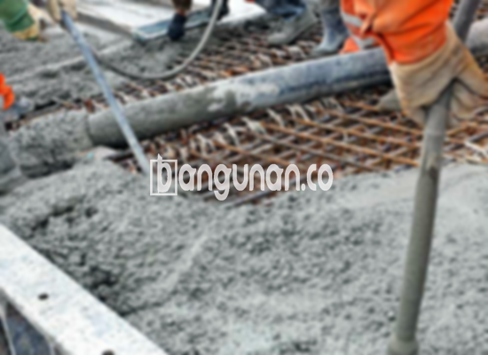

**Jasa Cor Beton Readymix & Jayamix Di Gombong Kebumen** – Mitra Bangunan menyediakan solusi pengecoran modern untuk kebutuhan proyek Anda di Gombong Kebumen. Beton cor readymix, atau adukan beton siap pakai, adalah material komposit yang diformulasikan secara khusus untuk pengecoran instan, memberikan efisiensi waktu dan kualitas terjamin. Komposisi utamanya terdiri dari campuran pasir beton, kerikil, semen, dan air, dengan proporsi yang telah diatur sedemikian rupa untuk mencapai kekuatan dan daya tahan yang optimal.



## Mengapa Layanan Pengadukan Beton Modern dari bangunan.co Memberikan Keunggulan di Gombong Kebumen?

Penggunaan beton readymix dari bangunan.co menawarkan kemudahan dalam melaksanakan pekerjaan pengecoran. Tujuan utamanya adalah mempercepat proses konstruksi serta memastikan kualitas beton yang konsisten dan dapat diandalkan. Dengan kualitas yang terstandarisasi, Anda dapat mencapai hasil pengecoran yang sesuai dengan spesifikasi dan harapan konstruksi yang direncanakan.

Beton ready mix tersedia dalam berbagai mutu, dirancang untuk aplikasi yang berbeda.  Sering disebut juga beton cair siap pakai, beton ini diproduksi oleh bangunan.co di pabrik pengolahan beton dengan formulasi yang tepat agar siap digunakan langsung di lokasi proyek. Hal ini memberikan efisiensi signifikan karena mengurangi kebutuhan untuk proses pencampuran manual di lokasi, serta memastikan mutu yang seragam di seluruh area pengecoran. Anda tidak perlu lagi khawatir tentang ketidakakuratan campuran.

Pengendalian mutu beton dilakukan secara ketat oleh bangunan.co, mulai dari pemilihan material baku hingga proses pengadukan dan pengiriman. Proses ini diawasi oleh para ahli di batching plant, memastikan kualitas beton sesuai standar industri, sehingga mempermudah para pelaku konstruksi dalam proyek mereka tanpa perlu repot memikirkan perbandingan material yang tepat untuk kualitas yang terbaik.

## Keunggulan dan Pertimbangan Memilih Beton Readymix dari bangunan.co

Beton yang diproduksi oleh bangunan.co melalui batching plant tentu berbeda dengan beton yang dicampur secara manual. Kedua metode memiliki kelebihan dan kekurangan masing-masing. Berikut adalah perbandingan kelebihan dan kekurangannya:

Kelebihan beton readymix dari bangunan.co meliputi:

1.  Formulasi campuran yang tepat untuk memenuhi standar kualitas yang diinginkan.
2.  Kualitas beton yang merata karena proses pengadukan yang homogen.
3.  Penggunaan material pilihan dengan kualitas terbaik.
4.  Penghematan waktu dan biaya operasional.
5.  Anda tidak perlu menghabiskan waktu memikirkan komposisi beton yang tepat, karena bangunan.co telah merancang formulasi yang sesuai dengan kebutuhan konstruksi Anda.

Sebagai pertimbangan, pemesanan beton readymix dari bangunan.co memerlukan penjadwalan terlebih dahulu dan survey lokasi untuk memperkirakan kebutuhan material secara akurat. Hal ini penting untuk memastikan ketersediaan beton yang cukup tanpa menimbulkan pemborosan.

## Ragam Mutu Beton yang Banyak Digunakan di Proyek Gombong Kebumen

Kualitas beton K225 adalah pilihan paling populer, terutama untuk pengecoran lantai rumah atau lantai dua. K225 secara khusus diformulasikan untuk aplikasi tersebut. Kualitas ini juga ideal untuk pembangunan jalan gang yang tidak menanggung beban lalu lintas kendaraan berat.

Mutu beton K250 dan K300 juga sering digunakan untuk berbagai proyek, seperti pengecoran tiang, pondasi atau cakar ayam. Untuk pekerjaan jalan pedesaan, K250, K300, dan K350 merupakan pilihan umum. Kualitas beton yang lebih tinggi seperti K375, K400, K500 dan seterusnya sering disebut beton *fast track* yang digunakan untuk proyek-proyek yang membutuhkan kekuatan tinggi dan waktu pengeringan yang cepat, misalnya jalan tol atau area parkir yang menahan beban berat.

## Jasa Cor Beton Readymix & Jayamix Di Gombong Kebumen dari bangunan.co: Prioritas pada Kualitas



Campuran beton readymix atau *ready mix concrete* harus dirancang dengan cermat oleh bangunan.co untuk menghasilkan performa dan kekuatan yang optimal.  Formulasinya harus mematuhi Standar Nasional Indonesia (SNI) guna memastikan kekuatan dan ketahanan yang sesuai. Campuran ideal terdiri dari sekitar 10-15% semen Portland, 60-75% agregat halus dan kasar (pasir dan split), serta 10-15% air. 

Beton berkualitas tinggi diproduksi dengan mengurangi rasio air terhadap semen sebanyak mungkin tanpa mengurangi kemampuan kerja campuran beton segar. Penggunaan air bersih dan bebas dari kontaminan – seperti tanah atau lumut – adalah hal krusial untuk menjaga kualitas beton.  Bangunan.co memastikan semua material yang digunakan memenuhi standar yang ketat.

**Ref by:** [Cor Beton Readymix & Jayamix Gombong Kebumen](https://id.wikipedia.org/wiki/Cor)

Mitra Bangunan, jika Anda membutuhkan jasa cor beton readymix atau jayamix di Gombong Kebumen, hubungi bangunan.co melalui tombol WhatsApp atau Telepon di halaman ini. Kami siap melayani kebutuhan konstruksi Anda dengan mutu terjamin dan layanan profesional. Kami akan memastikan kualitas beton sesuai dengan kebutuhan proyek Anda.