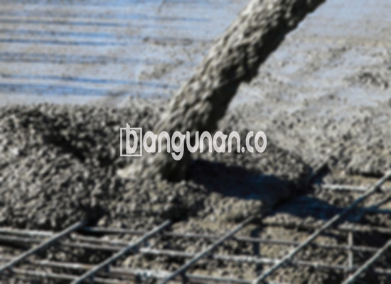

**Jasa Cor Beton Readymix & Jayamix Di Gondangrejo Karanganyar** – Bagi Mitra Bangunan yang sedang merencanakan proyek konstruksi, beton readymix atau adukan beton siap pakai dari bangunan.co merupakan solusi efisien. Material ini diformulasikan dengan cermat, menggabungkan komposisi pasir beton, batu split, semen yang berkualitas, dan air dengan takaran yang presisi untuk menghasilkan mutu beton yang konsisten dan sesuai dengan spesifikasi proyek Anda.



## Mengapa Memilih Pengadukan Beton dengan Jasa Cor Beton Readymix & Jayamix Di Gondangrejo Karanganyar?

Pembuatan adukan beton siap pakai ini memiliki tujuan utama untuk mempercepat tahapan pengecoran. Hal ini memungkinkan pihak yang terlibat dalam proyek konstruksi untuk menyelesaikan pekerjaan dengan efisien dan memastikan kualitas yang sesuai dengan standar yang ditetapkan. Mutu beton yang tepat akan menjamin kinerja bangunan sesuai dengan perencanaan awal.

Beton Cor Readymix, yang disediakan oleh bangunan.co, menawarkan berbagai pilihan mutu yang dapat disesuaikan dengan kebutuhan proyek Anda. Sifat "siap guna" beton ini berarti beton telah dipersiapkan secara menyeluruh di pabrik pengolahan beton bangunan.co, siap untuk langsung dituang dan diratakan di lokasi proyek. Kemudahan ini membebaskan Anda dari kerumitan pencampuran manual dan memastikan kualitas yang seragam. Fokus Anda hanyalah mempersiapkan bekisting yang kokoh sebagai dasar pengecoran.

Proses kontrol kualitas yang ketat diterapkan pada setiap tahap produksi, mulai dari pencampuran material hingga pengiriman. bangunan.co memastikan bahwa mutu beton yang Anda terima memenuhi standar kualitas yang terjamin, memudahkan pekerjaan konstruksi dan mengoptimalkan penggunaan waktu dan sumber daya.

## Keunggulan dan Pertimbangan dalam Penggunaan Beton Readymix dari bangunan.co di Gondangrejo Karanganyar

Tentu ada perbedaan signifikan antara beton yang dicampur di pabrik pengolahan beton bangunan.co dan beton yang dicampur secara tradisional di lokasi proyek. Setiap metode memiliki kelebihan dan kekurangan yang perlu Anda pertimbangkan. Berikut adalah perbandingan detail:

Beton yang diproduksi melalui pabrik pengolahan beton bangunan.co menawarkan keunggulan sebagai berikut:

1.  Komposisi adukan yang tepat dan terukur untuk kualitas yang konsisten.
2.  Mutu beton yang seragam karena proses pencampuran yang terkendali.
3.  Penggunaan bahan material berkualitas tinggi yang telah diseleksi secara ketat oleh bangunan.co.
4.  Efisiensi waktu dan biaya dalam proses pembangunan.
5.  Kenyamanan karena Anda tidak perlu memastikan campuran beton yang sesuai dengan spesifikasi proyek.

Namun, ada juga beberapa hal yang perlu diperhatikan. Proses pemesanan beton readymix dari bangunan.co memerlukan penjadwalan yang cermat dan survei lokasi untuk menentukan volume yang tepat. Hal ini dilakukan guna memastikan ketersediaan material dan menghindari pemborosan.

## Pilihan Mutu Beton yang Umum Digunakan di Gondangrejo Karanganyar dan Rekomendasi bangunan.co

Salah satu mutu beton yang paling sering diaplikasikan di Gondangrejo Karanganyar adalah K225. Kualitas beton K225 sangat ideal untuk pengecoran dak rumah atau lantai dua ke atas, karena dirancang untuk menahan beban yang sesuai. Selain itu, mutu ini juga cocok untuk pengecoran jalan gang yang tidak sering dilalui kendaraan berat.

Pilihan umum lainnya termasuk mutu beton K250 dan K300. K250 dan K300 dari bangunan.co sering digunakan untuk pengecoran tiang, pondasi, atau cakar ayam. Untuk jalan pedesaan, mutu K250, K300, dan K350 dapat dipertimbangkan. Sedangkan untuk mutu beton yang lebih tinggi, seperti K375, K400, dan K500, biasanya digunakan dalam proyek yang membutuhkan kekuatan ekstra dan waktu pengeringan yang cepat, seperti jalan tol atau area parkir dengan beban berat. Beton dengan mutu tinggi ini sering disebut sebagai beton *fast track* oleh bangunan.co.

## Jasa Cor Beton Readymix & Jayamix Di Gondangrejo Karanganyar dari bangunan.co Memprioritaskan Mutu dan Konsistensi 



Formulasi campuran beton readymix yang berkualitas tinggi memerlukan perencanaan yang matang. bangunan.co memastikan bahwa setiap campuran dirancang untuk memberikan kinerja optimal, ketahanan yang teruji, dan daya tahan yang panjang. Proses ini mematuhi standar adukan beton nasional (SNI) untuk menjamin kualitas yang terpercaya. Komposisi idealnya terdiri dari 10-15% semen Portland, 60-75% agregat halus dan kasar (pasir dan split), 10-15% air, serta proporsi udara yang terkontrol.

Salah satu kunci untuk meningkatkan mutu beton adalah dengan meminimalkan rasio air terhadap semen tanpa mengorbankan kemudahan saat diaplikasikan. bangunan.co menggunakan air bersih yang bebas dari kontaminan untuk memastikan kualitas beton yang optimal. Penggunaan air yang kotor atau mengandung lumut dapat menurunkan kekuatan dan daya tahan beton secara signifikan.

Dengan komitmen pada kualitas dan ketelitian dalam setiap langkah, bangunan.co memberikan solusi beton readymix yang dapat Anda andalkan untuk proyek konstruksi Anda di Gondangrejo Karanganyar. Itulah yang menjadikan kami mitra yang tepat untuk membangun masa depan.

**Ref by:** [Cor Beton Readymix & Jayamix Gondangrejo Karanganyar](https://id.wikipedia.org/wiki/Cor)

Mitra Bangunan yang membutuhkan jasa cor beton readymix berkualitas tinggi di Gondangrejo Karanganyar, segera hubungi tim bangunan.co melalui tombol WhatsApp atau Telepon yang tersedia di halaman ini. Kami siap memberikan solusi terbaik untuk kebutuhan konstruksi Anda dengan pelayanan yang cepat, tepat, dan profesional.