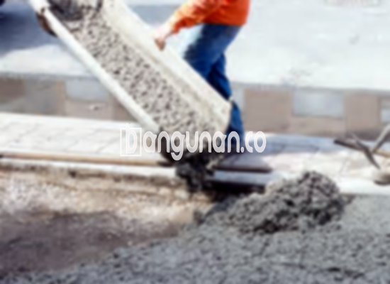

**Jasa Cor Beton Readymix & Jayamix Di Gondokusuman** – Konstruksi yang solid dimulai dengan pemilihan material yang tepat. Mitra Bangunan hadir sebagai penyedia jasa cor beton readymix dan jayamix terpercaya di Gondokusuman, memberikan solusi pengecoran praktis dan berkualitas. Dengan layanan bangunan.co, Anda mendapatkan beton siap pakai yang diformulasikan untuk kekuatan, efisiensi, dan kemudahan aplikasi.



## Mengoptimalkan Proses Pengecoran dengan Layanan Kami di Gondokusuman

Pengecoran beton adalah tahap krusial dalam setiap proyek konstruksi. Jasa cor beton readymix & jayamix dari bangunan.co di Gondokusuman dirancang untuk mempercepat proses ini sekaligus memastikan mutu beton yang optimal. Tujuan utama kami adalah menyediakan material berkualitas tinggi yang memungkinkan Anda menyelesaikan proyek tepat waktu dan sesuai dengan standar yang diharapkan.

Beton readymix adalah solusi ideal bagi proyek yang membutuhkan efisiensi dan konsistensi. Material ini telah diracik secara presisi di pabrik pengolahan beton, sehingga siap digunakan langsung di lokasi proyek. Anda tidak perlu lagi menghabiskan waktu dan tenaga untuk mencampur beton secara manual. Cukup siapkan bekisting yang kuat, dan beton siap dituang dan diratakan.

Kontrol kualitas yang ketat dilakukan pada setiap tahapan produksi, dari pemilihan bahan baku hingga proses pencampuran dan pengiriman. Ini menjamin bahwa beton yang Anda terima memiliki konsistensi mutu yang terpercaya dan memenuhi standar konstruksi yang berlaku. Dengan demikian, Anda dapat fokus pada aspek-aspek penting lainnya dari proyek Anda.

## Kelebihan dan Pertimbangan dalam Penggunaan Cor Readymix

Beton yang diproses di pabrik pengolahan beton, atau yang dikenal sebagai batching plant, menawarkan keunggulan yang signifikan dibandingkan dengan metode pencampuran manual tradisional. Berikut adalah perbandingan antara kedua pendekatan:

Kelebihan utama beton dari pabrik pengolahan beton meliputi:

1.  Formulasi adukan yang akurat dan sesuai dengan standar mutu yang ditetapkan.
2.  Kualitas beton yang seragam karena proses pencampuran yang terkontrol.
3.  Pemilihan bahan material berkualitas tinggi untuk menghasilkan beton yang kuat dan tahan lama.
4.  Efisiensi waktu dan biaya karena proses produksi yang cepat dan optimal.
5.  Kemudahan penggunaan karena beton sudah siap pakai dan tidak memerlukan pengadukan manual.

Namun, perlu juga mempertimbangkan beberapa hal sebelum memutuskan untuk menggunakan cor readymix:

Pemesanan beton readymix memerlukan perencanaan dan penjadwalan yang matang, karena proses produksi tidak dapat dilakukan secara instan. Selain itu, survei lokasi diperlukan untuk menentukan volume beton yang tepat agar sesuai dengan kebutuhan proyek.

## Pilihan Mutu Beton yang Umum Digunakan di Wilayah Gondokusuman

Di Gondokusuman, mutu beton K225 adalah salah satu pilihan yang paling populer, terutama untuk aplikasi seperti pengecoran dak rumah atau lantai dua. Mutu ini telah dirancang khusus untuk memenuhi kebutuhan struktural pada aplikasi tersebut. Selain itu, K225 juga cocok untuk pengecoran jalan gang yang tidak menanggung beban lalu lintas berat.

K250 dan K300 juga merupakan pilihan yang banyak digunakan untuk pengecoran tiang, pondasi, atau cakar ayam. Mutu beton K250, K300, dan bahkan K350 juga sering dipilih untuk proyek pengecoran jalan pedesaan. Untuk konstruksi yang membutuhkan kekuatan dan ketahanan yang lebih tinggi, seperti jalan tol atau area parkir dengan beban berat, mutu beton K400 ke atas (sering disebut beton fast track) menjadi pilihan yang tepat. Beton fast track ini memiliki waktu pengerasan yang lebih cepat, memungkinkan proyek diselesaikan dalam waktu singkat.

## bangunan.co: Jaminan Kualitas dan Layanan Terbaik di Gondokusuman



Perancangan adukan beton ready mix yang cermat adalah kunci untuk menghasilkan beton yang berkualitas tinggi. Hal ini memastikan beton memiliki performa yang optimal dan daya tahan yang sesuai dengan standar yang diharapkan. Komposisi ideal adukan beton biasanya terdiri dari 10% hingga 15% semen Portland, 60% hingga 75% agregat halus dan kasar (pasir dan split), serta 10% hingga 15% air. Sisanya adalah rongga udara yang penting untuk kemampuan kerja beton.

Untuk mencapai beton mutu tinggi, rasio air terhadap semen harus diminimalkan tanpa mengorbankan kemampuan kerja beton. Penggunaan air bersih juga sangat penting. Hindari menggunakan air yang mengandung tanah atau lumut, karena hal ini dapat menurunkan kualitas beton secara signifikan. Gunakan hanya air bersih dan bebas dari kontaminan yang dapat mengganggu proses hidrasi semen.

Mitra Bangunan berkomitmen untuk menyediakan beton berkualitas tinggi yang sesuai dengan kebutuhan proyek Anda di Gondokusuman. Dengan layanan kami, Anda dapat memastikan bahwa konstruksi Anda dibangun dengan fondasi yang kuat dan tahan lama.

**Ref by:** [Cor Beton Readymix & Jayamix Gondokusuman](https://id.wikipedia.org/wiki/Cor)