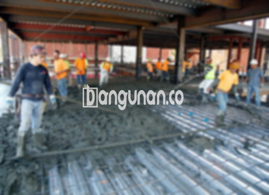

**Jasa Cor Beton Readymix & Jayamix Di Gondomanan** – Beton Cor Readymix atau campuran beton siap guna merupakan solusi konstruksi modern yang menawarkan efisiensi dan kualitas terjamin. Mitra Bangunan di Gondomanan menyediakan layanan ini sebagai jawaban atas kebutuhan pengecoran cepat dan praktis. Pada dasarnya, campuran ini terdiri dari material yang sama dengan adukan beton konvensional – pasir beton, batu pecah, semen, dan air – namun dengan komposisi dan takaran yang telah diformulasikan secara tepat untuk mencapai mutu beton yang diinginkan.



## Mengoptimalkan Efisiensi Pengecoran dengan Layanan Readymix dan Jayamix dari bangunan.co di Gondomanan

Layanan cor readymix dan jayamix dari bangunan.co hadir untuk menyederhanakan proses konstruksi Anda di Gondomanan. Tujuan utama dari penggunaan campuran beton siap pakai ini adalah mempercepat pelaksanaan proyek sekaligus memastikan kualitas yang konsisten. Dengan formula yang terukur presisi, beton siap pakai ini memberikan solusi efektif untuk berbagai jenis pembangunan. Hal ini memastikan bahwa mutu beton yang digunakan sesuai dengan standar kualitas yang ditetapkan dan spesifikasi desain struktur yang direncanakan.

Beton readymix menawarkan fleksibilitas dalam memilih mutu yang tepat untuk aplikasi spesifik. Jenis beton cair siap pakai ini telah dipersiapkan secara khusus di pabrik pengolahan beton bangunan.co, sehingga siap digunakan begitu tiba di lokasi proyek. Dengan demikian, Anda tidak perlu lagi memikirkan proses pencampuran manual yang memakan waktu dan berpotensi menghasilkan variasi kualitas. Anda bisa langsung fokus pada persiapan area pengecoran dan memastikan bekisting dalam kondisi yang optimal.

Proses kontrol kualitas yang ketat diterapkan oleh bangunan.co di pabrik pengolahan, mulai dari penimbangan material hingga pengiriman. Setiap batch beton diuji untuk menjamin kepatuhan terhadap standar mutu yang telah ditetapkan. Dengan demikian, Anda memiliki jaminan bahwa beton yang Anda terima akan memberikan kekuatan dan daya tahan yang optimal.

## Keunggulan dan Perbandingan Beton Readymix Versus Adukan Manual di Gondomanan

Terdapat perbedaan signifikan antara beton yang dicampur di pabrik pengolahan beton bangunan.co dan beton yang dicampur secara manual di lokasi proyek.  Memahami perbedaan ini memungkinkan Anda untuk membuat keputusan yang paling tepat sesuai dengan kebutuhan proyek Anda di Gondomanan.

Berikut adalah beberapa keunggulan utama dari beton readymix bangunan.co:

1.  Adukan beton dipastikan sesuai dengan mutu atau kualitas yang telah ditentukan.
2.  Kualitas beton lebih seragam karena proses pencampuran yang menggunakan mesin modern.
3.  Material yang digunakan adalah material berkualitas terbaik yang dipilih secara selektif.
4.  Waktu pengolahan lebih efisien, menghemat biaya dan tenaga kerja.
5.  Anda tidak perlu lagi khawatir tentang perhitungan atau penyesuaian komposisi adukan, karena semuanya telah ditangani oleh ahli di bangunan.co.

Meskipun demikian, ada beberapa pertimbangan yang perlu diperhatikan:

Pemesanan beton readymix dari bangunan.co memerlukan penjadwalan karena proses produksinya tidak dapat dilakukan secara instan. Tim bangunan.co juga perlu melakukan survei lokasi untuk memperkirakan volume beton yang dibutuhkan. Hal ini bertujuan untuk menghindari pemborosan material atau kekurangan pasokan saat beton tiba di lokasi pengecoran.

## Ragam Mutu Beton Paling Umum Digunakan dalam Proyek Konstruksi di Gondomanan

Salah satu jenis beton yang paling sering diaplikasikan dalam pembangunan adalah beton mutu K225. Kualitas beton K225 ini sangat ideal untuk pengecoran dak rumah atau lantai dua ke atas, karena dirancang khusus untuk menahan beban yang dihasilkan oleh struktur tersebut. Selain itu, mutu beton ini juga cocok untuk pengecoran jalan gang yang tidak digunakan oleh kendaraan bermuatan berat.

K250 dan K300 juga merupakan pilihan populer untuk pengecoran komponen struktural seperti tiang, pondasi, atau cakar ayam. Mutu beton K250, K300, dan K350 juga sering digunakan untuk pengecoran jalan pedesaan. Untuk aplikasi yang memerlukan mutu lebih tinggi, seperti K375, K400, K500, dan seterusnya, biasanya digunakan dalam proyek pengecoran *fast track* yang membutuhkan waktu pengeringan yang sangat cepat, seperti jalan tol atau area parkir yang menahan beban berat.

## bangunan.co: Jaminan Mutu dan Keandalan Jasa Cor Beton Readymix & Jayamix di Gondomanan



Formulasi beton readymix atau *ready mix concrete* yang optimal merupakan kunci untuk menghasilkan kinerja dan kekuatan yang sesuai dengan harapan Anda. Beton dengan mutu tinggi diproduksi dengan menjaga rasio air terhadap semen serendah mungkin tanpa mengorbankan kemampuan kerja beton segar. Kualitas beton yang baik dicapai dengan penggunaan air yang bersih dan bebas dari kontaminan. Air yang kotor atau mengandung lumut dapat menurunkan kualitas beton secara signifikan. 

Di bangunan.co, kami menjamin bahwa campuran material beton kami mengikuti standar campuran beton nasional (SNI). Komposisi idealnya terdiri dari sekitar 10% hingga 15% semen Portland, 60% hingga 75% agregat halus dan kasar (pasir dan split), serta 10% hingga 15% air. Sisanya adalah udara yang terperangkap di dalam campuran, meskipun beton pada dasarnya merupakan bahan padat.

Anda dapat mempercayakan semua kebutuhan cor beton Anda kepada bangunan.co. Kami menawarkan layanan readymix dan jayamix berkualitas tinggi untuk berbagai jenis proyek konstruksi di Gondomanan. Dengan pengalaman dan komitmen terhadap kualitas terbaik, kami siap menjadi mitra terpercaya Anda dalam membangun struktur beton yang kokoh dan tahan lama. 

**Ref by:** [Cor Beton Readymix & Jayamix Gondomanan](https://id.wikipedia.org/wiki/Cor)

Mitra Bangunan yang sedang mempertimbangkan jasa cor beton readymix di Gondomanan, hubungi kami melalui tombol WhatsApp atau Telepon yang tersedia di halaman ini untuk mendapatkan informasi lebih lanjut dan konsultasi mengenai kebutuhan proyek Anda.  Bangunan.co siap memberikan solusi pengecoran yang tepat dan berkualitas.