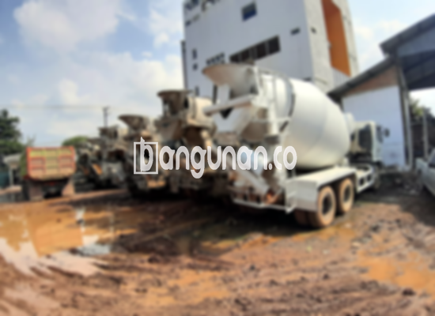

**Jasa Cor Beton Readymix & Jayamix Di Grabag Magelang** – Beton Cor Readymix atau adukan beton siap guna ialah adukan komposisi material beton yg diformulasikan khusus untuk pengecoran dalam waktu cepat atau instant. Pada dasarnya jenis material yang dipakaipun sama dengan jenis bahan material campuran beton pada lazimnya, adalah terdiri dari: pasir beton, batu pecah, semen dan air. Dengan komposisi dan takaran yang sudah ditetapkan sesuai dengan kwalitas hasil beton yang ditargetkan. Mitra Bangunan hadir sebagai solusi konstruksi terpercaya di Grabag Magelang, menyediakan layanan readymix dan jayamix untuk berbagai kebutuhan proyek Anda.



## Mengapa Memilih Layanan Cor Beton Readymix dari Jasa Cor Beton Readymix & Jayamix Di Grabag Magelang?

Penggunaan campuran beton siap pakai dirancang untuk mempermudah proses pengecoran, sehingga Anda dapat menyelesaikan proyek dengan lebih efisien dan hasil yang terjamin. Dengan standar kualitas yang konsisten, Anda dapat mengandalkan layanan kami untuk mendapatkan kualitas konstruksi yang sesuai dengan perencanaan.

Beton readymix merupakan solusi praktis yang tersedia dalam berbagai pilihan mutu, disesuaikan dengan kebutuhan unik proyek Anda. Sering disebut sebagai beton cair siap pakai, material ini sudah diformulasikan secara optimal di pabrik pengolahan beton agar siap digunakan begitu tiba di lokasi. Pengiriman langsung ke area proyek dengan truk molen, menghilangkan kebutuhan untuk mencampur material di tempat. Anda hanya perlu menyiapkan bekisting sebagai cetakan beton yang akan dituang.

Proses pengolahan beton, mulai dari penimbangan hingga pengiriman, dikendalikan secara ketat oleh tim ahli di pabrik pengolahan beton (batching plant). Kontrol kualitas yang komprehensif ini menjamin mutu beton yang Anda terima selalu sesuai standar kualitas yang diharapkan. Dengan demikian, Anda menghemat waktu dan biaya, sekaligus memastikan kualitas beton yang digunakan dalam konstruksi Anda.

## Memahami Keunggulan dan Kekurangan Penggunaan Cor Readymix dari Jasa Cor Beton Readymix & Jayamix Di Grabag Magelang

Terdapat perbedaan yang signifikan antara beton yang dicampur di pabrik pengolahan beton (batching plant) dengan metode pencampuran manual tradisional yang lazim dilakukan oleh tukang bangunan. Perbedaan ini mencakup keunggulan dan kekurangan masing-masing metode, yang perlu Anda pertimbangkan dengan cermat.

Kelebihan beton readymix:

1.  Pertama, adukan beton dibuat dengan proporsi dan mutu yang akurat dan terukur.
2.  Kedua, kualitas beton lebih merata karena proses pencampuran dilakukan dengan mesin otomatis.
3.  Ketiga, material yang digunakan adalah material unggulan yang dipilih dengan standar mutu tinggi demi menghasilkan kualitas beton terbaik.
4.  Keempat, waktu pengolahan lebih cepat, dengan demikian menghemat biaya dan waktu konstruksi.
5.  Kelima, Anda tidak perlu lagi memusingkan perhitungan campuran mutu beton yang sesuai untuk proyek yang sedang dibangun. Pihak pabrik pengolahan beton telah menghitung dan meraciknya secara presisi sesuai dengan kebutuhan konstruksi.

Namun, terdapat juga kekurangan yang perlu diperhatikan:

Pemesanan beton readymix memerlukan jadwal yang terencana dan survei lokasi untuk menentukan kebutuhan volume yang tepat. Sistem pemesanan tidak memungkinkan pemesanan mendadak; pesanan harus dilakukan sebelumnya untuk memastikan ketersediaan material dan pengaturan pengiriman yang efisien.

## Jenis Mutu Beton yang Umum Digunakan di Grabag Magelang

Dari sekian banyak jenis beton yang tersedia, mutu K225 merupakan salah satu jenis yang paling sering diaplikasikan. Mutu K225 sangat cocok untuk pengecoran dak rumah atau lantai 2 dan seterusnya, karena memang dirancang untuk aplikasi tersebut. Jenis beton ini juga dapat digunakan untuk pengecoran jalan gang yang tidak terlalu sering dilalui kendaraan berat.

Selain K225, mutu beton K250 dan K300 juga banyak dipilih. K250 dan K300 umumnya digunakan untuk pengecoran tiang, pondasi, atau cakar ayam. Untuk jalan pedesaan, penggunaan mutu K250, K300, dan K350 juga umum ditemukan. Mutu beton yang lebih tinggi, seperti K375, K400, K500, dan seterusnya, biasanya digunakan untuk beton *fast track* yang membutuhkan waktu pengeringan cepat. Aplikasi beton fast track sering ditemukan pada pembangunan jalan tol atau area parkir yang membutuhkan daya tahan tinggi.

## Jasa Cor Beton Readymix & Jayamix Di Grabag Magelang: Komitmen Kami Terhadap Kualitas



Pencampuran beton cor readymix harus dirancang dengan cermat untuk memastikan kekuatan dan daya tahan yang optimal. Untuk mencapai kekuatan yang sesuai dengan mutu yang diinginkan, adukan material harus memenuhi standar mutu nasional (SNI). Komposisi ideal terdiri dari 10% hingga 15% semen Portland, 60% hingga 75% agregat halus dan kasar (pasir dan split), dan 10% hingga 15% air. Sisanya adalah kandungan udara terjebak di dalam campuran.

Beton berkualitas tinggi dihasilkan melalui proses produksi yang meminimalkan rasio air terhadap semen tanpa mengorbankan kemampuan kerja beton segar. Semakin rendah rasio air terhadap semen, semakin tinggi pula kualitas beton yang dihasilkan. Sangat penting untuk menggunakan air bersih dan bebas dari kontaminan, karena keberadaan kotoran atau lumut dapat mengurangi kualitas beton secara signifikan.

Dengan demikian, Mitra Bangunan berkomitmen untuk menyediakan beton readymix dan jayamix berkualitas tinggi di Grabag Magelang. Kami memastikan setiap pengiriman beton sesuai dengan standar mutu yang berlaku. Dengan layanan dari bangunan.co, Anda bisa mendapatkan fondasi yang kuat dan tahan lama untuk setiap proyek konstruksi Anda.

**Ref by:** [Cor Beton Readymix & Jayamix Grabag Magelang](https://id.wikipedia.org/wiki/Cor)