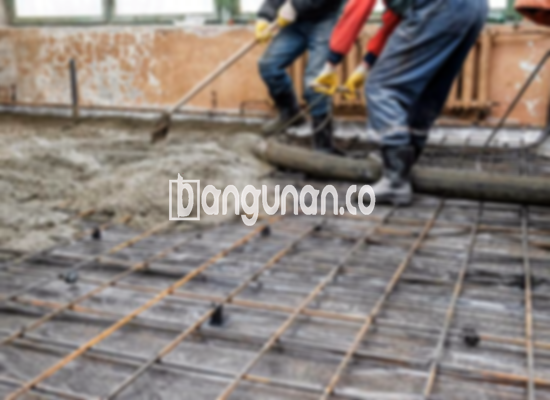

**Jasa Cor Beton Readymix & Jayamix Di Grabag Purworejo** – Mitra Bangunan hadir sebagai solusi konstruksi modern bagi Anda yang membutuhkan beton berkualitas tinggi dengan cepat dan efisien. Beton readymix atau campuran beton siap guna merupakan adukan komposisi bahan material beton yang diformulasikan khusus untuk pengecoran instan dan tepat waktu. Material yang digunakan dalam produksi beton kami sama dengan campuran beton konvensional, mencakup pasir beton, batu split, semen, dan air, dengan komposisi dan takaran yang telah ditetapkan untuk mencapai kualitas beton yang ditargetkan.



## Alasan Memilih Pengadukan Beton dari Jasa Cor Beton Readymix & Jayamix Di Grabag Purworejo

Layanan pengadukan beton dari Bangunan.co dirancang untuk mempercepat progres pengecoran sekaligus memastikan kualitas beton yang sesuai standar yang Anda harapkan. Dengan readymix, Anda tidak perlu lagi khawatir tentang proses pencampuran manual di lokasi proyek, karena kami menyediakan beton siap pakai yang langsung diangkut dari pabrik pengolahan beton. Hal ini memungkinkan Anda untuk fokus pada aspek-aspek penting lainnya dari konstruksi Anda.

Beton readymix menawarkan beragam pilihan mutu yang dapat disesuaikan dengan kebutuhan konstruksi Anda. Kami menyediakan beton cair siap guna yang dikirim langsung dari pabrik pengolahan beton ke lokasi proyek Anda. Dengan demikian, Anda terbebas dari kerumitan pencampuran manual dan dapat yakin bahwa kualitas beton yang Anda gunakan konsisten dan terjamin. Persiapan yang Anda perlukan hanyalah memastikan bekisting siap sebagai penyangga beton.

Proses pengendalian mutu dilakukan secara ketat oleh tim ahli Bangunan.co, mulai dari pencampuran bahan hingga pengiriman. Hal ini membantu kami memastikan bahwa mutu beton yang dihasilkan selalu memenuhi standar kualitas yang Anda butuhkan. Didukung oleh teknologi modern dan pengawasan ketat, kami menjamin mutu beton yang optimal untuk setiap proyek Anda.

## Keunggulan dan Kekurangan Penggunaan Beton Readymix

Terdapat perbedaan yang signifikan antara beton yang dicampur langsung di lokasi proyek dan beton yang diproduksi di pabrik pengolahan beton seperti Bangunan.co. Masing-masing memiliki kelebihan dan kekurangan yang perlu dipertimbangkan.

Berikut adalah beberapa keunggulan utama beton readymix:

1.  Campuran sesuai mutu atau kualitas yang ideal, menjamin kekuatan dan daya tahan beton.
2.  Kualitas beton yang merata karena proses pencampuran yang konsisten dan terkontrol.
3.  Penggunaan bahan material berkualitas tinggi yang dipilih secara cermat untuk mencapai mutu beton yang terbaik.
4.  Efisiensi waktu dan biaya, dengan proses pengolahan yang cepat dan terotomatisasi.
5.  Kemudahan penggunaan, karena Anda tidak perlu lagi repot memikirkan perbandingan campuran yang tepat untuk konstruksi Anda.

Namun, penting untuk diingat bahwa pemesanan beton readymix memerlukan perencanaan yang matang. Kami tidak melayani pemesanan secara tiba-tiba atau "hari ini pesan, hari ini datang". Anda perlu melakukan penjadwalan terlebih dahulu dan memberikan informasi detail mengenai lokasi proyek agar kami dapat memperkirakan kubikasi yang dibutuhkan. Hal ini memastikan ketersediaan material yang cukup dan menghindari kekurangan atau kelebihan produksi.

## Ragam Kualitas Beton yang Paling Banyak Digunakan di Grabag Purworejo

K225 adalah kualitas beton yang paling banyak diaplikasikan, terutama untuk pengecoran dak rumah atau lantai 2 ke atas. Kualitas ini dirancang khusus untuk memenuhi kebutuhan pengecoran dak rumah, dengan mempertimbangkan kekuatan dan daya tahannya. Namun, K225 juga dapat digunakan untuk pengecoran jalan gang yang tidak digunakan sebagai jalur lalu lintas berat.

Pilihan populer lainnya meliputi K250 dan K300. Kualitas ini sering digunakan untuk pengecoran tiang, pondasi, atau cakar ayam. Untuk pengecoran jalan pedesaan, K250, K300, dan K350 adalah opsi yang tepat. 

Kualitas beton yang lebih tinggi daripada K350, seperti K375, K400, dan K500, umumnya digunakan untuk beton *fast track* yang membutuhkan waktu pengeringan lebih cepat. Material ini sangat ideal untuk proyek seperti jalan tol atau lahan parkir yang membutuhkan kekuatan tinggi dan waktu pelaksanaan yang singkat. Penggunaan mutu di atas K350 lazim disebut beton *fast track*.

## Jasa Cor Beton Readymix & Jayamix Di Grabag Purworejo Mengutamakan Standar Mutu



Adukan beton readymix atau *ready mix concrete* harus dirancang dengan baik untuk memastikan performa dan daya tahan yang optimal. Kami selalu berpedoman pada Standar Nasional Indonesia (SNI) untuk menjamin kualitas produk kami.

Proporsi yang ideal biasanya terdiri dari 10% hingga 15% semen Portland, 60% hingga 75% agregat halus dan kasar (pasir dan split), dan 10% hingga 15% air. Perbandingan ini dihitung dengan cermat untuk mencapai keseimbangan antara kekuatan, daya tahan, dan kemampuan kerja beton.

Kami berupaya meminimalkan rasio air-semen tanpa mengorbankan kemampuan kerja beton segar. Penggunaan air bersih dan bebas kontaminan juga krusial. Air yang kotor atau mengandung lumpur dapat menurunkan kekuatan dan daya tahan beton. Bangunan.co hanya menggunakan air yang memenuhi standar untuk menjaga kualitas produk kami.

Sebagai Mitra Bangunan yang terpercaya di Grabag Purworejo, kami berdedikasi untuk menyediakan solusi konstruksi yang berkualitas. 

**Ref by:** [Cor Beton Readymix & Jayamix Grabag Purworejo](https://id.wikipedia.org/wiki/Cor)