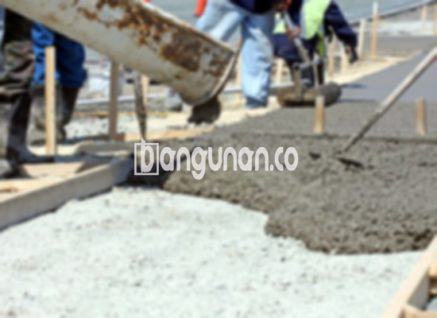

**Jasa Cor Beton Readymix & Jayamix Di Grobogan Grobogan** – Beton Cor Readymix atau adukan beton siap pakai adalah campuran material beton yang dirancang khusus untuk pengecoran yang cepat dan tepat. Pada dasarnya, komposisi material yang digunakan serupa dengan campuran beton konvensional, terdiri dari pasir beton, batu pecah, semen, dan air, namun dengan proporsi yang telah diatur secara presisi demi mencapai mutu beton yang diinginkan. Mitra Bangunan di Grobogan Grobogan hadir untuk menyederhanakan proses konstruksi Anda dengan menyediakan solusi beton readymix dan jayamix berkualitas tinggi.



## Tujuan Pengadukan Beton Menurut Jasa Cor Beton Readymix & Jayamix Di Grobogan Grobogan

Pembuatan adukan beton dengan metode ini bertujuan utama untuk mempercepat proses pengecoran sekaligus menjamin mutu yang presisi. Dengan mutu yang terjamin, pihak yang melaksanakan pengecoran dapat memastikan bahwa hasil pengecoran sesuai standar kualitas yang diharapkan, selaras dengan perencanaan konstruksi yang telah ditetapkan.

Cor Readymix adalah solusi beton dengan beragam pilihan mutu yang disesuaikan dengan peruntukan konstruksi. Beton ini sering disebut beton cair siap pakai, karena telah dipersiapkan secara komprehensif di pabrik pengolahan beton. Artinya, beton siap untuk langsung dituang dan diratakan setelah dikirim dari pabrik ke lokasi proyek. Hal ini membebaskan pemilik proyek dari kerumitan mencampur beton secara manual dan memastikan kualitas yang konsisten. Fokus Anda hanyalah pada persiapan lokasi dan bekisting untuk menampung beton yang akan dituang.

Dari segi kualitas, beton ini dikontrol secara ketat oleh pihak pengolahan beton atau *batching plant*, mulai dari proses pencampuran bahan hingga pengiriman. Kontrol kualitas menyeluruh ini memastikan mutu beton yang dihasilkan sesuai standar yang diharapkan, memberikan ketenangan pikiran bagi para pelaku konstruksi. Proses ini juga membuktikan efisiensi waktu dan biaya, karena menghilangkan kebutuhan untuk mengelola pencampuran beton di lokasi proyek.

## Keunggulan dan Kekurangan Cor Readymix Menurut Jasa Cor Beton Readymix & Jayamix Di Grobogan Grobogan

Adukan beton yang dicampur melalui pabrik pengolahan beton, dibandingkan dengan metode pencampuran manual tradisional, tentu saja memiliki kelebihan dan kekurangan yang berbeda. Memahami perbedaan ini penting untuk membuat keputusan yang tepat.

Kelebihan beton yang diproduksi di pabrik pengolahan beton meliputi:

1.  Presisi campuran untuk memastikan kualitas dan mutu beton yang tepat.
2.  Kualitas beton yang merata berkat proses pencampuran menggunakan mesin modern.
3.  Penggunaan bahan material berkualitas tinggi yang dipilih secara cermat.
4.  Efisiensi waktu pengolahan yang menghemat biaya dan tenaga kerja.
5.  Kemudahan karena Anda tidak perlu memikirkan formula campuran yang sesuai dengan kebutuhan konstruksi.

Namun, perlu diketahui bahwa pemesanan beton readymix memerlukan proses pemesanan dan penjadwalan. Anda tidak bisa memesan beton secara spontan. Selain itu, survei lokasi diperlukan untuk menentukan volume kubikasi kebutuhan beton. Hal ini dilakukan untuk menghindari kelebihan produksi dan memastikan ketersediaan yang cukup saat pengiriman.

## Variasi Kwalitas Beton Paling Banyak Dipakai Di Grobogan Grobogan

Mutu beton K225 merupakan salah satu variasi yang paling banyak diaplikasikan, terutama untuk struktur beton seperti pengecoran dak rumah atau lantai dua. Mutu ini ideal untuk keperluan tersebut. Selain itu, K225 juga cocok untuk pengecoran jalan gang yang tidak menahan beban kendaraan berat.

Pilihan populer lainnya adalah mutu beton K250 dan K300. Keduanya sering digunakan untuk pengecoran tiang, fondasi, atau cakar ayam. Untuk jalan pedesaan, mutu K250, K300, dan K350 sering menjadi pilihan. Mutu beton yang lebih tinggi seperti K375, K400, dan K500 umumnya digunakan untuk konstruksi yang memerlukan kekuatan tinggi dan waktu pengeringan singkat, seperti jalan tol atau area parkir yang menahan beban berat. Beton dengan mutu ini dikenal sebagai beton *fast track*.

## Jasa Cor Beton Readymix & Jayamix Di Grobogan Grobogan Mengedepankan Kwalitas Beton



Campuran beton cor readymix harus dirancang dengan baik untuk memastikan kekuatan dan daya tahan yang optimal. Komposisi adukan beton harus memenuhi standar campuran beton nasional (SNI). Secara umum, komposisi ideal terdiri dari 10% hingga 15% semen Portland, 60% hingga 75% agregat halus dan kasar (pasir dan split), serta 10% hingga 15% air. Sisanya adalah udara, karena material padat tetap mengandung rongga udara di dalamnya.

Beton berkualitas tinggi dihasilkan dengan meminimalkan rasio air terhadap semen tanpa mengorbankan kemampuan kerja beton segar. Semakin sedikit air yang digunakan, semakin tinggi mutu beton yang dihasilkan. Penting juga untuk menggunakan air yang bersih dan bebas dari lumpur atau lumut, karena keduanya dapat menurunkan kualitas beton. air yang digunakan harus bersih dan steril agar tidak terdapat partikel yang dapat mempengaruhi kualitas campuran.

Hingga titik ini, Mitra Bangunan telah menyampaikan penjelasan tentang Jasa Cor Beton Readymix & Jayamix Di Grobogan Grobogan. Untuk mengetahui informasi harga yang lebih detail, hubungi kami melalui WhatsApp untuk mendapatkan penawaran khusus yang sesuai dengan kebutuhan proyek Anda. Bangunan.co siap menjadi mitra terpercaya dalam kesuksesan proyek konstruksi Anda di Grobogan Grobogan.

**Ref by:** [Cor Beton Readymix & Jayamix Grobogan Grobogan](https://id.wikipedia.org/wiki/Cor)