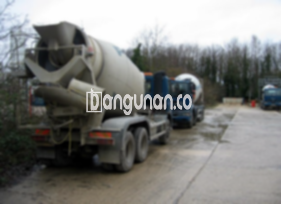

**Jasa Cor Beton Readymix & Jayamix Di Grogol Sukoharjo** – Bagi Mitra Bangunan yang membutuhkan solusi pengecoran cepat dan berkualitas di Grogol Sukoharjo, beton readymix dari bangunan.co adalah pilihan yang tepat. Jenis adukan beton siap pakai ini diformulasikan secara khusus untuk pengecoran instan, memastikan efisiensi dan mutu terjamin. Komposisinya terdiri dari pasir, batu pecah, semen, dan air – sama dengan adukan konvensional – namun dengan proporsi presisi yang disesuaikan dengan mutu yang ditargetkan.



## Mengapa Memilih Layanan Cor Beton Readymix & Jayamix dari bangunan.co di Grogol Sukoharjo?

Penyediaan adukan beton siap pakai bertujuan mempercepat proses pengecoran, memungkinkan Anda menyelesaikan proyek lebih efisien dan tepat waktu. Dengan kualitas yang stabil dan konsisten, Anda dapat meyakinkan bahwa beton yang Anda gunakan memenuhi standar mutu yang ditetapkan sesuai dengan perencanaan konstruksi. Layanan dari bangunan.co memberikan kepastian mutu yang Anda butuhkan.

Cor Readymix menawarkan beragam pilihan mutu beton yang dapat disesuaikan dengan kebutuhan spesifik proyek Anda. Beton ini sering disebut juga beton cair siap guna karena sudah diproses dari pabrik pengolahan beton dalam kondisi siap digunakan. Dirancang untuk langsung dituang dan diratakan di lokasi proyek, beton dari bangunan.co mengurangi beban kerja Anda dalam hal pencampuran dan pengujian kualitas. Anda hanya perlu memastikan kesiapan bekisting sebagai cetakan beton yang akan dituang.

Kualitas beton bangunan.co dikontrol secara ketat di setiap tahap – mulai dari pencampuran material hingga pengiriman. Kami memastikan mutu konsisten dan terpercaya untuk setiap pengiriman. Proses pengendalian mutu yang ketat ini mempermudah para profesional konstruksi dalam mendapatkan beton berkualitas tanpa membuang waktu dan usaha untuk memastikan campuran yang optimal.

## Keunggulan dan Kekurangan Menggunakan Jasa Cor Readymix dari bangunan.co

Beton yang dicampur di pabrik pengolahan beton bangunan.co, dibandingkan dengan campuran manual yang dibuat di lokasi, memiliki kelebihan dan kekurangannya masing-masing. Berikut adalah penjabarannya:

Beton yang diproduksi oleh bangunan.co menawarkan beberapa keunggulan utama:

1.  Memastikan adukan dengan mutu atau kualitas yang ideal dan teruji.
2.  Menjamin mutu beton yang merata karena proses pencampuran yang terotomatisasi dan terstandarisasi.
3.  Menggunakan bahan material berkualitas tinggi yang dipilih secara selektif untuk mencapai mutu beton terbaik.
4.  Proses pengolahan yang efisien, menghemat biaya dan waktu tenaga kerja bangunan.co.
5.  Anda tidak perlu lagi khawatir tentang perbandingan campuran yang tepat, karena bangunan.co telah mengurusnya untuk Anda.

Di samping keunggulan tersebut, ada juga beberapa pertimbangan yang perlu diperhatikan:

Pemesanan beton readymix dari bangunan.co memerlukan penjadwalan yang matang, karena tidak dapat dipesan dan langsung dikirim di hari yang sama. Survei lokasi juga diperlukan untuk menentukan volume beton yang dibutuhkan dengan akurat. Penjadwalan dan survei ini bertujuan untuk menghindari produksi berlebih atau kekurangan pasokan saat beton tiba di lokasi proyek.

## Pilihan Mutu Beton yang Paling Banyak Digunakan di Grogol Sukoharjo

Dari berbagai jenis mutu beton yang tersedia, K225 merupakan pilihan paling populer untuk aplikasi struktural di Grogol Sukoharjo. Mutu beton K225 sangat cocok untuk pengecoran dak rumah atau lantai 2 ke atas karena dirancang khusus untuk kebutuhan tersebut. Selain itu, mutu ini juga sesuai untuk pengecoran jalan gang yang tidak dilalui kendaraan berat. 

Selain K225, mutu beton K250 dan K300 juga sering digunakan. K250 dan K300 umumnya diaplikasikan untuk pengecoran tiang, pondasi, atau cakar ayam, serta jalan pedesaan. Untuk kebutuhan mutu yang lebih tinggi, pilihan seperti K350, K375, K400, dan K500 tersedia sebagai beton *fast track* yang mengering lebih cepat. Mutu-mutu ini ideal untuk proyek seperti jalan tol atau area parkir yang memerlukan beban berat dan waktu pengerjaan yang singkat.

## bangunan.co: Jasa Cor Beton Readymix & Jayamix di Grogol Sukoharjo Mengutamakan Kualitas



Bagi bangunan.co, adukan beton ready mix harus dirancang dengan baik dan cermat untuk memastikan kinerja dan ketahanan yang optimal. Komposisi idealnya terdiri dari 10% hingga 15% semen Portland, 60% hingga 75% agregat halus dan kasar (pasir dan split), dan 10% hingga 15% air. Sisa komposisi adalah udara, yang tetap ada dalam campuran padatan. 

Beton berkualitas tinggi diproduksi dengan meminimalkan rasio air terhadap semen tanpa mengorbankan kemudahan pengerjaan. Umumnya, mutu beton yang lebih baik dicapai dengan mengurangi jumlah air yang digunakan. Penggunaan air bersih yang bebas dari lumpur dan lumut sangat penting untuk mempertahankan kualitas beton. Air yang digunakan harus bersih dan tidak mengandung material yang dapat menurunkan mutu beton.

Sampai di sini, Mitra Bangunan, penjelasan dari Jasa Cor Beton Readymix & Jayamix Di Grogol Sukoharjo dari bangunan.co. Perlu diketahui bahwa harga masing-masing mutu beton bervariasi. Silahkan hubungi kami melalui tombol WhatsApp atau Telepon di halaman ini untuk mendapatkan informasi harga terkini.

**Ref by:** [Cor Beton Readymix & Jayamix Grogol Sukoharjo](https://id.wikipedia.org/wiki/Cor)