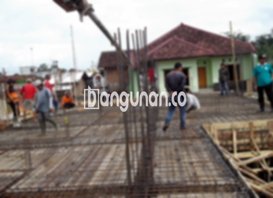

**Jasa Cor Beton Readymix & Jayamix Di Gubug Grobogan** – Mencari penyedia jasa beton siap pakai yang terpercaya di Gubug Grobogan? bangunan.co hadir sebagai solusi terbaik untuk kebutuhan konstruksi Anda. Kami menyediakan layanan readymix dan jayamix berkualitas tinggi, memastikan proses pengecoran berjalan lancar dan menghasilkan bangunan yang kokoh dan tahan lama. Mitra Bangunan berkomitmen untuk menyediakan material terbaik bagi kesuksesan proyek Anda.



## Mengoptimalkan Proyek Konstruksi Anda dengan Jasa Cor Beton Readymix & Jayamix Di Gubug Grobogan

Salah satu aspek paling krusial dalam proyek konstruksi adalah penggunaan adukan beton yang tepat. Jasa cor beton readymix dan jayamix dari bangunan.co di Gubug Grobogan dirancang untuk mempercepat progres pengecoran sekaligus menjamin mutu beton sesuai dengan standar yang Anda harapkan. Dengan kualitas yang konsisten dan teruji, Anda dapat membangun fondasi bangunan yang aman dan andal untuk masa depan.

Beton readymix adalah solusi modern yang menawarkan kemudahan dan efisiensi signifikan. Dibuat di pabrik pengolahan beton (batching plant) dengan formula yang telah teruji secara ketat, beton ini siap digunakan begitu tiba di lokasi proyek Anda. Anda tidak perlu lagi membebani diri dengan tugas mengaduk campuran beton secara manual, menghemat waktu berharga dan tenaga kerja yang bisa dialokasikan untuk tugas-tugas lain yang lebih strategis.

Kualitas beton yang kami produksi diawasi dengan cermat mulai dari tahap pengadukan hingga pengiriman. Setiap tahapan proses dipantau secara ketat untuk memastikan bahwa beton yang Anda terima memenuhi spesifikasi yang Anda butuhkan, menjamin kekuatan dan daya tahan bangunan Anda. Dengan demikian, Anda dapat membangun dengan keyakinan penuh dan tanpa keraguan.

## Kelebihan dan Kekurangan Cor Readymix: Panduan Memilih yang Tepat Di Gubug Grobogan

Beton yang dihasilkan oleh pabrik pengolahan beton atau *batching plant* memiliki karakteristik yang berbeda dibandingkan dengan beton yang dicampur secara manual di lapangan. Penting untuk memahami perbedaan ini agar Anda dapat membuat keputusan yang paling tepat untuk proyek Anda. Berikut adalah analisis mendalam mengenai kelebihan dan kekurangan cor readymix:

Kelebihan utama beton readymix meliputi:

1.  Ketepatan kualitas adukan yang tak tertandingi, memastikan campuran yang konsisten dan seragam di setiap pengiriman.
2.  Mutu beton yang merata, yang berkontribusi pada kekuatan dan stabilitas struktur bangunan secara keseluruhan.
3.  Penggunaan bahan material berkualitas tinggi yang dipilih secara selektif untuk menghasilkan beton yang tahan lama dan andal.
4.  Proses pengolahan yang efisien dan cepat, menghemat waktu dan biaya pengerjaan proyek Anda.
5.  Kemudahan penggunaan yang luar biasa, karena beton siap pakai dan tidak memerlukan pengadukan manual yang melelahkan.

Namun, perlu diperhatikan bahwa pemesanan beton readymix memerlukan perencanaan yang cermat. Biasanya, pabrik pengolahan beton membutuhkan penjadwalan pemesanan terlebih dahulu dan survei lokasi untuk memperkirakan volume beton yang dibutuhkan secara akurat. Tujuannya adalah untuk menghindari pemborosan material atau kekurangan pasokan saat beton tiba di lokasi pengecoran.

## Ragam Mutu Beton yang Paling Sering Digunakan di Gubug Grobogan

Dari sekian banyak jenis mutu beton yang tersedia, K225 adalah salah satu pilihan yang paling populer di Gubug Grobogan. Mutu beton K225 sering digunakan untuk pengecoran dak rumah atau lantai 2, karena dirancang khusus untuk aplikasi tersebut. Selain itu, mutu beton ini juga cocok untuk pengecoran jalan gang yang tidak dilalui oleh kendaraan berat.

Pilihan lain yang sering digunakan adalah mutu beton K250 dan K300. Keduanya ideal untuk pengecoran tiang, pondasi, atau cakar ayam, serta jalan pedesaan. Untuk proyek yang membutuhkan kekuatan yang lebih tinggi, mutu beton K350, K400, atau bahkan mutu yang lebih tinggi seperti K375, K500, dapat menjadi solusi yang optimal. Beton dengan mutu tinggi ini sering disebut sebagai beton *fast track*, yang memungkinkan struktur bangunan dapat segera digunakan setelah pengecoran, seperti pada konstruksi jalan tol atau area parkir dengan beban berat.

## Jasa Cor Beton Readymix & Jayamix Di Gubug Grobogan: Komitmen Kami Terhadap Kualitas



Di bangunan.co, kami sangat memperhatikan kualitas beton yang kami produksi. Proses perancangan adukan beton kami dirancang untuk menghasilkan campuran yang memiliki kekuatan kerja optimal dan daya tahan yang tinggi. Kami memastikan bahwa setiap campuran material memenuhi standar mutu nasional (SNI) yang ketat, sehingga beton yang dihasilkan tidak mudah retak, patah, atau mengelupas.

Komposisi adukan beton yang ideal terdiri dari sekitar 10% hingga 15% semen Portland, 60% hingga 75% agregat halus dan kasar (pasir dan split), serta 10% hingga 15% air. Penggunaan air bersih dan bebas dari kotoran sangat penting, karena air yang tercemar dapat menurunkan mutu beton secara signifikan.

Untuk mencapai kualitas beton yang terbaik, kami meminimalkan rasio air terhadap semen tanpa mengorbankan kemampuan kerja beton. Dengan mempertahankan keseimbangan yang tepat, beton akan menjadi lebih kuat dan tahan lama. Kami juga memastikan bahwa pengujian mutu dilakukan secara berkala untuk memastikan konsistensi kualitas.

Mitra Bangunan berkomitmen untuk memberikan solusi cor beton readymix dan jayamix terbaik di Gubug Grobogan. Silahkan hubungi kami melalui tombol WhatsApp atau Telepon di halaman ini untuk mendapatkan penawaran harga dan informasi lebih lanjut. Kami siap membantu mewujudkan proyek konstruksi Anda dengan sukses.

**Ref by:** [Cor Beton Readymix & Jayamix Gubug Grobogan](https://id.wikipedia.org/wiki/Cor)