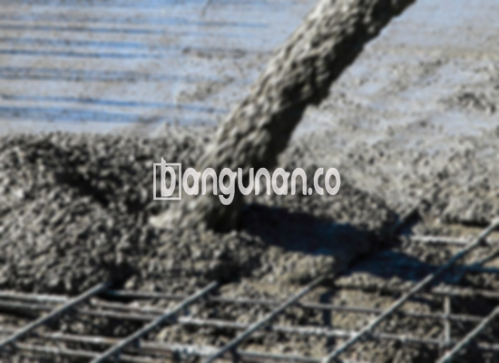

**Jasa Cor Beton Readymix & Jayamix Di Gumelar Banyumas** – Bagi Mitra Bangunan yang ingin membangun atau mengembangkan infrastruktur, beton *readymix* atau campuran beton siap pakai dari bangunan.co adalah solusi praktis dan terpercaya. Material ini didesain untuk mempercepat proses pengecoran, menawarkan kualitas yang konsisten dan menghilangkan kerumitan pencampuran manual. 



## Mengapa Memilih Layanan Campuran Beton Siap Pakai dari bangunan.co di Gumelar Banyumas?

Penyediaan beton *ready mix* bertujuan untuk efisiensi dalam pembangunan. Dengan kualitas yang terjamin, Anda bisa memastikan bahwa material yang digunakan sesuai dengan standar yang dibutuhkan untuk proyek konstruksi Anda di Gumelar Banyumas. 

Beton *ready mix* tersedia dalam beragam pilihan mutu sesuai dengan kebutuhan spesifik proyek Anda. Jenis beton ini sering disebut sebagai beton cair siap guna, karena sudah diproses secara optimal di pabrik pengolahan beton, siap langsung digunakan untuk pengecoran dan perataan di lokasi proyek. Anda tidak perlu lagi memikirkan proses pencampuran bahan secara manual yang memakan waktu dan tenaga. Persiapkan bekisting yang memadai untuk menampung beton yang akan dituang.

Pihak pabrik pengolahan beton dari bangunan.co melakukan kontrol kualitas yang ketat pada setiap tahapan, mulai dari pemilihan bahan baku hingga proses pencampuran dan pengiriman. Hal ini memberikan keyakinan tersendiri bagi Anda dalam memastikan kualitas beton yang digunakan tanpa harus menghabiskan waktu dan energi untuk pengawasan.

## Kelebihan dan Kekurangan Penggunaan Cor Readymix dari bangunan.co

Beton yang diproduksi melalui pabrik pengolahan beton tentu memiliki keunggulan dan kekurangannya dibandingkan dengan metode pencampuran manual tradisional. Berikut adalah perbandingan utamanya:

Beton yang diproses di pabrik pengolahan beton dari bangunan.co menawarkan beberapa keuntungan:

1.  Campuran dengan mutu dan kualitas yang terukur dan sesuai dengan standar.
2.  Mutu beton yang homogen dan merata karena proses pencampuran yang presisi dan terkontrol.
3.  Penggunaan bahan-bahan konstruksi berkualitas terbaik yang dijaga agar menghasilkan beton dengan daya tahan optimal.
4.  Efisiensi waktu dan biaya yang signifikan dalam proses konstruksi.
5.  Tidak perlu lagi memusingkan perhitungan komposisi adukan beton yang tepat untuk kebutuhan konstruksi.

Tentu saja, ada pula beberapa hal yang perlu dipertimbangkan:

Pemesanan beton *readymix* umumnya memerlukan penjadwalan terlebih dahulu dan survei lokasi untuk menentukan volume kebutuhan beton yang tepat. Hal ini bertujuan untuk menghindari kelebihan produksi yang tidak perlu atau kekurangan pasokan saat beton tiba di lokasi pengecoran.

## Jenis Kualitas Beton yang Paling Sering Dimanfaatkan di Gumelar Banyumas

Di Gumelar Banyumas, kualitas beton K225 merupakan yang paling umum digunakan, khususnya untuk aplikasi pengecoran dak rumah atau lantai dua ke atas. Kualitas beton ini dirancang khusus untuk keperluan tersebut. Selain itu, K225 juga dapat dimanfaatkan untuk pengecoran jalan setapak atau gang yang tidak menerima beban lalu lintas berat.

Kualitas beton K250 dan K300 juga sering dipilih untuk pengecoran tiang, fondasi, atau cakar ayam. Untuk pembuatan jalan desa, K250, K300, hingga K350 sering jadi pilihan. Kualitas beton di atas K350 seperti K375, K400, dan K500 umumnya dipakai untuk beton *fast track* yang memerlukan pengerasan cepat, seperti untuk pembangunan jalan tol atau area parkir yang membutuhkan daya tahan tinggi.

## bangunan.co: Jasa Cor Beton Readymix & Jayamix Di Gumelar Banyumas yang Mengutamakan Kualitas



Untuk menghasilkan adukan cor *readymix* yang berkualitas, proses perancangan harus dilakukan dengan cermat. Tujuannya adalah menghasilkan beton dengan kekuatan dan performa yang optimal. Komposisi ideal umumnya terdiri dari 10% hingga 15% semen Portland, 60% hingga 75% agregat halus dan kasar (pasir dan split), serta 10% hingga 15% air. Udara juga merupakan komponen penting dalam campuran beton untuk memberikan elastisitas.

Penggunaan air bersih merupakan faktor penting dalam menghasilkan beton berkualitas. Hindari penggunaan air yang kotor, berlumpur, atau mengandung lumut. Air yang digunakan harus bersih dan bebas dari kontaminan yang dapat menurunkan kualitas beton.

Dengan demikian, Jasa Cor Beton Readymix & Jayamix Di Gumelar Banyumas dari bangunan.co berkomitmen untuk menyediakan beton berkualitas tinggi yang diproduksi sesuai dengan standar nasional (SNI). Kami memahami betul kebutuhan Anda akan material konstruksi yang andal dan tahan lama.

**Ref by:** [Cor Beton Readymix & Jayamix Gumelar Banyumas](https://id.wikipedia.org/wiki/Cor)

Mitra Bangunan yang sedang mencari jasa cor beton *readymix* di Gumelar Banyumas, jangan ragu untuk menghubungi kami melalui tombol WhatsApp atau Telepon yang tersedia di halaman ini. Kami siap melayani dan membantu Anda mewujudkan proyek konstruksi yang sukses. [Jasa Cor Beton Readymix & Jayamix Di Cilongok Banyumas](/jasa-cor-beton-readymix-jayamix-di-cilongok-banyumas/) dapat menjadi solusi lain. [Jasa Cor Beton Readymix & Jayamix Di Baturraden Banyumas](/jasa-cor-beton-readymix-jayamix-di-baturraden-banyumas/) juga siap menyediakan layanan terbaik.