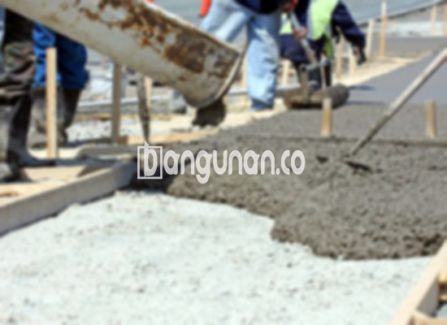

**Jasa Cor Beton Readymix & Jayamix Di Gunungwungkal Pati** – Bagi Mitra Bangunan yang tengah merencanakan proyek konstruksi di Gunungwungkal Pati, beton readymix dari bangunan.co adalah solusi yang tepat untuk mendapatkan adukan beton siap pakai yang berkualitas. Material ini dirancang khusus untuk pengecoran cepat dan akurat, memastikan proyek Anda berjalan efisien dan sesuai dengan harapan. Kami berkomitmen untuk menyediakan layanan terbaik dengan kualitas terjamin.



## Mengapa Memilih Jasa Cor Beton Readymix & Jayamix bangunan.co Di Gunungwungkal Pati?

Kami memahami tantangan yang dihadapi dalam proses pembangunan, oleh karena itu, jasa cor beton readymix & jayamix dari bangunan.co hadir sebagai solusi praktis untuk mempercepat penyelesaian proyek Anda di Gunungwungkal Pati. Tujuan kami adalah menyediakan beton siap pakai dengan kualitas yang konsisten dan terpercaya, sesuai dengan standar yang Anda butuhkan.

Beton readymix, atau adukan beton siap pakai, adalah campuran material beton yang diformulasikan dengan cermat untuk pengecoran yang tepat waktu dan efisien. Pada dasarnya, komposisi materialnya sama dengan adukan beton konvensional, terdiri dari pasir beton, batu kerikil, semen, dan air. Perbedaannya terletak pada proporsi dan takaran yang telah ditentukan untuk mencapai kualitas beton yang diinginkan. Dengan menggunakan layanan kami, Anda dapat memastikan hasil pengecoran yang optimal.

Melalui kontrol kualitas yang ketat di pabrik pengolahan beton, mutu beton yang Anda terima akan selalu sesuai dengan standar yang diharapkan. Pihak proyek hanya perlu mempersiapkan lokasi dan bekisting yang memadai, sementara kami akan mengantarkan beton siap pakai langsung ke lokasi proyek Anda di Gunungwungkal Pati.

## Keunggulan dan Kekurangan Beton Readymix dari bangunan.co di Gunungwungkal Pati

Beton yang diproduksi di pabrik pengolahan beton, seperti di bangunan.co, menawarkan sejumlah keunggulan dibandingkan dengan campuran manual yang sering dilakukan oleh tukang bangunan tradisional. Berikut adalah perbandingan detailnya:

Kelebihan beton yang diproduksi oleh bangunan.co:

1.  Ketepatan komposisi campuran untuk kualitas beton yang optimal.
2.  Kualitas beton yang merata, berkat penggunaan mesin pencampur modern.
3.  Pemilihan bahan material berkualitas tinggi untuk menjamin mutu beton terbaik.
4.  Efisiensi waktu dan biaya karena proses pengolahan yang cepat dan terotomatisasi.
5.  Anda tidak perlu lagi khawatir tentang menentukan perbandingan campuran yang tepat, karena bangunan.co telah meraciknya sesuai dengan standar konstruksi.

Meskipun demikian, perlu diingat bahwa pemesanan beton readymix memerlukan penjadwalan yang matang. Anda tidak dapat memesan secara mendadak; kami membutuhkan waktu untuk mempersiapkan campuran yang sesuai dengan kebutuhan Anda dan mengatur pengiriman ke lokasi proyek di Gunungwungkal Pati.

## Pilihan Mutu Beton Terpopuler dari bangunan.co di Gunungwungkal Pati

Salah satu kualitas beton yang paling banyak diminati oleh pelanggan bangunan.co di Gunungwungkal Pati adalah K225. Kualitas beton ini sangat ideal untuk pengecoran dak rumah atau lantai dua, karena dirancang khusus untuk aplikasi tersebut. Namun, K225 juga dapat digunakan untuk pengecoran jalan gang yang tidak terlalu sering dilalui kendaraan berat.

Selain itu, K250 dan K300 juga merupakan pilihan populer untuk proyek-proyek konstruksi di Gunungwungkal Pati. Kedua kualitas ini sering diaplikasikan untuk pengecoran tiang, pondasi, atau cakar ayam. Untuk proyek jalan pedesaan, K250, K300, dan K350 sering direkomendasikan. 

Untuk aplikasi yang membutuhkan kekuatan yang lebih besar, seperti jalan tol atau area parkir yang membutuhkan daya tahan tinggi, bangunan.co menyediakan mutu beton yang lebih tinggi, seperti K400, K500, dan seterusnya. Beton *fast track* ini dirancang untuk mengeras dengan cepat setelah pengecoran, memungkinkan konstruksi dapat digunakan dalam waktu singkat.

## bangunan.co Mengutamakan Kualitas Beton di Gunungwungkal Pati



Penting bagi kami di bangunan.co untuk memastikan bahwa setiap adukan beton readymix yang kami produksi memiliki kemampuan kerja yang baik dan daya tahan yang optimal. Hal ini dicapai dengan merancang campuran beton secara cermat, sesuai dengan standar campuran beton skala nasional (SNI). 

Komposisi adukan beton yang kami gunakan biasanya terdiri dari 10% hingga 15% semen Portland, 60% hingga 75% agregat halus dan kasar (pasir dan split), serta 10% hingga 15% air. Sisanya adalah kandungan udara yang penting untuk memberikan daya tahan dan kemudahan aplikasi. 

Kami selalu berupaya untuk menurunkan rasio air dan semen sebanyak mungkin tanpa mengorbankan kemampuan kerja beton segar. Penggunaan air bersih yang bebas dari kotoran atau lumut juga sangat penting untuk menjaga kualitas beton.

Mitra Bangunan yang membutuhkan solusi cor beton readymix dan jayamix berkualitas di Gunungwungkal Pati, bangunan.co siap menjadi mitra terpercaya Anda. Hubungi kami sekarang juga untuk mendapatkan informasi lebih lanjut dan penawaran harga terbaik melalui tombol WhatsApp atau Telepon yang tersedia di halaman ini.

**Ref by:** [Cor Beton Readymix & Jayamix Gunungwungkal Pati](https://id.wikipedia.org/wiki/Cor)