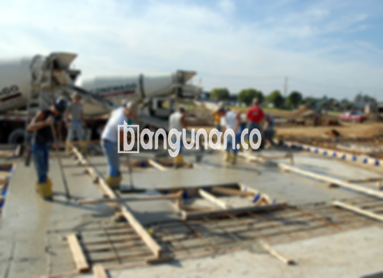

**Jasa Cor Beton Readymix & Jayamix Di Imogiri Bantul** – Bagi Mitra Bangunan di Imogiri Bantul yang sedang berencana melakukan proyek konstruksi, beton readymix dari bangunan.co atau adukan beton siap pakai menawarkan solusi yang efisien dan praktis. Material ini merupakan campuran optimal dari bahan-bahan berkualitas tinggi – pasir beton, batu pecah, semen, dan air – dengan komposisi yang dirancang khusus untuk memenuhi kebutuhan mutu beton yang Anda inginkan. Kami dari bangunan.co hadir untuk menyediakan beton siap pakai yang terpercaya dan tepat waktu untuk setiap proyek Anda.



## Pertimbangan Menggunakan Layanan Pengadukan Beton dari bangunan.co di Imogiri Bantul

Pembuatan campuran beton dengan formulasi yang tepat bertujuan untuk mempercepat pelaksanaan pengecoran sekaligus memastikan mutu yang konsisten. Dengan mutu yang terjamin, Anda dapat memfokuskan upaya Anda pada penyelesaian proyek tanpa perlu khawatir tentang kualitas beton yang tidak sesuai standar. Tujuan kami adalah menyediakan beton yang memenuhi spesifikasi kualitas yang Anda butuhkan, selaras dengan desain konstruksi yang direncanakan. 

Beton ready mix hadir dalam beragam opsi mutu, memfasilitasi Anda untuk memilih yang paling ideal sesuai dengan aplikasinya. Sering disebut juga sebagai beton cair siap pakai, material ini diproduksi di fasilitas pengolahan beton dengan persiapan yang matang agar langsung siap digunakan. Artinya, beton ini dapat langsung dituang dan diratakan setibanya di lokasi proyek, tanpa perlu proses pencampuran tambahan. Hal ini membebaskan Anda dari kerumitan pencampuran manual di lokasi. Anda bisa lebih fokus mempersiapkan bekisting yang solid sebagai penopang pengecoran yang andal.

Proses kendali mutu dijalankan secara ketat oleh tim bangunan.co di setiap tahap produksi, mulai dari pemilihan material, pencampuran, hingga pengiriman. Kami menjamin mutu yang terjaga dari awal hingga akhir. Hal ini menjadi keuntungan bagi para profesional konstruksi dalam melaksanakan proyek tanpa membuang waktu untuk mencari bahan terbaik dan merumuskan campuran yang optimal – semuanya telah menjadi tanggung jawab kami dari bangunan.co.

## Keunggulan dan Perbandingan Beton Readymix dari bangunan.co dengan Metode Tradisional di Imogiri Bantul

Tentu saja, beton yang dicampur di pabrik pengolahan beton, seperti yang dilakukan oleh bangunan.co, dan beton yang dicampur secara manual memiliki kelebihan dan kekurangannya masing-masing. Berikut perbandingan rinci yang perlu Anda pertimbangkan:

Beton yang diproduksi oleh bangunan.co menawarkan keunggulan-keunggulan berikut:

1.  Kualitas mutu yang konsisten dan terukur secara akurat.
2.  Keseragaman kualitas yang terjamin berkat sistem pencampuran yang presisi.
3.  Penggunaan bahan material terpilih yang memenuhi standar kualitas tertinggi.
4.  Efisiensi waktu dan biaya karena proses pengolahan yang cepat dan terotomatisasi.
5.  Kemudahan karena Anda tidak perlu khawatir tentang formula campuran yang sesuai dengan kebutuhan konstruksi Anda – bangunan.co telah melakukannya untuk Anda.

Sebagai pertimbangan tambahan:

Pemesanan beton readymix dari bangunan.co memerlukan penjadwalan yang terencana karena proses produksi tidak dapat dilakukan secara instan. Survei lokasi juga diperlukan untuk memperkirakan volume beton yang dibutuhkan secara akurat. Hal ini bertujuan untuk mencegah kelebihan atau kekurangan pasokan, sehingga memastikan efisiensi dan keberhasilan proyek Anda.

## Ragam Mutu Beton Paling Umum Digunakan di Imogiri Bantul

Pada umumnya, mutu beton K225 merupakan salah satu pilihan yang paling banyak digunakan, khususnya untuk pengecoran dak rumah atau lantai 2 ke atas, karena memang dirancang untuk aplikasi tersebut. K225 juga cocok untuk pengecoran jalan gang yang tidak menanggung beban kendaraan berat secara rutin.

Mutu beton K250 dan K300 juga sangat populer, kerap diaplikasikan untuk pengecoran tiang, pondasi, atau cakar ayam. Sementara itu, K250, K300, dan K350 sering digunakan dalam proyek pengecoran jalan pedesaan. Untuk kebutuhan yang lebih spesifik, seperti jalan tol atau area parkir dengan beban berat dan tenggat waktu yang ketat, beton dengan mutu K400 atau lebih tinggi (K400, K500, dan seterusnya) adalah solusi yang ideal. Jenis beton ini, yang dikenal sebagai *fast track concrete*, memiliki waktu pengeringan yang singkat, sehingga memungkinkan penggunaan struktur lebih cepat.

## bangunan.co Mengedepankan Kualitas Beton untuk Proyek Anda di Imogiri Bantul



Campuran beton readymix yang berkualitas perlu dirancang dengan cermat. Komposisi yang optimal terdiri dari 10% hingga 15% semen Portland, 60% hingga 75% agregat halus dan kasar (pasir dan split), serta 10% hingga 15% air. Udara juga menjadi komponen penting, meskipun dalam bentuk ruang antar partikel material padat.

Untuk mencapai kualitas beton yang tinggi, kadar air dalam campuran (water-cement ratio) harus serendah mungkin tanpa mengorbankan kemampuan kerja beton saat segar. Semakin rendah rasio air-semen, semakin tinggi pula kekuatan beton yang dihasilkan. Oleh karena itu, penggunaan air bersih yang bebas dari lumpur atau lumut adalah kunci untuk mencegah penurunan kualitas beton secara signifikan. Pastikan air yang digunakan tidak mengandung bahan-bahan yang dapat mengganggu proses hidrasi semen dan struktur akhir beton.

Hingga titik ini, Mitra Bangunan, kami telah menyampaikan penjelasan lengkap dari Jasa Cor Beton Readymix & Jayamix Di Imogiri Bantul dari bangunan.co. Perlu diketahui bahwa harga untuk masing-masing mutu berkualitas bervariasi. Silakan hubungi kami melalui WhatsApp untuk mendapatkan informasi harga terkini yang sesuai dengan kebutuhan proyek Anda.

**Ref by:** [Cor Beton Readymix & Jayamix Imogiri Bantul](https://id.wikipedia.org/wiki/Cor)