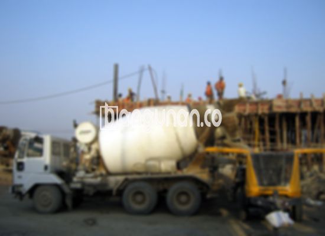

**Jasa Cor Beton Readymix & Jayamix Di Jaken Pati** – Bagi Mitra Bangunan yang mencari solusi pengecoran praktis dan efisien di Jaken Pati, bangunan.co hadir dengan layanan beton readymix dan jayamix berkualitas tinggi. Adalah campuran material beton yang diformulasikan untuk pengecoran instan, memberikan kemudahan dan kepastian mutu untuk proyek konstruksi Anda.



## Mengapa Memilih Layanan Cor Beton Readymix bangunan.co di Jaken Pati?

Layanan pengadukan beton dari bangunan.co dirancang untuk mempercepat proses pembangunan Anda dengan jaminan kualitas yang terpercaya. Beton readymix memastikan pengecoran dilakukan dengan efisien dan menghasilkan struktur bangunan yang kuat dan tahan lama. Dengan memilih bangunan.co, Anda mendapatkan solusi yang disesuaikan dengan kebutuhan spesifik proyek Anda.

Beton ready mix, yang juga dikenal sebagai beton cair siap pakai, adalah campuran beton yang telah disiapkan secara khusus di pabrik batching plant. Formulasi ini memungkinkan Anda langsung menuang dan meratakan beton di lokasi proyek, tanpa perlu khawatir tentang proses pencampuran manual yang memakan waktu dan tenaga. Anda hanya perlu mempersiapkan bekisting yang kokoh sebagai penopang selama proses pengecoran.

Kami di bangunan.co mengontrol kualitas beton secara ketat mulai dari pemilihan material hingga proses pengiriman. Hal ini memastikan bahwa beton yang Anda terima selalu memenuhi standar mutu yang tinggi, memberikan Anda keyakinan dalam setiap proyek konstruksi.

## Keunggulan dan Hal yang Perlu Dipertimbangkan Saat Menggunakan Beton Readymix dari bangunan.co di Jaken Pati

Beton yang diproduksi di pabrik batching plant oleh bangunan.co menawarkan sejumlah keunggulan dibandingkan dengan metode pencampuran manual tradisional. Namun, penting juga untuk mempertimbangkan beberapa hal sebelum membuat keputusan.

Berikut adalah beberapa keunggulan utama menggunakan beton readymix dari bangunan.co:

1.  Kualitas yang konsisten dan terjamin berkat kontrol mutu yang ketat.
2.  Mutu beton yang merata, hasil dari proses pencampuran yang presisi dan terkontrol.
3.  Penggunaan material berkualitas tinggi yang dipilih secara cermat oleh tenaga ahli bangunan.co.
4.  Efisiensi waktu dan biaya karena proses pengolahan yang cepat dan teroptimasi.
5.  Kemudahan dalam penggunaan, menghilangkan kebutuhan akan tenaga kerja dan peralatan pencampuran.

Sebagai pertimbangan, pemesanan beton readymix dari bangunan.co memerlukan perencanaan yang matang dan penjadwalan yang tepat. Kami akan melakukan survei lokasi untuk menghitung volume beton yang dibutuhkan secara akurat, memastikan bahwa pasokan beton sesuai dengan kebutuhan proyek Anda di Jaken Pati.

## Pilihan Mutu Beton yang Sering Digunakan di Jaken Pati dari bangunan.co

Di Jaken Pati, mutu beton K225 adalah pilihan yang paling umum, khususnya untuk pengecoran dak rumah atau lantai 2. Mutu ini dirancang khusus untuk aplikasi tersebut, memberikan kekuatan dan daya tahan yang optimal. K225 juga cocok untuk pembangunan jalan gang kecil yang tidak menahan beban kendaraan berat.

Selain K225, mutu beton K250 dan K300 juga banyak diminati untuk pengecoran tiang, pondasi, atau cakar ayam. Untuk proyek jalan pedesaan, mutu K250, K300, dan K350 menjadi pilihan yang ideal. Bagi proyek yang membutuhkan waktu pengeringan cepat, seperti jalan tol atau lahan parkir, mutu beton di atas K350 seperti K375, K400, dan K500 – sering dikenal sebagai beton *fast track* – adalah solusi yang tepat.

## bangunan.co Memastikan Kualitas Beton yang Terpercaya di Jaken Pati



Campuran beton readymix dari bangunan.co dirancang dengan formula yang tepat untuk memastikan kekuatan dan daya tahan optimal. Proporsi yang ideal dari bahan-bahan seperti semen Portland (10-15%), agregat halus dan kasar (pasir dan split, 60-75%), dan air (10-15%) digabungkan untuk menghasilkan beton berkualitas tinggi. Kandungan udara yang tepat juga diperhatikan untuk memastikan kemampuan kerja beton yang baik.

Untuk menghasilkan mutu beton yang unggul, bangunan.co meminimalkan rasio air terhadap semen tanpa mengorbankan kemampuan kerja beton segar. Penggunaan air bersih sangat penting untuk mencegah kontaminasi yang dapat mengurangi kualitas beton. Kami hanya menggunakan air yang bebas dari kotoran, lumpur, lumut, atau bahan lain yang dapat merusak proses pengerasan beton. Dengan standar kualitas yang tinggi, bangunan.co memberikan jaminan mutu terbaik untuk setiap pengiriman beton readymix.

Itulah penjelasan tentang Jasa Cor Beton Readymix & Jayamix Di Jaken Pati dari bangunan.co. Mitra Bangunan yang mencari beton berkualitas di Jaken Pati, hubungi kami untuk informasi harga dan pemesanan melalui formulir kontak atau nomor telepon yang tersedia di situs web bangunan.co. Kami siap membantu Anda mewujudkan proyek konstruksi impian Anda!

**Ref by:** [Cor Beton Readymix & Jayamix Jaken Pati](https://id.wikipedia.org/wiki/Cor)