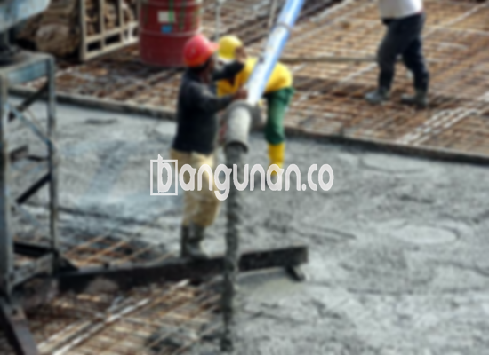

**Jasa Cor Beton Readymix & Jayamix Di Jakenan Pati** – Bagi Mitra Bangunan yang mencari solusi konstruksi yang efisien dan berkualitas di Jakenan Pati, bangunan.co menyediakan jasa cor beton readymix dan jayamix. Dengan layanan ini, pengecoran menjadi lebih cepat, praktis, dan menghasilkan mutu beton yang konsisten, membantu Anda menyelesaikan proyek tepat waktu dan sesuai anggaran.



## Mengoptimalkan Pengerjaan Konstruksi dengan Jasa Cor Beton Readymix & Jayamix Di Jakenan Pati

Dalam dunia konstruksi modern, efisiensi waktu dan biaya serta kualitas hasil akhir adalah faktor-faktor yang krusial. Jasa cor beton readymix dari bangunan.co di Jakenan Pati hadir sebagai solusi cerdas untuk mengatasi tantangan tersebut. Layanan ini menawarkan kemudahan dalam pengadaan material beton siap pakai, yang disesuaikan dengan kebutuhan spesifik proyek Anda. Dengan begini, Anda dapat menghindari kerumitan dan potensi ketidakakuratan yang seringkali terjadi pada proses pencampuran manual.

Kami memahami bahwa setiap proyek konstruksi memiliki karakteristik unik. Oleh karena itu, kami menyediakan berbagai pilihan mutu beton yang dapat disesuaikan dengan jenis pekerjaan yang akan dilakukan. Beton readymix juga dikenal sebagai beton cair siap pakai karena telah melalui proses pencampuran dan pengujian kualitas yang ketat di pabrik pengolahan beton. Hal ini menjamin bahwa beton yang Anda terima sudah siap digunakan, hanya tinggal dicurahkan dan diratakan di lokasi proyek. Dengan demikian, Anda dapat menghemat waktu dan sumber daya yang berharga.

## Keunggulan dan Pertimbangan dalam Penggunaan Beton Readymix dari bangunan.co

Beton yang diproduksi di pabrik pengolahan beton bangunan.co memiliki sejumlah keunggulan dibandingkan dengan beton yang dicampur secara manual di lokasi proyek. Berikut ini adalah beberapa keunggulan utama yang dapat Anda rasakan:

1.  **Adukan dengan Kualitas Terjamin:** Formulasi adukan beton dirancang secara teliti untuk mencapai mutu yang konsisten dan sesuai dengan standar yang berlaku.
2.  **Mutu Beton yang Lebih Merata:** Proses pencampuran yang menggunakan mesin modern memastikan distribusi material yang homogen, sehingga menghasilkan mutu beton yang seragam di seluruh bagian struktur.
3.  **Material Berkualitas Tinggi:** Kami hanya menggunakan material terbaik, termasuk semen, pasir, dan split, yang telah melalui proses seleksi yang ketat.
4.  **Efisiensi Waktu dan Biaya:** Dengan menggunakan beton readymix, Anda dapat mempercepat proses pengecoran dan mengurangi biaya tenaga kerja serta material.
5.  **Kemudahan dan Kepraktisan:** Anda tidak perlu lagi repot menyiapkan peralatan dan tenaga kerja untuk mengaduk beton secara manual.

Namun, perlu diingat bahwa pemesanan beton readymix memerlukan perencanaan yang cermat. Proses pemesanan memerlukan koordinasi dengan tim bangunan.co untuk memastikan ketersediaan material dan jadwal pengiriman yang sesuai dengan kebutuhan proyek Anda.

## Variasi Mutu Beton Paling Sering Digunakan di Jakenan Pati

Di Jakenan Pati, mutu beton K225 merupakan salah satu pilihan yang paling banyak digunakan. Beton K225 sangat cocok untuk pengecoran lantai rumah, lantai dua atau lebih, serta jalan gang yang tidak menanggung beban berat. Mutu beton ini memberikan kekuatan yang cukup untuk menopang struktur bangunan dan memberikan kenyamanan bagi pengguna.

Selain K225, mutu beton K250 dan K300 juga sering diaplikasikan untuk pengecoran tiang, pondasi, atau cakar ayam. Mutu beton ini menawarkan kekuatan yang lebih tinggi untuk menahan beban yang lebih berat. Untuk proyek-proyek yang membutuhkan kekuatan dan daya tahan yang ekstra, seperti jalan pedesaan, mutu beton K350 atau bahkan mutu yang lebih tinggi dapat menjadi pilihan yang tepat. Untuk konstruksi-konstruksi khusus seperti jalan tol atau area parkir yang membutuhkan daya tahan tinggi dan waktu pengeringan cepat, kami juga menyediakan beton *fast track* dengan mutu K400 ke atas.

## bangunan.co Mengutamakan Kualitas Beton untuk Proyek Anda



Kualitas beton readymix sangat bergantung pada proporsi campuran yang tepat antara semen, pasir, split, dan air. Di bangunan.co, kami menggunakan formulasi campuran yang telah teruji dan disesuaikan dengan standar mutu nasional (SNI). Secara umum, campuran beton yang ideal terdiri dari 10% hingga 15% semen Portland, 60% hingga 75% agregat halus dan kasar (pasir dan split), dan 10% hingga 15% air.

Selain itu, kami juga memperhatikan faktor-faktor lain yang dapat mempengaruhi kualitas beton, seperti kebersihan air yang digunakan dan kondisi lingkungan sekitar. Kami hanya menggunakan air bersih yang bebas dari lumpur atau kotoran lainnya. Seluruh proses produksi kami diawasi secara ketat oleh tim kontrol kualitas yang berpengalaman untuk memastikan bahwa setiap batch beton yang kami hasilkan memenuhi standar mutu yang ditetapkan.

Itulah informasi yang dapat kami sampaikan dari Jasa Cor Beton Readymix & Jayamix Di Jakenan Pati dari bangunan.co. Mengenai harga masing-masing mutu beton, Anda dapat menghubungi kami untuk mendapatkan penawaran yang sesuai dengan kebutuhan proyek Anda.

**Ref by:** [Cor Beton Readymix & Jayamix Jakenan Pati](https://id.wikipedia.org/wiki/Cor)

Mitra Bangunan yang membutuhkan solusi beton readymix berkualitas tinggi di Jakenan Pati, segera hubungi bangunan.co melalui tombol WhatsApp atau Telepon yang tersedia di halaman ini. Kami siap memberikan konsultasi gratis dan membantu Anda memilih mutu beton yang paling sesuai dengan kebutuhan proyek Anda.