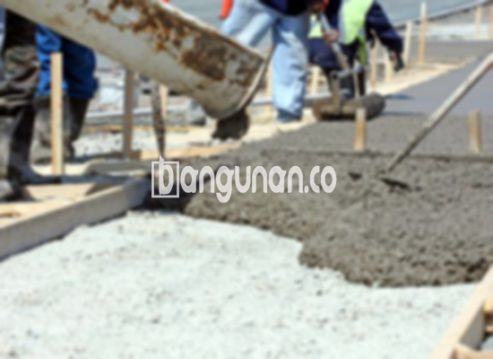

**Jasa Cor Beton Readymix & Jayamix Di Jambu Semarang** – Mencari solusi pengecoran praktis dan berkualitas untuk proyek Anda di Jambu Semarang? Mitra Bangunan menyediakan jasa cor beton readymix dan jayamix yang dirancang untuk mempercepat proses pembangunan Anda. Dengan layanan dari bangunan.co, Anda bisa mendapatkan beton siap pakai dengan mutu terjamin, ideal untuk berbagai aplikasi konstruksi.

## Mengoptimalkan Pengecoran dengan Layanan dari bangunan.co di Jambu Semarang

Pemanfaatan campuran beton siap pakai bertujuan untuk efisiensi waktu dan memastikan kualitas yang seragam dalam setiap pengecoran. Dengan memilih layanan bangunan.co, Anda mendapatkan beton dengan mutu terukur yang sesuai dengan kebutuhan proyek Anda.

Beton cor readymix, atau beton siap pakai, diproduksi di pabrik dengan formulasi yang telah diatur sedemikian rupa, sehingga siap digunakan begitu sampai di lokasi proyek. Ini memungkinkan Anda untuk langsung melakukan pengecoran tanpa perlu repot mencampur bahan-bahan secara manual. Anda hanya perlu mempersiapkan bekisting yang kuat dan sesuai standar. Layanan dari bangunan.co memastikan kemudahan dan kualitas dalam setiap tahapan.

Proses kendali mutu beton dilakukan secara ketat oleh tim bangunan.co, mulai dari penimbangan bahan baku hingga proses pengiriman. Pendekatan ini menjamin bahwa beton yang Anda terima memiliki konsistensi dan kekuatan yang optimal, serta memenuhi standar kualitas yang berlaku. Dengan begitu, Anda dapat menghemat waktu dan biaya, serta meminimalkan potensi kesalahan dalam konstruksi.

## Keunggulan dan Pertimbangan Memilih Beton Readymix dari bangunan.co

Beton yang dicampur di pabrik bangunan.co memiliki keunggulan dan kekurangan dibandingkan dengan metode pencampuran manual tradisional. Berikut adalah perbandingan yang perlu Anda pertimbangkan:

Beton readymix dari bangunan.co menawarkan:

1.  Komposisi yang presisi dan konsisten untuk kualitas yang terjamin.
2.  Adukan yang merata, yang menghasilkan kekuatan beton yang seragam.
3.  Penggunaan material berkualitas tinggi yang telah melewati seleksi ketat.
4.  Efisiensi waktu dan biaya karena proses pencampuran yang terotomatisasi.
5.  Kemudahan karena Anda tidak perlu khawatir tentang perbandingan material yang tepat.

Meskipun demikian, perlu diingat bahwa pemesanan beton readymix memerlukan penjadwalan terlebih dahulu. Hal ini karena bangunan.co membutuhkan waktu untuk mempersiapkan produksi dan mengatur pengiriman. Selain itu, survei lokasi diperlukan untuk menghitung volume beton yang dibutuhkan secara akurat.

## Variasi Mutu Beton yang Tersedia dari bangunan.co di Jambu Semarang

Mutu beton K225 merupakan salah satu yang paling sering digunakan, khususnya untuk pengecoran dak rumah atau lantai dua ke atas. Beton ini juga cocok untuk pengecoran jalan gang yang tidak menanggung beban berat kendaraan roda empat.

Selain itu, mutu K250 dan K300 juga populer karena digunakan untuk aplikasi seperti pengecoran tiang, pondasi, atau cakar ayam. Untuk pengecoran jalan pedesaan, mutu K250, K300, dan K350 adalah opsi yang umum dipilih. Untuk proyek yang membutuhkan pengerasan yang lebih cepat, mutu beton yang lebih tinggi seperti K375, K400, atau K500 seringkali digunakan – khususnya pada proyek jalan tol atau area parkir yang menahan beban berat.



## Komitmen bangunan.co Terhadap Kualitas Beton di Jambu Semarang



Formulasi campuran beton readymix dari bangunan.co dirancang dengan mempertimbangkan kemampuan kerja beton yang baik, kekuatan yang terjamin, serta ketahanan terhadap berbagai kondisi lingkungan. Komposisi idealnya mencakup 10% hingga 15% semen Portland, 60% hingga 75% agregat halus dan kasar (pasir dan split), ditambah 10% hingga 15% air. Kandungan udara juga turut berperan dalam karakteristik beton.

Untuk mencapai mutu beton yang optimal, bangunan.co meminimalkan rasio air dan semen tanpa mengorbankan kemampuan kerja beton. Penggunaan air bersih bebas dari kontaminan, seperti tanah atau lumut, sangat penting. Air yang digunakan harus memenuhi standar kualitas yang ditetapkan oleh bangunan.co untuk memastikan beton yang dihasilkan tahan lama dan memiliki kekuatan maksimal.

Dengan memilih jasa cor beton readymix dari bangunan.co, Anda memilih kualitas, efisiensi, dan keandalan untuk proyek konstruksi Anda. Layanan kami dirancang untuk memenuhi kebutuhan Anda di Jambu Semarang dengan solusi beton yang tepat dan terpercaya.

**Ref by:** [Cor Beton Readymix & Jayamix Jambu Semarang](https://id.wikipedia.org/wiki/Cor)

Mitra Bangunan siap membantu Anda menemukan solusi beton terbaik untuk proyek Anda di Jambu Semarang. Hubungi kami segera melalui tombol WhatsApp atau Telepon yang tertera pada halaman ini untuk mendapatkan informasi harga dan konsultasi gratis. Kami jamin Anda akan mendapatkan layanan yang profesional dan kepuasan yang maksimal.