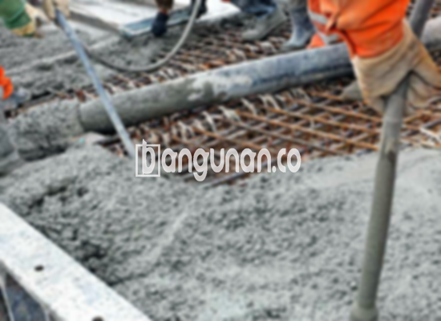

**Jasa Cor Beton Readymix & Jayamix Di Japah Blora** – Solusi konstruksi modern bagi Mitra Bangunan di Japah Blora adalah beton readymix, atau adukan beton siap pakai. Beton ini merupakan campuran material yang dirancang khusus untuk kemudahan dan efisiensi pengecoran instan. Dengan komposisi yang terdiri dari pasir beton, batu split, semen, dan air—dalam takaran yang telah diatur secara presisi—kami menjamin kualitas hasil beton sesuai dengan spesifikasi yang Anda butuhkan.



## Mengoptimalkan Pengecoran dengan Jasa Cor Beton Readymix & Jayamix Di Japah Blora

Tujuan utama dari penyediaan beton siap pakai ini adalah untuk mempercepat proses pengecoran sekaligus memastikan mutu hasil yang konsisten. Dengan demikian, Anda, sebagai pelaku konstruksi, dapat fokus pada aspek-aspek penting lainnya dari proyek Anda di Japah Blora. Keunggulan utama terletak pada kontrol kualitas yang ketat, yang menjamin bahwa beton yang Anda terima memenuhi standar mutu yang diinginkan dan sesuai dengan desain konstruksi yang direncanakan.

Beton readymix hadir dalam berbagai pilihan mutu, memungkinkan Anda untuk memilih yang paling sesuai dengan kebutuhan spesifik proyek Anda. Beton ini sering disebut sebagai beton cair siap pakai karena sudah dipersiapkan secara khusus di pabrik pengolahan beton bangunan.co. Proses ini memastikan beton siap untuk dicurahkan dan diratakan langsung di lokasi proyek, mengurangi pekerjaan persiapan yang memakan waktu dan tenaga.

Kualitas beton dikendalikan secara ketat mulai dari pencampuran bahan baku hingga pengiriman. Hal ini dilakukan oleh tim ahli di pabrik pengolahan beton, memastikan bahwa setiap batch memenuhi standar kualitas yang ditetapkan. Pilihan readymix dari bangunan.co akan memudahkan Anda dalam melaksanakan pembangunan tanpa perlu pusing memikirkan pencampuran manual atau kualitas bahan.

## Keunggulan dan Kekurangan Cor Readymix: Analisis Mendalam

Ketika membandingkan beton yang dicampur di lokasi proyek dengan beton yang diproduksi di pabrik bangunan.co, terdapat kelebihan dan kekurangan yang perlu dipertimbangkan. Berikut adalah analisa mendalam mengenai kedua metode tersebut:

Untuk beton yang diproses di pabrik pengolahan beton, keunggulannya meliputi:

1.  Ketepatan kualitas yang terjamin berkat formula yang telah teruji.
2.  Distribusi mutu yang merata karena proses pencampuran yang seragam.
3.  Penggunaan material berkualitas tinggi yang dipilih secara cermat.
4.  Efisiensi waktu dan biaya melalui proses produksi yang cepat.
5.  Kemudahan dalam memilih mutu beton yang sesuai dengan aplikasi konstruksi Anda.

Namun, kekurangan dari sistem ini adalah:

Proses pemesanan beton readymix memerlukan penjadwalan yang matang dan survei lokasi untuk menghitung volume yang dibutuhkan. Tujuannya adalah memastikan ketersediaan beton yang cukup untuk proyek Anda, menghindari kekurangan atau kelebihan material.

## Ragam Mutu Beton yang Sering Digunakan di Japah Blora

Di Japah Blora, mutu beton K225 menjadi salah satu pilihan paling umum. Mutu ini sangat ideal untuk pengecoran lantai rumah, terutama untuk lantai dua ke atas, karena dirancang khusus untuk aplikasi tersebut. Selain itu, K225 juga cocok untuk pengecoran jalan gang yang tidak dilalui kendaraan berat.

Pilihan populer lainnya adalah mutu beton K250 dan K300. Keduanya sering digunakan untuk pengecoran tiang, pondasi, dan cakar ayam. Mutu K250, K300, dan bahkan K350 juga umum digunakan untuk jalan pedesaan. Untuk kebutuhan konstruksi yang lebih berat dan memerlukan waktu pengerasan yang lebih cepat, mutu beton di atas K350 seperti K375, K400, dan K500 sering digunakan. Mutu-mutu ini, yang dikenal sebagai beton *fast track*, sangat cocok untuk proyek seperti jalan tol atau lahan parkir yang membutuhkan kekuatan tinggi dan waktu konstruksi yang singkat.

## Jasa Cor Beton Readymix & Jayamix Di Japah Blora: Kualitas Terjamin oleh bangunan.co



Formulasi beton siap pakai yang berkualitas tinggi membutuhkan pendekatan yang cermat dan presisi. Proses ini memastikan beton memiliki performa yang optimal dan ketahanan yang sesuai dengan harapan Anda. Beton yang bermutu tidak mudah retak, pecah, atau mengelupas. Campuran material harus sesuai dengan standar mutu nasional (SNI). Komposisinya biasanya terdiri dari 10% hingga 15% semen Portland, 60% hingga 75% agregat halus dan kasar (pasir dan split), serta 10% hingga 15% air.

Mengurangi rasio air-semen semaksimal mungkin tanpa mengorbankan kemampuan kerja beton merupakan kunci untuk menghasilkan beton berkualitas tinggi. Idealnya, beton yang baik mengandung lebih sedikit air untuk meningkatkan kekuatannya. Penggunaan air bersih juga sangat penting. Hindari menggunakan air yang kotor, berlumpur, atau mengandung lumut, karena dapat menurunkan kualitas beton. bangunan.co hanya menggunakan air bersih untuk memastikan kualitas beton yang optimal.

Itulah penjelasan lengkap dari jasa cor beton readymix & jayamix di Japah Blora yang disajikan oleh bangunan.co. Untuk informasi harga masing-masing mutu beton, silakan hubungi kami melalui WhatsApp untuk mendapatkan penawaran terbaik yang sesuai dengan kebutuhan anggaran Anda.

**Ref by:** [Cor Beton Readymix & Jayamix Japah Blora](https://id.wikipedia.org/wiki/Cor)

Mitra Bangunan yang sedang mencari solusi pengecoran berkualitas di Japah Blora, jangan ragu untuk menghubungi bangunan.co melalui tombol WhatsApp atau Telepon yang tersedia di halaman ini. Tim kami yang berpengalaman siap membantu Anda memilih mutu beton yang paling sesuai dan memberikan layanan pengecoran yang optimal untuk memastikan keberhasilan proyek Anda.