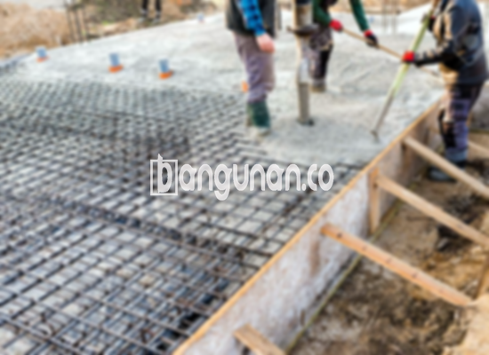

**Jasa Cor Beton Readymix & Jayamix Di Jaten Karanganyar** – Bagi Mitra Bangunan yang tengah merencanakan proyek konstruksi, beton readymix atau adukan beton siap pakai dari bangunan.co merupakan solusi praktis dan efisien. Dengan layanan kami di Jaten Karanganyar, Anda mendapatkan material berkualitas tinggi yang siap digunakan langsung di lokasi proyek, menghemat waktu dan tenaga. Kami menghadirkan beton dengan mutu terjamin untuk berbagai kebutuhan pembangunan Anda.



## Mengoptimalkan Pengerjaan Konstruksi dengan Jasa Pengadukan Beton bangunan.co di Jaten Karanganyar

Layanan pengadukan beton readymix atau jayamix dari bangunan.co hadir untuk mempercepat pelaksanaan pengecoran sekaligus menjamin mutu beton yang konsisten. Tujuan utama kami adalah memastikan kualitas beton sesuai dengan standar yang Anda harapkan dan sesuai dengan desain konstruksi yang direncanakan. Dengan sistem readymix, Anda dapat fokus pada aspek lain dari proyek Anda, sementara kami menyediakan material yang andal dan siap pakai.

Beton ready mix menawarkan beragam pilihan mutu yang dapat disesuaikan dengan spesifikasi proyek Anda. Dijuluki juga beton cair siap guna, beton ini diproduksi di pabrik bangunan.co dengan formulasi yang presisi, siap langsung diaplikasikan di lokasi. Anda tidak perlu lagi khawatir dengan proses pengadukan manual yang memakan waktu dan risiko kesalahan dalam proporsi campuran. Cukup siapkan area pengecoran dan bekisting, dan kami akan mengantarkan beton siap pakai langsung ke lokasi Anda.

Proses kontrol kualitas yang ketat diterapkan mulai dari pemilihan material hingga proses pencampuran dan pengiriman. Hal ini memastikan bahwa beton yang Anda terima memenuhi standar mutu yang berlaku dan memenuhi kebutuhan konstruksi Anda secara optimal. Dengan bangunan.co, Anda mendapatkan ketenangan pikiran karena mendapatkan material berkualitas tinggi yang mendukung keberhasilan proyek Anda.

## Keunggulan dan Pertimbangan Penggunaan Beton Readymix Melalui bangunan.co di Jaten Karanganyar

Beton yang dihasilkan oleh pabrik bangunan.co (batching plant) memiliki keistimewaan tersendiri dibandingkan dengan metode pengadukan tradisional. Berikut adalah beberapa keunggulan dan hal-hal yang perlu Anda pertimbangkan:

Kelebihan signifikan dari beton readymix meliputi:

1.  Komposisi campuran yang presisi dan sesuai standar mutu.
2.  Kualitas beton yang homogen dan merata berkat proses pencampuran yang terkontrol.
3.  Penggunaan material pilihan yang teruji kualitasnya.
4.  Efisiensi waktu dan biaya operasional yang lebih baik.
5.  Kemudahan pemakaian, karena Anda tidak perlu lagi menyiapkan peralatan dan tenaga kerja untuk pengadukan beton.

Meskipun demikian, perlu Anda ketahui bahwa pemesanan beton readymix melalui bangunan.co umumnya membutuhkan perencanaan yang matang. Sebaiknya lakukan pemesanan dengan menjadwalkan terlebih dahulu dan memberikan informasi detail mengenai lokasi proyek dan volume beton yang dibutuhkan. Hal ini memungkinkan kami untuk mempersiapkan dan mengantarkan beton tepat waktu sesuai kebutuhan Anda.

## Ragam Mutu Beton bangunan.co yang Paling Sering Digunakan di Jaten Karanganyar

Salah satu mutu beton yang paling populer di Jaten Karanganyar adalah K225. Kualitas beton ini sangat cocok untuk pengecoran dak rumah, lantai dua, atau struktur beton ringan lainnya. K225 dirancang untuk menahan beban yang relatif ringan dan memberikan kekuatan yang memadai untuk aplikasi tersebut.

Selain K225, mutu beton K250 dan K300 juga banyak digunakan. K250 dan K300 umumnya dipilih untuk pengecoran tiang, pondasi, atau cakar ayam karena memiliki kekuatan yang lebih tinggi. Untuk proyek jalan pedesaan, penggunaan mutu beton K250, K300, atau bahkan K350 dapat memberikan performa yang optimal.

Untuk aplikasi yang membutuhkan kekuatan sangat tinggi dan waktu pengeringan yang cepat, seperti konstruksi jalan tol atau area parkir yang menahan beban berat, mutu beton K400 ke atas (sering disebut beton *fast track*) menjadi pilihan utama. Layanan bangunan.co menyediakan berbagai pilihan mutu beton untuk memenuhi kebutuhan proyek Anda, besar maupun kecil.

## bangunan.co: Jaminan Kualitas dan Konsistensi pada Jasa Cor Beton Readymix & Jayamix Di Jaten Karanganyar



Formulasi campuran beton readymix atau *ready mix concrete* dari bangunan.co dirancang dengan cermat untuk menciptakan beton yang kuat, tahan lama, dan memenuhi standar kualitas tertinggi. Komposisi idealnya melibatkan sekitar 10% hingga 15% semen Portland, 60% hingga 75% agregat halus dan kasar (pasir dan split), dan sekitar 10% hingga 15% air. Sisanya diisi dengan udara yang penting untuk memperkuat struktur beton.

Kualitas beton yang superior adalah hasil dari rasio air terhadap semen yang optimal. Semakin sedikit air yang digunakan, semakin tinggi kualitas beton yang dihasilkan, tanpa mengorbankan kemudahan saat pengecoran. bangunan.co menggunakan air bersih dan bebas kontaminan dalam proses produksi beton, memastikan bahwa tidak ada material asing yang dapat menurunkan kualitas beton.

Dengan demikian, Mitra Bangunan dapat mempercayakan kebutuhan beton Anda kepada bangunan.co. Kami berkomitmen untuk memberikan layanan terbaik dan produk berkualitas tinggi yang mendukung kesuksesan proyek Anda di Jaten Karanganyar. Untuk informasi lebih lanjut mengenai harga dan pemesanan, jangan ragu untuk menghubungi kami melalui tombol WhatsApp atau Telepon yang tersedia di halaman ini.

**Ref by:** [Cor Beton Readymix & Jayamix Jaten Karanganyar](https://id.wikipedia.org/wiki/Cor)