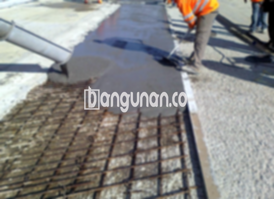

**Jasa Cor Beton Readymix & Jayamix Di Jati Blora** – Membangun infrastruktur yang kokoh dan tahan lama memerlukan material konstruksi yang andal. Mitra Bangunan hadir sebagai solusi bagi Anda di Jati Blora, menyediakan jasa cor beton readymix dan jayamix yang berkualitas tinggi. Memilih beton siap pakai berarti Anda menghemat waktu, mengurangi biaya operasional, dan memastikan mutu konstruksi yang konsisten sesuai dengan kebutuhan proyek Anda.



## Mengapa Memilih Jasa Cor Beton Readymix & Jayamix dari bangunan.co di Jati Blora?

Sebagai penyedia layanan terpercaya yang beroperasi di Jati Blora, bangunan.co berkomitmen untuk menghadirkan solusi pengecoran beton yang efisien dan terpercaya. Beton readymix, atau beton siap pakai, dirancang untuk mempercepat proses konstruksi tanpa mengorbankan aspek kualitas. Proses ini melibatkan pencampuran material-material unggul dengan takaran presisi – termasuk pasir beton, batu kerikil, semen, dan air – untuk menghasilkan adukan beton yang memenuhi standar mutu yang terukur.

Keunggulan utama beton readymix terletak pada kemampuannya untuk mengakomodasi berbagai aplikasi konstruksi. Anda dapat memilih mutu beton yang paling sesuai dengan karakteristik dan tuntutan proyek Anda, mulai dari pengecoran ringan hingga struktur yang memerlukan kekuatan ekstra. Produk ini dikenal pula sebagai beton cair siap guna karena telah diproses di pabrik dengan kontrol kualitas ketat, siap digunakan langsung di lokasi proyek. Hal ini secara signifikan mengurangi beban kerja dan risiko kesalahan dalam pencampuran manual.

Kami mengerti bahwa waktu merupakan elemen krusial dalam setiap proyek konstruksi. Dengan readymix, Anda dapat mempercepat jadwal pembangunan secara keseluruhan, karena proses pengecoran menjadi lebih cepat dan efisien, dan pada akhirnya meminimalkan biaya operasional secara signifikan. Tim bangunan.co memastikan bahwa setiap batch beton yang kami sediakan telah melalui pengujian dan pemantauan yang ketat untuk menjamin kualitas dan kekuatan yang sesuai dengan spesifikasi Anda.

## Keunggulan dan Kekurangan Cor Readymix dari bangunan.co

Beton yang diproduksi oleh pabrik pengolahan beton seperti bangunan.co, dibandingkan dengan metode pencampuran manual tradisional, memiliki kelebihan dan kekurangan yang perlu dipertimbangkan.

Keunggulan menggunakan beton readymix dari bangunan.co antara lain:

1.  **Ketepatan Formula Campuran:** bangunan.co menggunakan formula campuran yang tepat untuk menghasilkan mutu yang konsisten dan memenuhi standar mutu.
2.  **Mutu Beton yang Seragam:** Proses pencampuran terkontrol memastikan distribusi material yang merata, menghasilkan mutu beton yang homogen di seluruh area cor.
3.  **Material Berkualitas Tinggi:** bangunan.co hanya menggunakan material terbaik yang dipilih dengan cermat untuk menghasilkan beton berkualitas optimal.
4.  **Efisiensi Waktu dan Biaya:** Proses produksi yang efisien menghemat waktu dan biaya dibandingkan dengan pencampuran manual.
5.  **Kepraktisan dan Kemudahan:** Anda tidak perlu khawatir tentang perbandingan material yang rumit atau kualitas adukan beton. bangunan.co telah mengurus semuanya.

Namun, perlu juga diperhatikan beberapa kekurangan:

Pemesanan beton readymix memerlukan perencanaan yang matang karena tidak dapat dilakukan secara spontan. Anda perlu melakukan penjadwalan pemesanan dan survei lokasi untuk menentukan volume kubikasi yang dibutuhkan. Ini penting untuk memastikan produksi beton tepat sesuai kebutuhan, menghindari kelebihan atau kekurangan.

## Variasi Mutu Beton yang Paling Banyak Diterapkan di Jati Blora

Di Jati Blora, beberapa jenis mutu beton paling sering digunakan untuk berbagai keperluan konstruksi. K225 adalah jenis mutu beton yang paling banyak diterapkan untuk pengecoran dak rumah atau lantai dua ke atas. Mutu ini dirancang khusus memenuhi kebutuhan tersebut. Mutu ini juga cocok untuk pengecoran jalan gang yang tidak digunakan oleh kendaraan berat.

Selain itu, K250 dan K300 juga sering digunakan untuk pengecoran tiang, pondasi, atau cakar ayam. K250, K300, hingga K350 sering digunakan untuk pengecoran jalan pedesaan. Sedangkan mutu beton di atas K350, seperti K375, K400, dan K500, umum digunakan untuk proyek-proyek yang membutuhkan daya tahan tinggi, seperti konstruksi jalan tol atau lahan parkir yang menahan beban berat. Mutu beton yang lebih tinggi ini—sering disebut beton *fast track*—memungkinkan struktur beton cepat kering dan siap digunakan hanya dalam hitungan hari.

## Jasa Cor Beton Readymix & Jayamix Di Jati Blora dari bangunan.co Mengutamakan Mutu



Formulasi beton readymix yang berkualitas memerlukan perencanaan dengan cermat dan penerapan standar yang ketat. Untuk memastikan kekuatan dan performa optimal, beton harus tahan lama, tidak mudah retak, atau pecah. Untuk mencapai hal ini, campuran material beton harus sesuai dengan standar adukan beton nasional (SNI). Komposisi yang direkomendasikan adalah 10% hingga 15% semen Portland, 60% hingga 75% agregat halus dan kasar (pasir dan split), kemudian tambahkan 10% hingga 15% air, dengan sisanya adalah ruang udara.

Penggunaan air bersih dan berkualitas adalah kunci dalam proses pembuatan beton. Meminimalkan rasio air terhadap semen meningkatkan kualitas dan kekuatan beton. Hindari penggunaan air kotor atau mengandung lumpur karena dapat menurunkan kualitas beton.

Anda dapat mengandalkan bangunan.co untuk memberikan kualitas beton yang unggul.

**Ref by:** [Cor Beton Readymix & Jayamix Jati Blora](https://id.wikipedia.org/wiki/Cor)

Mitra Bangunan yang sedang mencari solusi terbaik untuk kebutuhan beton di Jati Blora, hubungi kami melalui tombol WhatsApp atau Telepon di halaman ini untuk mendapatkan penawaran dan konsultasi gratis. Kami siap membantu Anda memilih mutu beton yang tepat untuk memastikan keberhasilan proyek Anda.