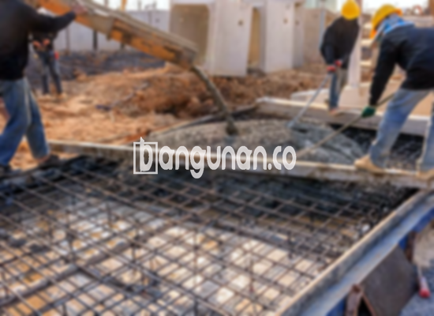

**Jasa Cor Beton Readymix & Jayamix Di Jati Kudus** – Bagi Mitra Bangunan yang sedang mencari solusi pengecoran yang cepat, praktis, dan terpercaya, beton readymix atau adukan beton siap pakai dari bangunan.co adalah jawaban ideal. Material ini diformulasikan secara khusus untuk memastikan pengecoran yang efisien dengan kualitas terjamin, menggunakan campuran proporsional dari pasir beton, batu pecah, semen, serta air – sebuah komposisi yang telah ditetapkan untuk mencapai mutu beton yang Anda butuhkan.



## Mengapa Memilih Jasa Pengcampuran Beton Readymix & Jayamix Di Jati Kudus?

Menggunakan campuran beton siap pakai bertujuan untuk mempercepat tahap pengecoran proyek Anda, sembari menjamin kualitas yang stabil dan konsisten. Dengan memilih mutu beton yang tepat, Anda akan mendapatkan material yang memenuhi standar kualitas yang diperlukan untuk konstruksi yang sedang Anda kerjakan. 

Beton Cor Readymix menawarkan berbagai pilihan mutu beton yang dapat disesuaikan dengan spesifikasi proyek Anda. Sering dikenal sebagai beton cair siap pakai, material ini telah dipersiapkan dengan cermat di pabrik pengolahan beton agar siap digunakan langsung di lokasi proyek. Dengan begitu, Anda tidak perlu lagi repot melakukan pencampuran manual dan memastikan takaran yang tepat, cukup mempersiapkan area pengecoran yang sudah siap.

Kualitas beton yang dijanjikan didukung oleh sistem kontrol kualitas yang ketat di pabrik pengolahan beton, mulai dari proses pencampuran material hingga pengiriman ke lokasi Anda. Proses ini memastikan kualitas yang lebih terjamin jika dibandingkan dengan metode pencampuran tradisional. Hal ini tentu mempermudah para profesional konstruksi dalam melakukan pengecoran tanpa membuang waktu berharga atau mengkhawatirkan kualitas bahan.

## Keunggulan dan Kekurangan Beton Readymix Sesuai Pengalaman Jasa Cor Beton Readymix & Jayamix Di Jati Kudus

Terdapat perbedaan signifikan antara beton yang diproduksi di pabrik pengolahan beton (batching plant) dengan beton yang dicampur secara manual di lapangan. Keduanya memiliki kelebihan dan kekurangan masing-masing yang perlu Anda pertimbangkan sebelum membuat keputusan. Inilah rinciannya:

Keunggulan beton yang diproduksi di pabrik pengolahan beton meliputi:

1.  Ketepatan dan akurasi dalam komposisi campuran.
2.  Mutu beton yang lebih merata karena proses pencampuran yang seragam.
3.  Penggunaan bahan material berkualitas yang dipilih dengan seleksi ketat.
4.  Proses produksi yang cepat, sehingga menghemat waktu dan biaya operasional.
5.  Anda tidak perlu lagi khawatir tentang menentukan proporsi campuran beton yang tepat, karena semuanya sudah ditangani oleh pabrik.

Namun demikian, beton readymix juga memiliki beberapa kekurangan yang perlu Anda ketahui, seperti:

Pemesanan beton readymix membutuhkan perencanaan yang matang. Anda tidak bisa memesan secara dadakan; perlu dilakukan pemesanan sebelumnya dan survei lokasi untuk menentukan volume beton yang dibutuhkan secara akurat. Hal ini bertujuan untuk menghindari kelebihan atau kekurangan pasokan beton saat material tiba di lokasi proyek.

## Jenis-Jenis Mutu Beton yang Paling Sering Digunakan di Jati Kudus

Salah satu jenis mutu beton yang paling umum digunakan untuk berbagai proyek konstruksi di Jati Kudus adalah beton K225. Mutu beton ini sangat ideal untuk pengecoran dak rumah atau lantai dua ke atas, serta untuk pembuatan Jalan Gang yang tidak sering dilalui oleh kendaraan berat.

Selain itu, mutu beton K250 dan K300 juga banyak digunakan untuk konstruksi tiang, pondasi, atau cakar ayam. K250, K300, dan K350 sering dimanfaatkan untuk pengecoran jalan pedesaan. Untuk mutu yang lebih tinggi, seperti K375, K400, K500 dan seterusnya, biasanya digunakan untuk beton Fast Track – yaitu beton yang membutuhkan waktu pengeringan yang sangat singkat, seperti pada pemasangan jalan tol atau area parkir yang membutuhkan daya tahan tinggi.

## Jasa Cor Beton Readymix & Jayamix Di Jati Kudus: Komitmen Kami Terhadap Mutu Beton



Adukan cor readymix atau *ready mix concrete* harus dirancang dengan perhitungan yang tepat untuk memastikan kinerja dan daya tahan optimal. Untuk mencapai target ini, adukan harus memenuhi standar campuran beton nasional (SNI). Komposisi yang direkomendasikan adalah sekitar 10% hingga 15% semen Portland, 60% hingga 75% agregat halus dan kasar (yaitu pasir dan split), dan 10% hingga 15% air. Sisa volume adalah kandungan udara, yang juga merupakan komponen penting dalam campuran beton. 

Beton berkualitas tinggi dihasilkan dengan meminimalkan rasio air terhadap semen tanpa mengurangi kemampuan kerja saat pengecoran. Umumnya, mutu beton yang lebih baik dicapai dengan rasio air-semen yang lebih rendah. Oleh karena itu, penggunaan air harus terkontrol dan tidak berlebihan. Penting juga untuk menggunakan air yang bersih dan tidak terkontaminasi lumpur atau lumut, karena zat-zat tersebut dapat menurunkan kualitas beton secara signifikan. 

Sampai di sini, Mitra Bangunan, kami harap penjelasan dari Jasa Cor Beton Readymix & Jayamix Di Jati Kudus ini bermanfaat. Untuk informasi harga masing-masing mutu beton, jangan ragu untuk menghubungi kami melalui WhatsApp untuk mendapatkan penawaran terbaik.

**Ref by:** [Cor Beton Readymix & Jayamix Jati Kudus](https://id.wikipedia.org/wiki/Cor)