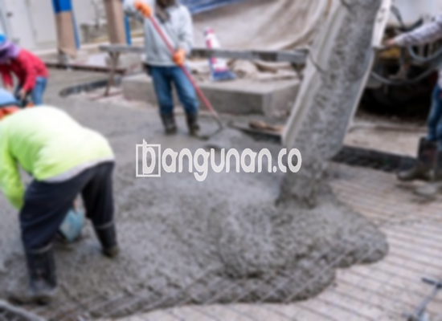

**Jasa Cor Beton Readymix & Jayamix Di Jatilawang Banyumas** – Beton Cor Readymix atau adukan beton siap pakai merupakan solusi konstruksi modern yang menawarkan kemudahan dan efisiensi. Material ini dirancang khusus untuk mempercepat proses pengecoran bangunan Anda di Jatilawang Banyumas, dengan memastikan kualitas dan kekuatan yang optimal. Sebagai Mitra Bangunan, Anda akan mendapatkan campuran material beton yang diformulasikan secara presisi, terdiri dari pasir beton, batu split, semen, dan air dengan perbandingan yang telah teruji.



## Mengapa Memilih Jasa Cor Beton Readymix & Jayamix Di Jatilawang Banyumas?

Keunggulan utama menggunakan layanan pengadukan beton dari bangunan.co di Jatilawang Banyumas terletak pada efisiensi waktu dan kualitas yang terjamin. Beton readymix dirancang untuk mempercepat progres konstruksi dengan menyediakan material siap pakai yang memenuhi standar mutu yang konsisten. Hal ini memungkinkan Anda untuk fokus pada aspek lain dari proyek Anda, tanpa perlu khawatir tentang proses pencampuran dan pengadukan beton di lokasi.

Beton cor readymix dihasilkan melalui proses pencampuran terkontrol di pabrik pengolahan beton (batching plant). Dengan teknologi modern dan pengawasan kualitas yang ketat, bangunan.co memastikan setiap batch beton yang dihasilkan memiliki komposisi yang akurat dan memenuhi spesifikasi yang dibutuhkan. Prosedur ini menghasilkan adukan beton yang homogen dan berkualitas tinggi, yang siap digunakan langsung di lokasi proyek Anda. Anda hanya perlu memastikan kesiapan bekisting yang memadai untuk menampung beton yang akan dicor.

## Kelebihan dan Kekurangan Beton Readymix dari bangunan.co di Jatilawang Banyumas

Terdapat perbedaan mendasar antara beton yang dicampur langsung di lokasi dengan beton readymix yang diproduksi oleh bangunan.co. Masing-masing metode memiliki kelebihan dan kekurangan yang perlu Anda pertimbangkan sesuai dengan kebutuhan proyek Anda.

Berikut beberapa keunggulan beton readymix dari bangunan.co:

1.  Kualitas campuran yang terjamin sesuai dengan mutu yang dipesan.
2.  Keseragaman kualitas beton, karena proses pencampuran yang terkontrol dan konsisten.
3.  Penggunaan material berkualitas tinggi yang telah diseleksi secara cermat oleh bangunan.co.
4.  Efisiensi waktu dan biaya, karena Anda tidak perlu menyediakan peralatan dan tenaga kerja untuk mencampur beton.
5.  Kemudahan dalam perencanaan, karena bangunan.co akan membantu Anda menentukan jumlah beton yang dibutuhkan.

Meskipun demikian, terdapat juga beberapa kekurangan yang perlu Anda ketahui:

Pemesanan beton readymix memerlukan penjadwalan yang tepat. bangunan.co memerlukan waktu untuk mempersiapkan produksi dan mengatur pengiriman ke lokasi proyek Anda di Jatilawang Banyumas. Oleh karena itu, pemesanan sebaiknya dilakukan jauh-jauh hari untuk memastikan ketersediaan material pada waktu yang dibutuhkan.

## Ragam Mutu Beton yang Tersedia dari bangunan.co di Area Jatilawang Banyumas

Salah satu mutu beton yang paling umum digunakan dalam konstruksi di Jatilawang Banyumas adalah mutu K225. Mutu K225 sangat ideal untuk pengecoran dak rumah, lantai dua, atau bahkan jalan setapak yang tidak menanggung beban berat seperti lalu lintas kendaraan berat. K225 menawarkan keseimbangan yang baik antara kekuatan dan biaya, menjadikannya pilihan yang populer untuk berbagai aplikasi konstruksi.

Selain K225, bangunan.co juga menyediakan mutu beton K250 dan K300. Mutu ini sering digunakan untuk pengecoran tiang, pondasi, atau cakar ayam yang membutuhkan kekuatan yang lebih tinggi. Untuk proyek-proyek infrastruktur seperti jalan pedesaan, mutu K250, K300, dan bahkan K350 sering digunakan untuk memastikan ketahanan dan daya tahan jalan tersebut. Untuk proyek-proyek khusus yang membutuhkan kekuatan sangat tinggi dan waktu pengeringan yang cepat, bangunan.co menyediakan mutu beton K400 ke atas, yang dikenal sebagai beton *fast track*.

## bangunan.co Prioritaskan Kualitas dan Konsistensi



Adukan beton ready mix dari bangunan.co harus diformulasikan secara optimal untuk memberikan kinerja dan ketahanan yang maksimal. Material harus dicampur dengan proporsi yang tepat sesuai dengan standar mutu nasional (SNI) agar memiliki kekuatan yang sesuai dengan kebutuhan konstruksi Anda. Komposisi tipikal adukan beton terdiri dari 10% - 15% semen Portland, 60% - 75% agregat halus dan kasar (pasir dan split), serta 10% - 15% air.

Kualitas beton sangat dipengaruhi oleh rasio air terhadap semen. Semakin rendah rasio ini, semakin tinggi kualitas beton yang dihasilkan. Di bangunan.co, kami selalu berusaha untuk meminimalkan penggunaan air tanpa mengorbankan kemudahan pengerjaan beton. Selain itu, kami hanya menggunakan air bersih dan bebas dari kontaminan yang dapat menurunkan kualitas beton. Penggunaan air bersih sangat penting untuk memastikan beton memiliki kekuatan dan daya tahan yang optimal.

Demikian Mitra Bangunan, informasi yang dapat kami sampaikan dari Jasa Cor Beton Readymix & Jayamix Di Jatilawang Banyumas. Untuk informasi mengenai harga masing-masing mutu beton, Anda dapat menghubungi kami segera melalui layanan pelanggan kami.

**Ref by:** [Cor Beton Readymix & Jayamix Jatilawang Banyumas](https://id.wikipedia.org/wiki/Cor)