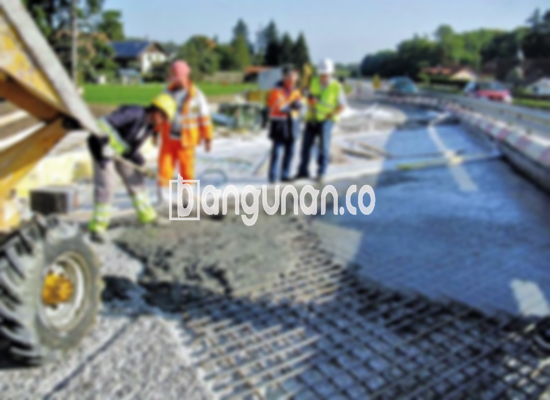

**Jasa Cor Beton Readymix & Jayamix Di Jatinegara Tegal** – Beton readymix atau adukan beton siap pakai merupakan campuran material konstruksi yang diformulasikan khusus untuk pengecoran cepat dan efisien. Pada dasarnya, komposisi material yang digunakan serupa dengan adukan beton konvensional, yaitu terdiri dari pasir beton, batu split, semen, dan air, dengan takaran yang telah diatur untuk menghasilkan kualitas beton yang diinginkan. Bangunan.co hadir sebagai solusi terpercaya untuk kebutuhan beton readymix dan jayamix di Jatinegara Tegal. Mitra Bangunan siap mendukung kelancaran proyek konstruksi Anda.



## Alasan Menggunakan Layanan Cor Beton Readymix & Jayamix Jatinegara Tegal

Penyediaan adukan beton melalui layanan readymix bertujuan untuk mempercepat proses pengecoran sekaligus memastikan kualitas yang terjamin secara konsisten. Dengan memilih layanan kami di Jatinegara Tegal, Anda akan mendapatkan beton dengan mutu yang terstandarisasi dan sesuai dengan kebutuhan konstruksi Anda.

Beton cor readymix menawarkan kemudahan karena telah diformulasikan secara khusus di pabrik pengolahan beton (batching plant) dan siap untuk langsung digunakan. Artinya, Anda tidak perlu membuang waktu dan tenaga untuk mencampur adukan di lokasi proyek. Cukup siapkan bekisting sebagai penahan beton saat pengecoran dilakukan. 

Kualitas beton dikendalikan ketat mulai dari tahap pencampuran material hingga pengiriman oleh pabrik. Hal ini menjamin bahwa Anda menerima beton dengan mutu terbaik, sehingga mempermudah pelaksanaan konstruksi dan memberikan ketenangan pikiran.

## Kelebihan dan Kekurangan Penggunaan Beton Readymix di Jatinegara Tegal

Terdapat perbedaan signifikan antara beton yang dicampur di pabrik pengolahan beton dan beton yang diaduk secara manual di lokasi konstruksi. Setiap metode memiliki kelebihan dan kekurangannya masing-masing yang perlu Anda pertimbangkan.

Beberapa keunggulan utama beton yang dicampur di pabrik meliputi:

1.  Adukan beton dengan kualitas yang sangat tepat dan konsisten.
2.  Mutu beton yang seragam karena proses pencampuran yang terstandarisasi.
3.  Penggunaan material berkualitas tinggi untuk menghasilkan beton dengan mutu optimal.
4.  Efisiensi waktu dan biaya, serta pengurangan kebutuhan tenaga kerja.
5.  Tidak perlu repot menghitung perbandingan campuran yang tepat untuk jenis konstruksi yang berbeda, karena pabrik telah merumuskannya sesuai standar.

Namun, terdapat beberapa hal yang perlu Anda pertimbangkan:

Pemesanan beton readymix memerlukan penjadwalan karena proses produksi dan pengiriman memerlukan persiapan. Selain itu, survei lokasi diperlukan untuk memperkirakan volume beton yang dibutuhkan secara akurat, sehingga menghindari pemborosan atau kekurangan material di lokasi proyek Anda.

## Jenis Mutu Beton yang Sering Digunakan di Jatinegara Tegal

Mutu beton K225 adalah salah satu pilihan yang paling populer, terutama untuk pengecoran dak rumah atau lantai dua ke atas. Mutu ini dirancang khusus untuk aplikasi pengecoran dak, meskipun juga dapat digunakan untuk pengecoran jalan gang yang tidak dilewati oleh kendaraan berat.

Selain K225, mutu beton K250 dan K300 juga sering digunakan, khususnya untuk pengecoran tiang, pondasi, atau cakar ayam. K250, K300, dan K350 juga umum digunakan untuk pengecoran jalan pedesaan. Untuk aplikasi yang membutuhkan kekuatan dan kecepatan pengerasan yang lebih tinggi, seperti jalan tol atau lahan parkir dengan beban berat, mutu beton yang lebih tinggi seperti K400, K500, atau bahkan di atasnya (sering disebut beton *fast track*) sering menjadi pilihan.

## Jasa Cor Beton Readymix & Jayamix Jatinegara Tegal Menjamin Kualitas Unggul



Kami di Bangunan.co, sebagai penyedia Jasa Cor Beton Readymix & Jayamix Jatinegara Tegal, sangat mengutamakan perancangan campuran beton yang tepat. Proses ini sangat penting untuk memastikan bahwa beton memiliki kinerja optimal dan daya tahan yang sesuai dengan ekspektasi Anda. 

Beton dengan kualitas tinggi dihasilkan melalui perbandingan material yang akurat, termasuk 10% hingga 15% semen Portland, 60% hingga 75% agregat halus dan kasar (pasir dan split), serta 10% hingga 15% air. Proporsi ini harus mengikuti Standar Nasional Indonesia (SNI) untuk menjamin kualitas beton yang terpercaya. 

Salah satu faktor kunci dalam memastikan kualitas adalah mengurangi rasio air terhadap semen sebanyak mungkin, tanpa mengurangi kemampuan kerja beton segar. Semakin rendah rasio air, semakin tinggi mutu beton yang dihasilkan. Selain itu, air yang digunakan harus bersih dan bebas dari kotoran atau lumpur yang dapat menurunkan kualitas beton.

Dengan komitmen terhadap kualitas dan proses yang terkontrol, kami di Bangunan.co memastikan Anda mendapatkan beton readymix yang andal dan tahan lama untuk berbagai proyek konstruksi di Jatinegara Tegal.

Demikian informasi dari Jasa Cor Beton Readymix & Jayamix Di Jatinegara Tegal. Untuk mengetahui lebih lanjut mengenai harga dan ketersediaan, serta mendapatkan penawaran terbaik, jangan ragu untuk menghubungi tim kami melalui tombol WhatsApp atau Telepon di halaman ini. Mitra Bangunan siap membantu mewujudkan proyek konstruksi Anda dengan bahan material berkualitas tinggi.

**Ref by:** [Cor Beton Readymix & Jayamix Jatinegara Tegal](https://id.wikipedia.org/wiki/Cor)