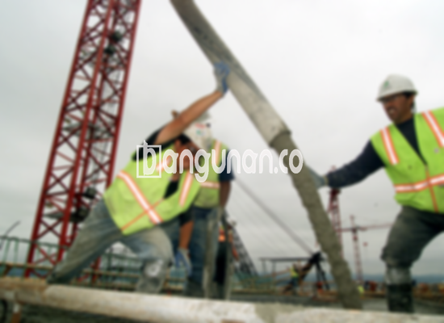

**Jasa Cor Beton Readymix & Jayamix Di Jatipuro Karanganyar** – Menciptakan fondasi yang kokoh dan efisien adalah inti dari setiap proyek konstruksi yang sukses. Mitra Bangunan menghadirkan solusi praktis dengan layanan cor beton readymix dan jayamix di Jatipuro Karanganyar, disediakan oleh bangunan.co. Melalui penyediaan beton siap pakai yang andal, Anda menghemat waktu dan tenaga sekaligus memastikan mutu bangunan yang unggul.



## Mengoptimalkan Proses Pengecoran dengan Layanan dari bangunan.co di Jatipuro Karanganyar

Layanan pengcampuran beton modern yang ditawarkan oleh jasa cor beton readymix dan jayamix dari bangunan.co di Jatipuro Karanganyar dirancang untuk memberikan kekuatan dan daya tahan optimal bagi bangunan Anda. Proses inovatif ini memastikan beton yang Anda terima telah diformulasikan secara akurat, siap untuk diaplikasikan langsung di lokasi proyek Anda.

Dengan memilih beton readymix dari bangunan.co, Anda tidak perlu lagi repot dengan proses pencampuran manual yang memakan waktu dan berpotensi menimbulkan kesalahan. Kami menghadirkan beton yang telah diukur dan dicampur secara presisi di pabrik kami, mengikuti standar kualitas yang ketat. Hal ini memungkinkan Anda untuk lebih fokus pada tahapan konstruksi lainnya, sembari memiliki keyakinan tinggi terhadap kualitas fondasi bangunan Anda.

## Keunggulan dan Pertimbangan dalam Penggunaan Beton Readymix

Terdapat perbedaan signifikan antara beton yang dicampur secara manual di lokasi proyek dan beton readymix yang disediakan oleh jasa cor beton readymix dan jayamix dari bangunan.co di Jatipuro Karanganyar, masing-masing dengan kelebihan dan kekurangan yang perlu dipertimbangkan. Berikut adalah perbandingan detailnya:

Beton yang diproduksi di pabrik pengolahan beton bangunan.co menawarkan berbagai keunggulan, antara lain:

1.  Komposisi yang sangat presisi dan mutu yang terjamin kualitasnya.
2.  Konsistensi kualitas yang merata pada setiap pengiriman, sesuai standar.
3.  Penggunaan material berkualitas terbaik yang telah dipilih dengan ketat.
4.  Efisiensi waktu dan biaya akibat proses pengolahan yang cepat dan efektif.
5.  Pengurangan kebutuhan tenaga kerja dan peralatan di area proyek.

Namun, perlu diingat bahwa pemesanan beton readymix dari bangunan.co memerlukan perencanaan awal. Proses pemesanan dan penjadwalan pengiriman membutuhkan waktu dan informasi yang akurat mengenai volume beton yang diperlukan. Tujuannya adalah untuk memastikan ketersediaan beton yang tepat di waktu yang tepat dan mencegah pemborosan material yang tidak perlu.

## Pilihan Mutu Beton yang Tersedia di Jatipuro Karanganyar

Beragam jenis beton tersedia untuk memenuhi kebutuhan spesifik dari setiap proyek konstruksi. Berikut ini adalah beberapa mutu beton yang paling umum digunakan di wilayah Jatipuro Karanganyar, disediakan oleh bangunan.co:

*   **K225:** Pilihan yang ideal untuk pengecoran lantai rumah, lantai dua, atau jalan gang yang tidak diperuntukkan bagi lalu lintas kendaraan berat.
*   **K250 & K300:** Umumnya dipakai untuk pengecoran tiang, pondasi, atau cakar ayam, juga sering digunakan untuk pengecoran jalan pedesaan.
*   **K350:** Sesuai untuk aplikasi yang membutuhkan kekuatan yang lebih tinggi, seperti pondasi bangunan bertingkat atau struktur yang menopang beban berat.
*   **K375, K400, K500 dan seterusnya:** Mutu beton ini, dikenal juga sebagai beton *fast track*, digunakan pada proyek yang memerlukan kecepatan pengerasan yang tinggi, misalnya untuk pembangunan jalan tol, area parkir, atau konstruksi yang membutuhkan kekuatan ekstra.

## Jasa Cor Beton Readymix & Jayamix Di Jatipuro Karanganyar: Kualitas dari bangunan.co



Untuk mencapai beton yang kuat dan awet, perancangan adonan beton readymix atau *ready mix concrete* dari bangunan.co membutuhkan ketelitian yang tinggi. Material yang digunakan harus memenuhi standar nasional Indonesia (SNI), dengan komposisi kurang lebih sebagai berikut: 10 hingga 15% semen Portland, 60 hingga 75% agregat halus dan kasar (pasir dan split), 10 hingga 15% air, dan sisanya adalah udara.

Beton berkualitas tinggi dihasilkan melalui proses produksi yang berfokus pada pengurangan rasio air terhadap semen tanpa mengorbankan kemudahan dalam pengerjaan beton segar. Semakin sedikit air yang digunakan, biasanya semakin tinggi kekuatan beton tersebut. Air yang digunakan juga harus bersih dan bebas dari kontaminan seperti lumpur, lumut, atau material lain yang dapat menurunkan kualitas beton.

Sebagai penutup, Mitra Bangunan dari bangunan.co berkomitmen untuk menyediakan Jasa Cor Beton Readymix & Jayamix Di Jatipuro Karanganyar dengan mutu terbaik serta pelayanan yang terpercaya. Untuk informasi lebih lanjut mengenai harga dan pemesanan, jangan ragu untuk menghubungi tim kami melalui tombol WhatsApp atau Telepon yang terdapat di halaman ini.

**Ref by:** [Cor Beton Readymix & Jayamix Jatipuro Karanganyar](https://id.wikipedia.org/wiki/Cor)