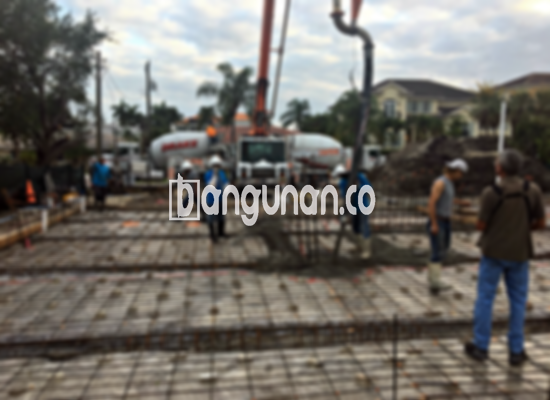

**Jasa Cor Beton Readymix & Jayamix Di Jatiroto Wonogiri** – Mencari solusi beton praktis dan berkualitas untuk proyek Anda di Jatiroto Wonogiri? Beton cor readymix, atau adukan beton siap pakai, adalah pilihan tepat. Material ini dirancang khusus untuk pengecoran cepat dan tepat, dengan komposisi pasir beton, batu kerikil, semen, dan air yang telah diformulasikan secara akurat untuk mencapai mutu yang diinginkan. Mitra Bangunan hadir untuk memberikan solusi pengecoran yang efisien dan handal di Jatiroto Wonogiri.



## Mengapa Memilih Adukan Beton Jadi dari Jasa Cor Beton Readymix & Jayamix Di Jatiroto Wonogiri?

Adukan beton siap pakai diciptakan untuk mempercepat proses pengecoran sekaligus menjamin kualitas yang konsisten. Dengan mutu yang terukur, Anda dapat memastikan bahwa kekuatan beton yang dihasilkan sesuai dengan standar yang dibutuhkan untuk konstruksi yang Anda rencanakan.

Cor readymix menawarkan beragam pilihan mutu, memungkinkan Anda memilih yang paling sesuai dengan kebutuhan spesifik proyek Anda. Beton ini dikenal sebagai beton cair siap pakai karena telah diproduksi di pabrik pengolahan beton, siap dituang dan diratakan langsung di lokasi proyek. Hal ini membebaskan Anda dari kerumitan mengaduk beton secara manual dan memastikan kualitas yang optimal. Anda hanya perlu mempersiapkan bekisting sebagai penopang beton yang akan dituang.

Proses kontrol kualitas dilakukan secara ketat oleh pihak pengolahan beton, mulai dari pencampuran bahan hingga pengiriman. Ini memberikan Anda ketenangan pikiran karena mutu beton sudah terjamin sebelum tiba di lokasi proyek. Dengan demikian, Anda dapat menghemat waktu dan biaya, serta menghindari risiko kesalahan dalam pencampuran material.

## Keunggulan dan Kekurangan Penggunaan Beton Readymix Menurut Jasa Cor Beton Readymix & Jayamix Di Jatiroto Wonogiri

Pencampuran beton di pabrik pengolahan beton atau _batching plant_ memiliki keunggulan dan kekurangan dibandingkan dengan adukan manual tradisional. Berikut adalah perbandingan keduanya:

Beton yang dicampur di pabrik pengolahan beton menawarkan keunggulan sebagai berikut:

1.  Pertama, adukan memiliki mutu atau kualitas yang tepat dan konsisten.
2.  Kedua, mutu beton merata karena menggunakan mesin pengaduk yang presisi.
3.  Ketiga, bahan material yang digunakan adalah berkualitas terbaik untuk mencapai mutu beton optimal.
4.  Keempat, waktu pengolahan lebih efisien, menghemat biaya dan waktu pengerjaan.
5.  Kelima, Anda tidak perlu repot memikirkan komposisi campuran yang tepat, karena pabrik sudah merancangnya sesuai kebutuhan konstruksi.

Sementara itu, kekurangan beton readymix adalah proses pemesanan yang memerlukan penjadwalan dan survei lokasi untuk menentukan volume yang dibutuhkan. Hal ini dilakukan untuk menghindari produksi berlebihan atau kekurangan beton saat pengiriman.

## Mutu Beton yang Paling Banyak Digunakan di Jatiroto Wonogiri

Di Jatiroto Wonogiri, mutu beton K225 adalah yang paling umum digunakan untuk pengecoran dak rumah atau lantai 2 ke atas. Mutu ini dirancang khusus untuk aplikasi tersebut. Selain itu, mutu K225 juga cocok untuk pengecoran jalan gang yang tidak dilalui kendaraan berat.

Pilihan populer lainnya adalah mutu beton K250 dan K300, yang sering digunakan untuk pengecoran tiang, pondasi, atau cakar ayam. K250, K300, dan K350 juga lazim digunakan untuk pengecoran jalan pedesaan. Untuk mutu yang lebih tinggi seperti K375, K400, K500, dan seterusnya, biasanya digunakan untuk beton _fast track_ yang membutuhkan waktu pengeringan cepat, seperti jalan tol atau area parkir dengan beban berat.

## Jasa Cor Beton Readymix & Jayamix Di Jatiroto Wonogiri Menjamin Kualitas Beton



Adukan beton _ready mix_ atau _ready mix concrete_ harus dirancang dengan baik dan optimal untuk menghasilkan kinerja dan daya tahan yang sesuai dengan harapan. Beton yang berkualitas tinggi diproduksi dengan mengurangi rasio air terhadap semen sebanyak mungkin tanpa mengorbankan kemampuan kerja beton segar. Lazimnya, mutu beton yang baik menggunakan lebih sedikit air untuk mencapai kualitas yang lebih tinggi. Penggunaan air yang tepat dan bersih sangat penting; hindari air yang kotor, berlumpur, atau mengandung lumut. Pastikan air yang digunakan bersih dan tidak mengandung material yang dapat menurunkan kualitas beton.

Seperti yang telah Anda ketahui, Mitra Bangunan.co telah memberikan penjelasan mengenai Jasa Cor Beton Readymix & Jayamix Di Jatiroto Wonogiri. Perlu diketahui bahwa harga untuk setiap mutu beton bervariasi. Silahkan hubungi kami untuk mendapatkan informasi harga terbaru melalui WhatsApp.

**Ref by:** [Cor Beton Readymix & Jayamix Jatiroto Wonogiri](https://id.wikipedia.org/wiki/Cor)