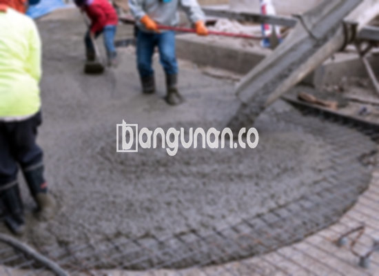

**Jasa Cor Beton Readymix & Jayamix Di Jatisrono Wonogiri** – Mencari solusi beton yang praktis, cepat, dan berkualitas untuk proyek Anda di Jatisrono Wonogiri? Mitra Bangunan hadir sebagai penyedia jasa cor beton readymix dan jayamix yang terpercaya. Beton siap pakai ini dirancang khusus untuk mempercepat proses pengecoran tanpa mengorbankan mutu, memberikan Anda kenyamanan dalam setiap tahap konstruksi.



## Mengapa Memilih Pengadukan Beton Modern dari Jasa Cor Beton Readymix & Jayamix Di Jatisrono Wonogiri?

Kami memahami bahwa efisiensi dan kualitas adalah kunci utama dalam setiap proyek konstruksi. Itulah mengapa kami menyediakan layanan pengadukan beton readymix, sebuah solusi modern yang dirancang untuk mempercepat proses pengecoran sekaligus menjamin kualitas yang konsisten. Dengan menggunakan metode ini, Anda tidak perlu lagi repot mencampur adonan beton secara manual di lokasi proyek.

Beton ready mix hadir dengan berbagai pilihan mutu yang dapat disesuaikan dengan kebutuhan spesifik konstruksi Anda. Kemudahan ini memastikan bahwa Anda mendapatkan beton dengan kualitas yang tepat, baik untuk proyek kecil maupun besar. Beton ini sering disebut juga beton cair siap pakai karena telah diformulasikan secara khusus di pabrik pengolahan beton, siap dituang dan diratakan langsung di lokasi proyek Anda di Jatisrono Wonogiri.

Keunggulan utama dari beton readymix adalah kendali mutu yang ketat. Mulai dari proses pencampuran material hingga pengiriman, setiap tahapan diawasi oleh tenaga ahli di batching plant kami. Hal ini memastikan bahwa beton yang Anda terima memiliki mutu yang sesuai dengan standar kualitas nasional (SNI) dan memenuhi persyaratan konstruksi Anda.

## Keunggulan dan Pertimbangan Penggunaan Cor Readymix di Jatisrono Wonogiri

Tentu saja, seperti metode konstruksi lainnya, beton readymix memiliki kelebihan dan kekurangan yang perlu Anda pertimbangkan. Berikut adalah uraian lengkapnya:

**Kelebihan Cor Readymix:**

1.  **Mutu Terjamin:** Adukan beton dengan mutu yang tepat sesuai dengan spesifikasi proyek Anda.
2.  **Kualitas Konsisten:** Kualitas beton merata karena proses pencampuran yang terstandarisasi.
3.  **Material Berkualitas:** Penggunaan material terbaik untuk menghasilkan beton dengan kualitas optimal.
4.  **Efisiensi Waktu dan Biaya:** Proses pengolahan yang cepat menghemat waktu dan biaya operasional.
5.  **Kemudahan Penggunaan:** Anda tidak perlu khawatir tentang perhitungan campuran, cukup fokus pada persiapan lokasi pengecoran.

Meskipun demikian, ada beberapa hal yang perlu diperhatikan. Proses pemesanan beton readymix memerlukan perencanaan yang matang, karena pemesanan mendadak mungkin sulit dipenuhi. Kami menyarankan untuk melakukan survei lokasi terlebih dahulu agar dapat memperkirakan volume beton yang dibutuhkan secara akurat. Hal ini membantu kami memastikan ketersediaan material dan menghindari pemborosan.

## Pilihan Mutu Beton yang Sering Digunakan di Jatisrono Wonogiri

Beberapa jenis mutu beton yang paling sering kami sediakan untuk proyek-proyek di Jatisrono Wonogiri antara lain:

*   **K225:** Mutu beton ini umum digunakan untuk pengecoran dak rumah atau lantai 2 ke atas. Sifatnya yang kuat dan tahan lama menjadikannya pilihan ideal untuk struktur vertikal.
*   **K250 & K300:** Cocok digunakan untuk pengecoran tiang, pondasi, atau cakar ayam. Mutu beton ini memberikan kekuatan ekstra untuk menopang beban bangunan Anda. K250 juga sering digunakan untuk jalan pedesaan.
*   **K350:** Digunakan untuk pengecoran jalan pedesaan atau struktur yang membutuhkan kekuatan lebih tinggi.
*   **K375, K400, K500 & Lebih Tinggi:** Mutu beton ini biasa digunakan untuk proyek konstruksi khusus seperti jalan tol, lahan parkir, atau struktur yang memerlukan kekuatan dan ketahanan yang ekstrem. Beton fast track ini memungkinkan waktu pengeringan yang lebih singkat, sehingga proyek Anda dapat selesai lebih cepat.



## Komposisi dan Standar Mutu Beton dari Jasa Cor Beton Readymix & Jayamix Di Jatisrono Wonogiri

Untuk menjamin kualitas dan durabilitas beton, kami selalu berpegang pada standar campuran beton nasional (SNI). Komposisi idealnya meliputi: 10% hingga 15% semen Portland, 60% hingga 75% agregat halus dan kasar (pasir dan split), serta 10% hingga 15% air. Sisa volume diisi oleh udara yang penting dalam memberikan kemampuan kerja beton.

Kami sangat menekankan penggunaan air bersih yang bebas dari lumpur, lumut, atau kontaminan lain yang dapat menurunkan kualitas beton. Penggunaan air yang berkualitas merupakan kunci untuk menghasilkan beton yang kuat dan tahan lama. Selain itu, proporsi air dan semen yang tepat juga krusial. Kami selalu berupaya meminimalkan rasio air terhadap semen tanpa mengorbankan kemampuan kerja beton.

Mitra Bangunan.co selalu berkomitmen untuk menyediakan layanan Jasa Cor Beton Readymix & Jayamix Di Jatisrono Wonogiri dengan kualitas terbaik. Mengenai harga masing-masing mutu, Anda dapat menghubungi kami untuk mendapatkan penawaran terbaik melalui WhatsApp.

**Ref by:** [Cor Beton Readymix & Jayamix Jatisrono Wonogiri](https://id.wikipedia.org/wiki/Cor)