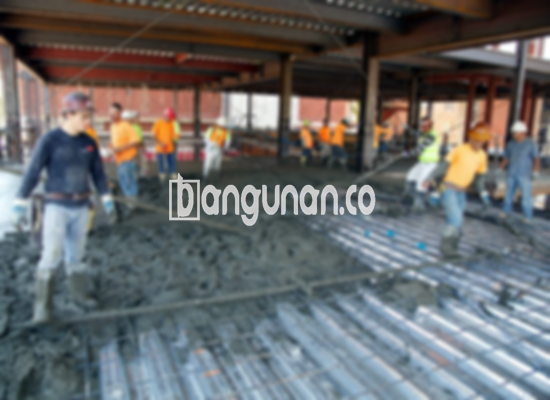

**Jasa Cor Beton Readymix & Jayamix Di Jebres Kota Surakarta** – Bagi Mitra Bangunan yang tengah mencari solusi konstruksi berkualitas dan terpercaya di Jebres Kota Surakarta, bangunan.co hadir dengan layanan cor readymix dan jayamix yang siap memenuhi kebutuhan pengecoran Anda. Beton siap pakai ini memberikan kemudahan, efisiensi, dan mutu yang terjamin, sehingga proyek Anda dapat berjalan lancar dan sesuai harapan. Kami menyediakan pengiriman readymix menggunakan truk molen langsung ke lokasi proyek Anda.



## Mengoptimalkan Pengecoran dengan Jasa Cor Beton Readymix & Jayamix dari bangunan.co di Jebres Kota Surakarta

Penyediaan campuran beton readymix dan jayamix merupakan solusi modern yang dirancang untuk mempercepat dan mempermudah proses pengecoran. Tujuan utama dari layanan ini adalah memastikan mutu beton yang tepat sesuai dengan spesifikasi proyek yang Anda inginkan. Dengan kualitas yang terjamin, konstruksi yang dihasilkan akan lebih kokoh, tahan lama, dan sesuai dengan standar yang ditetapkan. 

Beton ready mix menawarkan fleksibilitas karena tersedia dalam beragam mutu yang dapat disesuaikan dengan kebutuhan spesifik konstruksi Anda. Material ini sering disebut juga sebagai beton cair siap guna, karena telah dipersiapkan secara optimal dari pabrik pengolahan beton hingga siap digunakan. Beton ini dirancang untuk langsung dituang dan diratakan begitu sampai di lokasi proyek, sehingga Anda tidak perlu lagi repot mempersiapkan campuran di tempat. Anda hanya perlu memastikan kesiapan bekisting sebagai penahan saat pengecoran berlangsung.

Pengendalian mutu dilakukan secara menyeluruh oleh tim ahli di pabrik pengolahan beton, mulai dari tahap pencampuran material hingga proses pengiriman. Ini menjamin bahwa beton yang Anda terima memiliki kualitas yang konsisten dan sesuai dengan standar yang berlaku. Dengan demikian, Anda dapat mempercayakan proses pengecoran pada bangunan.co dan fokus pada aspek-aspek penting lainnya dari proyek Anda.

## Keunggulan dan Pertimbangan Memilih Cor Readymix dari bangunan.co

Terdapat perbedaan mendasar antara beton yang diproduksi di pabrik pengolahan beton (batching plant), seperti yang disediakan oleh bangunan.co, dan beton yang dicampur secara manual di lokasi proyek. Kedua metode ini memiliki kelebihan dan kekurangan masing-masing. Berikut adalah perbandingan yang lebih rinci:

Beton yang dicampur di pabrik pengolahan beton memiliki keunggulan sebagai berikut:

1.  Komposisi adukan yang presisi dan terukur, menjamin mutu yang konsisten.
2.  Mutu beton yang lebih merata karena proses pencampuran menggunakan mesin modern.
3.  Penggunaan bahan material berkualitas tinggi yang telah melalui seleksi ketat untuk mencapai mutu beton terbaik.
4.  Efisiensi waktu dan biaya karena proses pengolahan yang cepat dan terotomatisasi.
5.  Anda tidak perlu lagi khawatir tentang perbandingan material yang tepat; bangunan.co telah memastikan komposisi yang optimal untuk konstruksi Anda.

Meskipun memiliki banyak keunggulan, perlu juga mempertimbangkan beberapa hal sebelum memilih beton readymix:

Proses pemesanan beton readymix memerlukan penjadwalan yang tepat karena tidak dapat dipenuhi secara instan. Selain itu, survei lokasi diperlukan untuk menentukan volume kubikasi yang dibutuhkan secara akurat. Hal ini dilakukan untuk menghindari kelebihan atau kekurangan pasokan beton di lokasi proyek.

## Variasi Mutu Beton yang Sering Digunakan di Jebres Kota Surakarta

Salah satu mutu beton yang paling umum digunakan di Jebres Kota Surakarta adalah K225. Kualitas beton ini sangat ideal untuk pengecoran dak rumah atau lantai dua ke atas, karena dirancang khusus untuk aplikasi tersebut. Selain itu, K225 juga sering digunakan untuk pengecoran jalan gang yang tidak menanggung beban kendaraan berat.

Pilihan mutu beton lain yang banyak diminati adalah K250 dan K300. K250 dan K300 biasanya digunakan untuk pengecoran tiang, pondasi, atau cakar ayam. Untuk jalan pedesaan, mutu K250, K300, dan K350 juga merupakan pilihan yang populer. Sementara itu, mutu beton yang lebih tinggi, seperti K375, K400, K500, dan seterusnya, biasanya digunakan untuk beton *fast track*—beton yang membutuhkan kekuatan tinggi dan waktu pengeringan yang sangat cepat, misalnya untuk proyek jalan tol atau area parkir yang menahan beban berat. 

## bangunan.co: Jaminan Kualitas dalam Setiap Pengecoran di Jebres Kota Surakarta



Formulasi campuran beton readymix atau *ready mix concrete* memerlukan perhatian yang cermat untuk mendapatkan kinerja dan ketahanan optimal. Komposisi adukan harus memenuhi standar nasional Indonesia (SNI) untuk mencegah potensi masalah seperti keropos, retak, atau pengelupasan dini. Idealnya, campuran terdiri dari 10% hingga 15% semen Portland, 60% hingga 75% agregat halus dan kasar (pasir dan split), serta 10% hingga 15% air. Sisanya merupakan kandungan udara yang penting untuk menjaga kemampuan kerja beton.

Penggunaan air bersih sangat penting dalam proses pencampuran beton. Semakin sedikit air yang digunakan, tanpa mengorbankan kemampuan kerja, semakin tinggi kualitas beton yang dihasilkan. Hindari penggunaan air yang mengandung tanah, lumpur, atau lumut, karena hal ini dapat menurunkan kualitas beton secara signifikan. Pastikan air yang digunakan bersih dan bebas dari kontaminan.

Mitra Bangunan, dengan layanan dari bangunan.co di Jebres Kota Surakarta, Anda mendapatkan solusi pengecoran yang lengkap dan terpercaya. Jangan ragu untuk menghubungi kami untuk informasi harga dan pemesanan. 

**Ref by:** [Cor Beton Readymix & Jayamix Jebres Kota Surakarta](https://id.wikipedia.org/wiki/Cor)