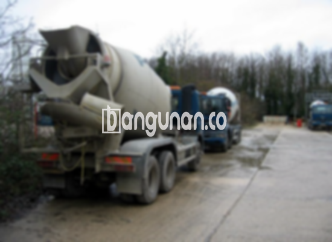

**Jasa Cor Beton Readymix & Jayamix Di Jekulo Kudus** – Mitra Bangunan yang berencana membangun atau mengembangkan infrastruktur di Jekulo Kudus, beton cor readymix atau adukan beton siap pakai adalah solusi pengecoran modern yang efisien dan andal. Material ini dirancang khusus untuk mempercepat pelaksanaan proyek Anda dengan kualitas yang konsisten. Pada dasarnya, material yang digunakan sama dengan campuran beton konvensional – pasir beton, batu kerikil, semen, dan air – namun dengan takaran terukur untuk menghasilkan mutu beton yang optimal. 



## Mengapa Memilih Jasa Cor Beton Readymix & Jayamix Di Jekulo Kudus?

Layanan cor readymix hadir sebagai jawaban atas kebutuhan pengecoran cepat dan berkualitas. Dengan menggunakan beton readymix, Anda dapat mempercepat proses konstruksi dan memastikan kualitas beton yang sesuai dengan standar yang diinginkan. Kualitas terjamin ini penting untuk menciptakan konstruksi yang tahan lama dan aman. 

Beton readymix juga menawarkan berbagai pilihan mutu yang dapat disesuaikan dengan kebutuhan spesifik proyek Anda. Material ini dikenal sebagai beton cair siap guna karena telah dipersiapkan secara khusus di pabrik pengolahan beton supaya siap digunakan. Beton ini langsung diangkut dari pabrik ke lokasi proyek, sehingga Anda tidak perlu lagi repot mencampur adukan beton secara manual. Anda hanya perlu memastikan kesiapan bekisting sebagai penahan beton saat pengecoran. 

Kualitas beton yang dihasilkan sudah diperhitungkan secara cermat oleh pihak pengolahan beton, mulai dari pencampuran material hingga pengiriman. Proses ini dikontrol ketat untuk memastikan beton yang Anda terima memiliki kualitas terbaik. Dengan demikian, Anda dapat fokus pada aspek lain dari proyek konstruksi Anda tanpa perlu khawatir tentang kualitas beton.

## Keunggulan dan Pertimbangan Penggunaan Cor Readymix

Membandingkan beton yang dicampur di pabrik pengolahan beton (batching plant) dengan adukan manual memiliki kelebihan dan kekurangan masing-masing. Berikut adalah beberapa poin penting yang perlu Anda pertimbangkan:

Beton yang dicampur di pabrik pengolahan beton memiliki beberapa keunggulan:

1.  **Takaran yang Presisi:** Campuran beton dibuat dengan takaran yang akurat untuk memastikan kualitas yang konsisten.
2.  **Kualitas Merata:** Proses pencampuran yang optimal menghasilkan adukan yang merata, sehingga kualitas beton seragam di seluruh area pengecoran.
3.  **Material Berkualitas Tinggi:** Bahan material yang digunakan dipilih dengan cermat untuk menghasilkan kualitas beton terbaik.
4.  **Efisiensi Waktu dan Biaya:** Proses pengolahan yang cepat menghemat waktu dan biaya operasional proyek Anda.
5.  **Kemudahan Penggunaan:** Anda tidak perlu lagi repot memikirkan campuran yang tepat untuk konstruksi Anda. Pihak pabrik pengolahan beton sudah melakukan perhitungan yang akurat sesuai dengan kebutuhan Anda.

Namun, ada juga beberapa hal yang perlu diperhatikan:

Pemesanan beton readymix memerlukan penjadwalan terlebih dahulu. Anda tidak dapat memesan dan langsung menerima beton di hari yang sama. Selain itu, perlu dilakukan survei lokasi untuk menentukan jumlah kubikasi beton yang dibutuhkan. Hal ini bertujuan untuk menghindari kelebihan atau kekurangan pasokan beton saat tiba di lokasi pengecoran.

## Pilihan Mutu Beton yang Umum Digunakan di Jekulo Kudus

Salah satu mutu beton yang paling sering digunakan di Jekulo Kudus adalah mutu beton K225. Kualitas ini ideal untuk pengecoran dak rumah atau lantai 2 ke atas. Namun, K225 juga dapat digunakan untuk pengecoran jalan gang yang tidak dilalui kendaraan berat.

Selain itu, mutu beton K250 dan K300 juga banyak digunakan untuk pengecoran tiang, pondasi, atau cakar ayam. Untuk jalan pedesaan, mutu K250, K300, dan bahkan K350 dapat digunakan. Mutu beton di atas K350, seperti K375, K400, dan K500, biasanya digunakan untuk beton *fast track* yang membutuhkan kekuatan dan kecepatan pengeringan tinggi. Contohnya adalah jalan tol atau lahan parkir yang membutuhkan beban berat dan waktu pengerjaan singkat.

## Komitmen Kami Terhadap Kualitas Beton di Jekulo Kudus



Untuk memastikan kualitas adukan beton *ready mix* yang optimal, kami merancang setiap campuran dengan sangat hati-hati. Beton yang berkualitas tinggi harus memiliki kemampuan dan daya tahan yang sesuai dengan mutu yang diinginkan. Campuran material yang tepat sangat penting untuk mencegah keropos, patah, atau pengelupasan beton. Kami selalu mengacu pada standar campuran beton nasional (SNI). Komponen utama adukan kami terdiri dari sekitar 10% hingga 15% semen Portland, 60% hingga 75% agregat halus dan kasar (pasir dan split), serta 10% hingga 15% air. Sisanya adalah udara, meskipun merupakan material padat, beton tetap mengandung udara di dalamnya.

Kami memprioritaskan rasio air-semen yang rendah untuk meningkatkan kualitas beton tanpa mengurangi kemampuan kerja beton segar. Semakin sedikit air yang digunakan, semakin tinggi kualitas beton yang dihasilkan. Kami juga memastikan penggunaan air bersih yang bebas dari lumpur, tanah, atau lumut untuk mencegah penurunan mutu beton.

**Ref by:** [Cor Beton Readymix & Jayamix Jekulo Kudus](https://id.wikipedia.org/wiki/Cor)

Sampai disini Mitra Bangunan,co telah menyampaikan penjelasan dari Jasa Cor Beton Readymix & Jayamix Di Jekulo Kudus. Untuk informasi lebih lanjut terkait harga masing-masing mutu beton, jangan ragu untuk menghubungi kami via WhatsApp. Kami siap membantu Anda menemukan solusi pengecoran terbaik untuk proyek Anda di Jekulo Kudus.