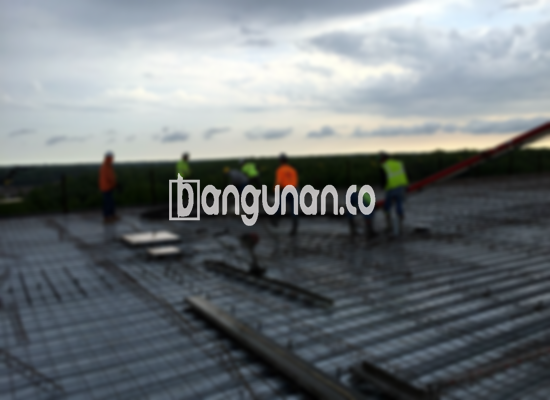

**Jasa Cor Beton Readymix & Jayamix Di Jenawi Karanganyar** – Bagi Mitra Bangunan yang membutuhkan solusi pengecoran praktis dan terpercaya, bangunan.co menghadirkan jasa cor beton readymix & jayamix di Jenawi Karanganyar. Beton siap pakai ini dirancang untuk mempercepat proses konstruksi, menjamin kualitas yang konsisten, dan mengurangi kerumitan di lokasi proyek. Dengan layanan kami, Anda dapat fokus pada aspek penting lainnya, sementara kami memastikan fondasi bangunan Anda kokoh dan tahan lama.



## Mengoptimalkan Pengecoran dengan Layanan Jasa Cor Beton Readymix & Jayamix Di Jenawi Karanganyar

Penggunaan beton readymix dari bangunan.co merupakan solusi cerdas untuk mempercepat proses konstruksi dan memastikan kualitas yang optimal. Layanan ini dirancang untuk meminimalkan waktu pengerjaan di lokasi proyek, sekaligus menjamin mutu beton yang sesuai dengan standar yang Anda butuhkan. Dengan begitu, Anda dapat menyelesaikan proyek lebih efisien dan efektif.

Beton cor readymix, atau beton siap pakai, diproduksi di pabrik khusus dengan formulasi yang telah teruji. Beton ini siap langsung digunakan, sehingga Anda hanya perlu mempersiapkan bekisting sebagai cetakan. Keuntungan utama dari metode ini adalah Anda tidak perlu lagi repot mencampur bahan material di lokasi proyek, yang seringkali memakan waktu dan tenaga.

Proses produksi beton readymix di pabrik bangunan.co diawasi secara ketat oleh tim ahli. Mulai dari pemilihan bahan baku hingga pencampuran dan pengiriman, setiap tahap dilakukan dengan presisi dan kontrol kualitas yang tinggi. Hal ini memastikan bahwa beton yang Anda terima memiliki mutu yang konsisten dan sesuai dengan spesifikasi proyek Anda.

## Keunggulan dan Pertimbangan Penggunaan Beton Cor Readymix dari bangunan.co di Jenawi Karanganyar

Terdapat beberapa perbedaan signifikan antara beton yang dicampur di pabrik bangunan.co dengan adukan manual tradisional. Masing-masing memiliki kelebihan dan kekurangan yang perlu Anda pertimbangkan sebelum memutuskan. Berikut ini adalah perbandingan komprehensifnya:

Beton yang diproduksi di pabrik bangunan.co menawarkan sejumlah keunggulan, antara lain:

1.  Komposisi adukan yang tepat dan konsisten, menghasilkan mutu beton yang stabil.
2.  Kualitas beton yang merata karena proses pencampuran yang homogen dengan peralatan modern.
3.  Penggunaan bahan material berkualitas tinggi yang telah melalui uji seleksi ketat.
4.  Efisiensi waktu dan biaya karena proses produksi yang lebih cepat dan akurat.
5.  Anda terbebas dari kerumitan pencampuran manual dan memastikan kualitas yang terjamin.

Namun, penting untuk diingat bahwa pemesanan beton readymix dari bangunan.co memerlukan perencanaan yang matang. Anda disarankan untuk memesan jauh-jauh hari dan memberikan informasi yang akurat mengenai lokasi proyek serta volume beton yang dibutuhkan. Hal ini memungkinkan kami untuk mempersiapkan material yang cukup dan memastikan pengiriman tepat waktu.

## Variasi Mutu Beton yang Tersedia di bangunan.co Jenawi Karanganyar

K225 adalah mutu beton yang paling sering digunakan untuk berbagai aplikasi konstruksi di Jenawi Karanganyar. Mutu ini ideal untuk pengecoran dak rumah atau lantai 2 ke atas, karena dirancang untuk menahan beban yang sesuai dengan kebutuhan tersebut. Selain itu, K225 juga dapat digunakan untuk pengecoran jalan gang yang tidak memiliki lalu lintas kendaraan berat.

Pilihan lainnya adalah mutu beton K250 dan K300, yang sering diaplikasikan untuk pengecoran tiang, pondasi, atau cakar ayam. K250, K300, dan K350 juga merupakan pilihan yang populer untuk pengecoran jalan pedesaan. Untuk proyek yang membutuhkan kekuatan ekstra dan waktu pengeringan yang lebih cepat, mutu beton di atas K350 seperti K375, K400, dan K500 dapat menjadi solusi yang tepat, terutama untuk konstruksi jalan tol atau area parkir dengan beban berat.

## bangunan.co: Jaminan Kualitas dan Keandalan Jasa Cor Beton Readymix & Jayamix Di Jenawi Karanganyar



Proses pembuatan adukan beton readymix di bangunan.co dirancang dengan cermat untuk menghasilkan produk yang memiliki daya kerja, kekokohan, dan ketahanan yang optimal. Kami memastikan bahwa setiap campuran memenuhi standar nasional Indonesia (SNI), dengan komposisi yang terdiri dari 10-15% semen Portland, 60-75% agregat halus dan kasar (pasir dan split), serta 10-15% air. Penambahan udara dalam campuran juga diperhatikan untuk menjaga kualitas beton.

Untuk memastikan kualitas yang maksimal, bangunan.co meminimalkan rasio air terhadap semen tanpa mengorbankan kemampuan kerja beton. Semakin sedikit air yang digunakan, semakin tinggi mutu beton yang dihasilkan. Namun, kami juga memastikan bahwa air yang digunakan bersih dan bebas dari kotoran atau lumut, karena kontaminan tersebut dapat menurunkan kualitas beton secara signifikan.

Mitra Bangunan yang mencari solusi pengecoran beton yang handal dan berkualitas di Jenawi Karanganyar, bangunan.co siap menjadi mitra terpercaya Anda. Hubungi kami melalui tombol WhatsApp atau Telepon di halaman ini untuk mendapatkan penawaran terbaik dan layanan yang profesional.

**Ref by:** [Cor Beton Readymix & Jayamix Jenawi Karanganyar](https://id.wikipedia.org/wiki/Cor)